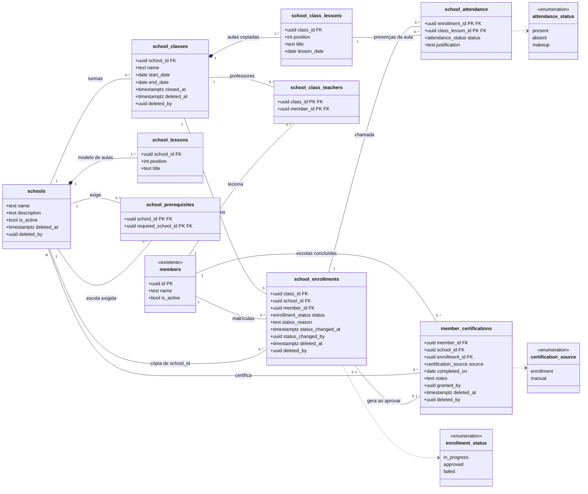

# Plano: spec de Escolas e Turmas (`docs/specs/escolas.md`)

> Plano criado em 2026-11-22, **ainda não executado**. Material de apoio: [`escolas-pesquisa-po.md`](escolas-pesquisa-po.md), com a pesquisa de domínio do `product-owner` (com fontes), o catálogo sugerido, o rascunho das RNs ESC-01…ESC-35 e as perguntas em aberto.

## Contexto

A feature nova **Escolas e Turmas** cobre a Escada do Sucesso da Visão G12 (Universidade da Vida, Pré-Encontro, Encontro, Pós-Encontro, Capacitação Destino etc.). Ela não existe no legado nem no `mci-connect`. Hoje o `CLAUDE.md` só tem um parágrafo em "Features futuras > Escolas" que diz "pergunte antes de modelar".

### Requisitos do usuário (2026-11-22)
- **U1:** concluir uma escola dá ao membro uma certificação ("badge") no cadastro. Um membro conclui várias escolas, e uma escola tem vários concluintes.
- **U2:** o membro está em 0..N turmas, e cada turma pertence a uma escola.
- **U3:** a turma tem um período de aulas.
- **U4:** a escola tem X aulas. A turma tem os alunos e a presença de cada aluno em cada aula.
- **U5:** quem tem a permissão de gestão lança a presença.
- **U6:** o aluno pode ser reprovado na turma e, nesse caso, não recebe a certificação.

### Decisões do usuário (2026-11-22), citadas como D-ESC-1…4
- **D-ESC-1, cronograma:** o spec é escrito agora e o código fica para depois. A implementação continua depois da fase 7 do `docs/migracao.md`.
- **D-ESC-2, aprovação só manual:** o gestor marca Aprovado ou Reprovado. A presença é informativa: a tela mostra a frequência, mas não decide nada.
- **D-ESC-3, escopo da v1:** entram pré-requisitos entre escolas, certificação manual (carga histórica), falta justificada e reposição (a reposição conta como presença) e o professor da turma lançando a chamada.
- **D-ESC-4, visibilidade:** as certificações seguem o mesmo escopo de Membros. Turmas e chamada completas ficam só com os gestores e os professores da turma. O aluno vê só o que é dele.

**Resultado desta etapa:** um PR no `apps-mci` com o spec (Negócio, Solução técnica e Tarefas) e os ponteiros no `CLAUDE.md` e no `docs/migracao.md`. Nada muda no `mci-connect` nem no banco.

## Passos

1. **Branch.** Se o plano ainda não foi mergeado, continuar na `docs/plano-escolas`. Se já foi, criar a `docs/spec-escolas` a partir da `origin/main`. Não incluir o ponteiro do submódulo `mci-connect` no commit.
2. **O `product-owner` escreve a seção Negócio** de `docs/specs/escolas.md`, a partir do rascunho em `escolas-pesquisa-po.md`, com estes ajustes:
   - Status "em refinamento" e Paridade "não".
   - Uma seção "Decisões" com D-ESC-1…4.
   - **ESC-20 reescrita:** a aprovação é manual e não há frequência mínima. A tela mostra presenças, faltas e o % de cada aluno.
   - Passam a "definida pelo usuário (2026-11-22)":
     - **ESC-04:** os pré-requisitos bloqueiam a matrícula e não podem formar ciclo.
     - **ESC-16:** o professor lança a chamada da própria turma.
     - **ESC-18:** a falta justificada continua sendo falta, e a reposição conta como presença.
     - **ESC-27:** certificação manual.
     - **ESC-30:** mesmo escopo de Membros.
   - Uma seção curta "Pesquisa de domínio", com as fontes. O catálogo sugerido vai marcado como sugestão para a liderança. O catálogo é **dado**: o gestor cadastra as escolas, e isso não muda o schema.
   - As perguntas que continuam abertas, por prioridade:
     - P-01: catálogo e granularidade (CD por nível ou por livro; UV inteira ou separada);
     - P-02: aulas com título; datas por aula;
     - P-05: refazer a escola;
     - P-11: ciclo da turma (encerrar e reabrir);
     - P-12: Encontro e Pré-Encontro com novos convertidos que ainda não são membros;
     - P-13: membro inativo;
     - P-15: desfazer uma aprovação;
     - P-16: excluir com dependentes;
     - P-17: dados da turma (nome ou código, dia, horário, local);
     - P-18: **material por turma** (está no `CLAUDE.md`, mas ficou fora da v1);
     - P-20: rede G12 ou M12.
3. **O `architect` escreve "Solução técnica" e "Tarefas".** É só desenho, sem acionar os desenvolvedores. Ele parte do esboço abaixo e confere o schema real e o spec do E1.08.
4. **Ponteiros:**
   - `CLAUDE.md`: em "Features futuras > Escolas", trocar "o modelo ainda não está definido…" por um resumo de 3 a 4 linhas e o link do spec. No glossário, acrescentar Escola, Turma, Aula, Chamada e Certificação.
   - `docs/migracao.md`, linha 37: link para o spec, mantendo "só começa depois da fase 7".
   - Remover `docs/plans/escolas*.md`, porque o spec passa a ser a fonte.
5. **Commit e PR** no `apps-mci`. O repositório é privado, então o PR pode ter detalhes. O merge é do usuário.

## Esboço da solução técnica (ponto de partida do architect)

Convenções:
- Os padrões do E1.08:
  - views *security definer*, com o `WHERE` espelhando o escopo;
  - `viewer_has()` e `viewer_ministry_member_ids()`;
  - nomes de membros via `LEFT JOIN members`, expondo só `name`;
  - paginação no servidor.
- O estilo das migrations e1xx:
  - `ALTER TYPE … ADD VALUE` numa migration separada e anterior;
  - `SECURITY DEFINER SET search_path = public`;
  - `REVOKE … FROM PUBLIC, anon`.
- Exclusão lógica (DEL-01/02).

### Tabelas

Todas têm `id uuid`, `created_at` e `updated_at` (via `update_updated_at_column()`). As entidades de negócio também têm `deleted_at` e `deleted_by`.

| Tabela | Colunas principais | Garantias |
|---|---|---|
| `schools` | `name`, `description`, `is_active` | índice único parcial em `search_normalize(name)` `WHERE deleted_at IS NULL` |
| `school_lessons` (modelo de aulas) | `school_id`, `position`, `title` | único em `(school_id, position)`; X é a quantidade de linhas; exclusão física, por ser configuração |
| `school_prerequisites` | `school_id`, `required_school_id` | PK composta; `CHECK` contra autorreferência; ciclo bloqueado na RPC |
| `school_classes` (turmas) | `school_id`, `name`, `start_date`, `end_date`, `closed_at` | `CHECK (end_date >= start_date)`; a escola não muda depois que a turma tem alunos |
| `school_class_teachers` | `class_id`, `member_id` | tabela de ligação; exclusão física |
| `school_class_lessons` | `class_id`, `position`, `title`, `lesson_date` | copiadas da escola quando a turma é criada (ESC-08); a data fica dentro do período |
| `school_enrollments` (matrículas) | `class_id`, `school_id` (copiado, imutável), `member_id`, `status` (`in_progress`, `approved`, `failed`), `status_reason`, `status_changed_at`, `status_changed_by` | único parcial em `(class_id, member_id)`; único parcial em `(member_id, school_id) WHERE status = 'in_progress'` |
| `school_attendance` | `enrollment_id`, `class_lesson_id`, `status` (`present`, `absent`, `makeup`), `justification` | PK `(enrollment_id, class_lesson_id)`; sem linha, a presença fica "Não lançada" |
| `member_certifications` | `member_id`, `school_id`, `enrollment_id` (nulo quando manual), `source` (`enrollment`, `manual`), `completed_on`, `notes`, `granted_by` | único parcial em `(member_id, school_id)`; `completed_on <= sp_today()` |

### Diagrama de dados (UML)

Para não poluir o diagrama, ele omite `id`, `created_at` e `updated_at`. `members` aparece só com as colunas usadas pelas regras. `◆` (composição) indica uma parte que não existe sem o todo: as aulas da escola e as aulas da turma.

Leitura do diagrama:
- **Membro ↔ escola concluída (N:N, U1):** a ligação é `member_certifications`, com no máximo uma certificação não excluída por membro e escola.
- **Membro ↔ turma (N:N, U2):** a ligação é `school_enrollments`, com no máximo uma matrícula não excluída por membro e turma.
- **Matrícula em andamento:** no máximo uma por membro e escola. É por isso que `school_id` é copiado para a matrícula.
- **Presença (U4):** é a ligação entre matrícula e aula da turma. Se não há linha, a presença está "Não lançada".
- **Origem da certificação:**
  - `source = enrollment`: tem `enrollment_id` e foi gerada ao aprovar a matrícula.
  - `source = manual`: não tem `enrollment_id` (carga histórica, ESC-27).
- **Exclusão:**
  - Exclusão lógica (`deleted_at`, `deleted_by`) em `schools`, `school_classes`, `school_enrollments` e `member_certifications`.
  - Exclusão física nas tabelas de configuração e de ligação: `school_lessons`, `school_prerequisites`, `school_class_teachers`, `school_class_lessons` e `school_attendance`.

### Permissão nova

`manage_schools` ("Gerenciar escolas") vale para a igreja toda.
- O banco a concede às roles `is_system`.
- Ela entra no `ALL_PERMISSIONS` de `src/pages/Roles.tsx`.
- O professor não tem permissão própria: as RPCs conferem se ele está em `school_class_teachers`.

### Escritas só por RPC

As RPCs são `SECURITY DEFINER`, com mensagens em pt-BR e erros `42501`/`22023`. As tabelas não têm políticas de INSERT, UPDATE nem DELETE.

- **Escolas:**
  - `save_school` grava dados, aulas e pré-requisitos, com detecção de ciclo.
  - `delete_school` faz exclusão lógica e recusa se houver turma ativa.
- **Turmas:**
  - `save_school_class` copia as aulas e define professores e datas.
  - `close_school_class` / `reopen_school_class` encerram e reabrem a turma.
  - `delete_school_class` exclui a turma.
- **Matrículas:**
  - `enroll_members` matricula em lote, tudo ou nada. A mensagem de erro lista o que falta para cada membro. Para cada membro, confere:
    - se está ativo e não excluído;
    - se já está na turma;
    - se tem outra matrícula em andamento na mesma escola;
    - se já tem a certificação;
    - se cumpre os pré-requisitos.
  - `remove_enrollment` faz exclusão lógica.
- **Chamada:** `save_attendance(class_lesson_id, entries jsonb)` grava a aula inteira numa só operação. Confere se quem grava é gestor ou professor, se a turma está aberta e se a aula já aconteceu (`sp_today()`).
- **Situação:** `set_enrollment_status` grava a situação e a certificação juntas. Desfazer uma aprovação aplica exclusão lógica à certificação gerada por aquela matrícula.
- **Certificação manual:** `grant_certification` e `revoke_certification`.

### Leitura por views

Uma view por entidade, com o escopo no `WHERE`:

| View | Escopo e conteúdo |
|---|---|
| `schools_view` | todos os autenticados; só escolas não excluídas |
| `school_classes_view` | o gestor vê todas, o professor vê as dele e o aluno vê as turmas em que está matriculado; traz as contagens |
| `school_enrollments_view` | traz o nome do aluno e as presenças, faltas e % calculados no servidor |
| `school_attendance_view` | — |
| `member_certifications_view` | `WHERE` espelhando o SELECT de `members`; o gestor vê tudo |

### Auditoria

- Valores novos no `event_entity`.
- Triggers `trg_log_<x>_event`, no padrão de `_trg_log_member_event`.
- A chamada gera **um evento por aula gravada**, emitido pela RPC, e não um por aluno e aula.
- Rótulos novos em `ENTITY_LABELS`, em `src/pages/Events.tsx`.

### Front (`mci-connect`)

- **Rotas** `/schools`, `/classes` e `/classes/:id`. Esta última é a primeira rota com parâmetro, então o item ativo do `AppSidebar` passa a usar `startsWith`.
- **Gate de permissão por página.** Antes, corrigir a corrida entre `loading` e `permissions` em `AuthContext.tsx:61-84`.
- **Detalhe da turma** com as abas Alunos, Chamada e Situação. A Chamada é uma grade de alunos × aulas, com checkbox, justificativa e reposição.
- **Seletor de membros** múltiplo e paginado, reaproveitando o `use-member-options` do E1.08 PR 4.
- **Seções "Escolas concluídas" e "Em andamento"** no `MemberForm` e em "Editar meus dados", com `Badge`.
- **Concessão manual** de certificação pelo gestor.

### Dependências da implementação

O architect confirma:
- E1.08: o padrão de views e o PR 4 dos seletores.
- E2.01: exclusão lógica de `members` (ESC-33).
- E2.02: escopo.
- Infraestrutura de pgTAP, que ainda não existe.

### Fatiamento sugerido em PRs

No `mci-connect`, depois da fase 7:
1. Banco: enums, tabelas, views, RPCs, auditoria, permissão, `types.ts` e pgTAP.
2. Catálogo de escolas, mais a permissão em Funções e os rótulos da Auditoria.
3. Turmas, professores e matrícula.
4. Chamada e situação.
5. Certificações no cadastro e concessão manual.

## Arquivos

- **Novo:** `docs/specs/escolas.md`. Modelo: `docs/specs/_template.md`. Padrões de referência: `docs/specs/e1-08-paginacao-servidor.md`.
- **Alterados:**
  - `CLAUDE.md`: "Features futuras > Escolas" e glossário;
  - `docs/migracao.md`: linha 37.
- **Removidos ao final:** `docs/plans/escolas.md` e `docs/plans/escolas-pesquisa-po.md`.

## Fora deste PR

- Qualquer código ou migration no `mci-connect`.
- Trocar "encontro" por "reunião" nas telas de relatório de célula (`CellReportForm.tsx:374,456`, `CellReports.tsx:182`). Com Escolas, "Encontro" passa a ser o retiro. É uma mudança pequena, para um PR à parte.

## Verificação

- O spec segue o template: Negócio com RNs e critérios de aceite, e Solução técnica e Tarefas preenchidas pelo architect.
- Toda RN tem origem: "definida pelo usuário (2026-11-22)", D1/DEL, ou "a confirmar" com a pergunta P-xx correspondente.
- Toda RN "definida" tem o lugar onde é imposta no banco, na tabela "Onde cada regra é imposta".
- Os links no `CLAUDE.md` e no `docs/migracao.md` abrem o spec.
- `git diff origin/main --stat` mostra só os arquivos de docs, sem o ponteiro do `mci-connect`.
- PR aberto no `apps-mci`, com o link para o usuário.
