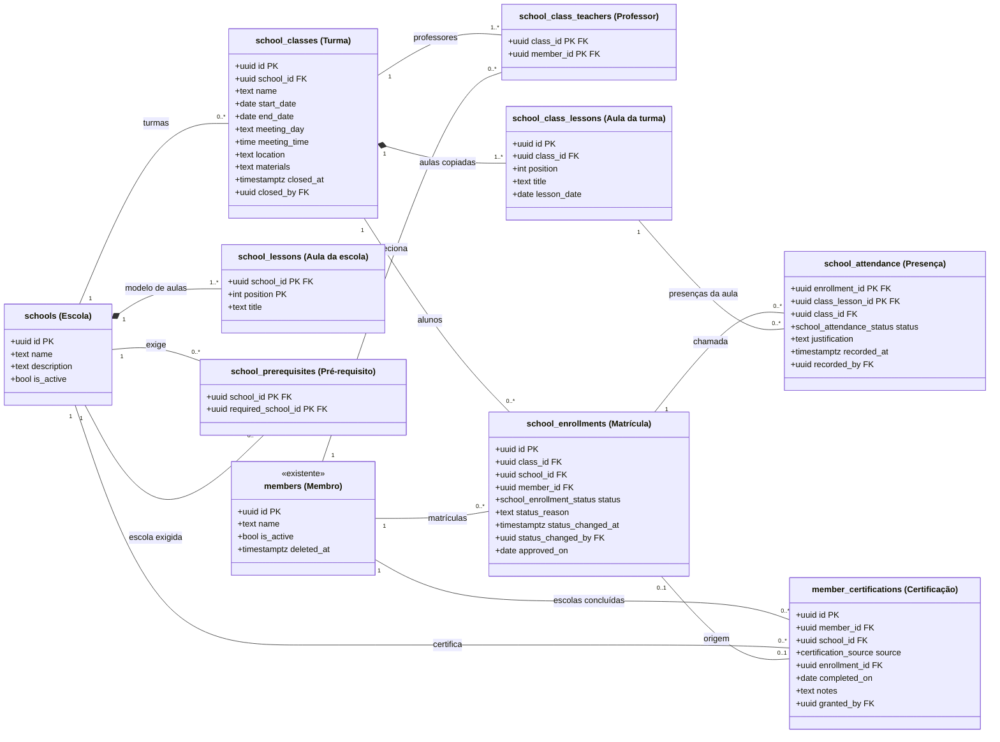

# Escolas e turmas

> Status: pronto para desenvolvimento (aguarda a fase 7 e as dependências)
> Slug: `escolas` · Paridade com o legado: não (feature nova; o legado não tem escolas)

## Negócio
_Seção do `product-owner`. Escrita em 2026-11-23 a partir dos requisitos e das decisões do usuário de 2026-11-22._

### Contexto e objetivo
A Escada do Sucesso (Ganhar, Consolidar, Discipular, Enviar) passa por escolas:
- na Consolidação: Pré-Encontro, Encontro e Pós-Encontro, reunidos na Universidade da Vida;
- no Discipulado: a Capacitação Destino e o Reencontro.

Hoje a igreja não registra no sistema quem fez cada escola. Por isso os líderes não sabem em que degrau cada discípulo está.

Objetivo:
- cadastrar as escolas, com a lista de aulas e os pré-requisitos;
- abrir turmas, com período, professores, material e alunos;
- registrar a chamada de cada aula;
- marcar quem foi aprovado e quem foi reprovado;
- mostrar no cadastro de cada membro as escolas que ele concluiu (certificações).

Requisitos dados pelo usuário em 2026-11-22, citados como U1 a U6 nas regras:
- **U1:** concluir uma escola dá ao membro uma certificação no cadastro. Um membro conclui várias escolas, e uma escola tem vários concluintes.
- **U2:** o membro está em 0..N turmas, e cada turma pertence a uma escola.
- **U3:** a turma tem um período de aulas.
- **U4:** a escola tem X aulas. A turma tem os alunos e a presença de cada aluno em cada aula.
- **U5:** quem tem a permissão de gestão lança a presença.
- **U6:** o aluno pode ser reprovado na turma e, nesse caso, não recebe a certificação.

Cronograma (D-ESC-1): o spec é escrito agora. A implementação começa depois da fase 7 do [`docs/migracao.md`](../migracao.md). As dependências técnicas ficam na Solução técnica.

### Termos
- **Escola**: um curso da Escada do Sucesso (ex.: Pré-Encontro, Capacitação Destino – Nível 1), com uma lista de aulas.
- **Aula da escola**: um item da lista de aulas da escola, com número e título opcional. É o programa da escola.
- **Turma**: uma edição da escola, com nome, período, professores, material, alunos e chamada.
- **Aula da turma**: a cópia de uma aula da escola dentro da turma, com data opcional. É nela que se faz a chamada.
- **Professor**: membro designado para dar as aulas da turma e lançar a chamada dela.
- **Aluno**: membro matriculado numa turma.
- **Matrícula**: a ligação do aluno com a turma. Guarda a situação dele.
- **Chamada**: o registro de presença dos alunos numa aula da turma.
- **Presença**: o registro de um aluno numa aula: Presente, Ausente, Ausente (justificada), Reposição ou Não lançada.
- **Reposição**: aula perdida que o aluno repôs. Conta como presença.
- **Situação do aluno**: Em andamento, Aprovado ou Reprovado.
- **Certificação**: o registro de que o membro concluiu a escola. Na tela, aparece como "Escolas concluídas". Há no máximo uma por membro e escola.
- **Pré-requisito**: escola cuja certificação é exigida para a matrícula em outra escola.
- **Material**: texto da turma com os livros e o que precisa ser comprado.
- **Gestor de escolas** (ou "gestor"): usuário com a permissão "Gerenciar escolas".
- **Turma encerrada**: turma que o gestor encerrou. Fica só para consulta até ser reaberta.

### Personas e permissões
| Persona | Quem é | Permissão | O que faz em Escolas |
|---|---|---|---|
| G Gestor de escolas | coordenação das escolas | "Gerenciar escolas" (nova), válida para a igreja toda | tudo: escolas, turmas, matrículas, chamada, situação e certificações |
| A Administrador | role `is_system` | recebe "Gerenciar escolas" no banco | o mesmo que G |
| P Professor | membro designado na turma | nenhuma especial | vê a turma completa e lança a chamada dela (ESC-16) |
| L Líder | acompanha os discípulos | escopo de Membros (`view_own_ministry`, `view_members` ou `view_all_church`) | vê as escolas concluídas dos membros que já vê |
| M Aluno | membro matriculado | qualquer | vê só o que é dele |
| S Sem permissão | usuário logado sem "Gerenciar escolas" que não é professor da turma | — | vê o catálogo de escolas e o que é dele |

### Histórias
- Como gestor de escolas, quero cadastrar as escolas com a lista de aulas e os pré-requisitos, para que todas as turmas sigam o mesmo programa.
- Como gestor de escolas, quero abrir uma turma com período, professores, material e alunos, para organizar cada edição da escola.
- Como professor (ou gestor), quero lançar a chamada de cada aula, com falta justificada e reposição, para acompanhar a presença dos alunos.
- Como gestor de escolas, quero marcar cada aluno como aprovado ou reprovado, vendo as presenças e as faltas dele, para conceder as certificações.
- Como gestor de escolas, quero encerrar a turma quando todos tiverem situação, e reabri-la se precisar corrigir algo.
- Como aluno, quero ver as minhas turmas, as minhas presenças, a minha situação e o material da turma.
- Como membro, quero ver no meu cadastro as escolas que concluí e as que estou cursando.
- Como líder, quero saber quais escolas meus discípulos já concluíram, para acompanhar cada um na Escada do Sucesso.
- Como gestor de escolas, quero matricular de novo quem foi reprovado ou quer refazer a escola, sem perder o histórico.
- Como gestor de escolas, quero registrar quem concluiu uma escola antes do sistema ou em outra igreja, para que essas pessoas não precisem refazê-la.

### Decisões

#### Decisões do usuário (2026-11-22)
| # | Tema | Decisão |
|---|---|---|
| D-ESC-1 | Cronograma | O spec é escrito agora e o código fica para depois. A implementação continua depois da fase 7 do `docs/migracao.md`. |
| D-ESC-2 | Aprovação só manual | O gestor marca Aprovado ou Reprovado. A presença é informativa: a tela mostra a frequência, mas não decide nada. |
| D-ESC-3 | Escopo da v1 | Entram pré-requisitos entre escolas, certificação manual (carga histórica), falta justificada e reposição (a reposição conta como presença) e o professor da turma lançando a chamada. |
| D-ESC-4 | Visibilidade | As certificações seguem o mesmo escopo de Membros. Turmas e chamada completas ficam só com os gestores e os professores da turma. O aluno vê só o que é dele. |
| D-ESC-5 | Aulas | - A escola tem uma lista de X aulas numeradas, com título opcional (por exemplo, o nome da lição).<br>- A turma copia essa lista ao ser criada.<br>- Cada aula da turma pode ter uma data, dentro do período da turma.<br>- Não se lança a chamada de uma aula futura. |
| D-ESC-6 | Só membros são alunos | Quem ainda não é membro (por exemplo, um novo convertido no Pré-Encontro) precisa ser cadastrado em Membros antes da matrícula. Quando a Consolidação existir, os consolidados também poderão ser alunos. |
| D-ESC-7 | Refazer | - O reprovado pode ser matriculado em outra turma da mesma escola.<br>- Quem já concluiu a escola também pode refazê-la. Nesse caso, ele continua com **uma única** certificação daquela escola.<br>- Todas as matrículas ficam no histórico. |
| D-ESC-8 | Material | O material é **um texto descritivo** (por exemplo, quais livros comprar), sem arquivos para baixar nem links externos. Ele é **informado no cadastro da turma**, não na escola, porque os materiais são atualizados de tempos em tempos e não ficam presos a uma escola. A escola não tem campo de material, e a turma não copia material nenhum dela. |
| D-ESC-9 | Escopo da gestão | Quem tem "Gerenciar escolas" cuida das turmas da **igreja toda** e pode matricular qualquer membro ativo. No seletor, os membros fora do escopo dele aparecem só pelo nome. |
| D-ESC-10 | Encerrar e reabrir | A turma encerrada não aceita matrícula, chamada nem mudança de situação. O gestor pode reabrir a turma para corrigir algo. |
| D-ESC-11 | Data de conclusão | É o **dia da aprovação** (a data em que o gestor marcou "Aprovado", no horário de Brasília). |
| D-ESC-12 | Propostas aceitas como estão | - **Membro inativo:** não pode ser matriculado. Se ficar inativo durante a turma, a matrícula, as presenças e a situação dele continuam.<br>- **Exclusão bloqueada:** uma escola com turmas, ou uma turma com alunos aprovados, não pode ser excluída. A mensagem diz o que resolver antes.<br>- **Dados da turma:** nome livre (ex.: "2027.1"); dia, horário e local opcionais; material opcional; um ou mais professores, sempre membros.<br>- **Unicidade e casal:** o nome da escola é único; cada membro tem no máximo uma matrícula "Em andamento" por escola; uma escola inativa não recebe turma nova; matrícula e certificação são individuais, mesmo para casais. |

#### Padrões adotados pelo plano (2026-11-22)
Detalhes que o usuário não decidiu explicitamente. Nas regras, aparecem como "definida pelo plano (2026-11-22)". O usuário pode mudar qualquer um na revisão do PR.
- **Aula sem data:** aceita chamada a partir do início da turma. Aula com data só aceita chamada a partir da própria data (ESC-17).
- **Aulas da turma:** a quantidade fica fixa a partir da criação. Na turma, só o título e a data de cada aula podem ser editados. Mudar a lista de aulas da escola só afeta turmas novas (ESC-03, ESC-08).
- **Motivo da situação:** é opcional, em texto, tanto ao aprovar quanto ao reprovar (ESC-20).
- **Pré-requisitos** (ESC-04):
  - só certificações de outras escolas contam; batismo e participação em célula ficam fora da v1;
  - não há exceção: se a pessoa concluiu a escola exigida em outro lugar, o gestor registra a certificação manual (ESC-27).
- **Quem vê o quê** (ESC-30):
  - "Escolas concluídas" seguem o escopo de Membros;
  - "Em andamento" e a chamada aparecem só para o próprio membro, para os gestores e para os professores da turma. O líder vê só as concluídas.
- **Fora da v1:** filtros de Membros por escola, cards no Dashboard, certificação como requisito para liderar célula e marcar "batizado" ao concluir a Universidade da Vida.
- **Encontro e Reencontro:** se a liderança os tratar como escola, eles são cadastrados como escolas com 1 aula. Isso não muda o modelo.
- **Permissão:** "Gerenciar escolas" vale para a igreja toda e é concedida no banco às roles `is_system` (ESC-28).
- **Auditoria:** as tabelas novas entram na Auditoria; a chamada gera um registro por aula gravada (ESC-34).

#### Padrões complementares deste spec
Lacunas que nem o usuário nem o plano cobriam. O PO adotou a opção mais conservadora e coerente com as decisões acima, como o plano pede. Nas regras, aparecem como "definida pelo plano (2026-11-22)". **Revisar no PR.**
- **ESC-04:** os pré-requisitos são conferidos só na matrícula. Mudanças posteriores não desfazem matrículas existentes.
- **ESC-05 e ESC-27:** escola inativa ainda aceita certificação manual.
- **ESC-06:** o nome da turma é obrigatório e único entre as turmas não excluídas da mesma escola.
- **ESC-07:** o período pode mudar enquanto a turma está aberta, desde que as aulas com data continuem dentro dele.
- **ESC-08:** enquanto a turma não tem aluno, trocar a escola substitui as aulas pela lista da nova escola.
- **ESC-09:** o termo é "Professor" (P-09). O professor precisa estar ativo ao ser designado e não pode ser aluno da mesma turma.
- **ESC-10:** para encerrar, todos os alunos precisam estar "Aprovado" ou "Reprovado". A turma encerrada fica só para consulta, inclusive para edição e exclusão.
- **ESC-11:** a matrícula é aceita enquanto a turma não está encerrada, sem limite de vagas e sem modalidade online (P-17). A matrícula em lote é tudo ou nada.
- **ESC-14:** um registro de presença lançado não volta a "Não lançada". A chamada pode deixar alunos sem registro.
- **ESC-15, ESC-20 e ESC-27:** ninguém lança a própria presença, define a própria situação nem concede ou revoga a própria certificação, nem mesmo um gestor.
- **ESC-17:** uma aula com chamada lançada não recebe data futura, e o início da turma não passa de hoje se uma aula sem data já tem chamada.
- **ESC-19:** não há as situações "Desistente" nem "Cancelada" (P-11). A desistência é "Reprovado" com motivo, ou a remoção da matrícula enquanto a turma está aberta.
- **ESC-20:** a frequência é presenças ÷ total de aulas da turma, arredondada para baixo.
- **ESC-24:** enquanto o membro tem uma matrícula aprovada numa escola, ele tem a certificação dela.
- **ESC-26:** ao desfazer a aprovação, a certificação passa para a matrícula aprovada mais antiga, com a data de aprovação dela.
- **ESC-27:** observação opcional; membro inativo pode receber; não se edita (revoga e concede de novo); só a certificação manual é revogada diretamente; concessão individual pela tela, sem carga em lote na v1 (P-10).
- **ESC-30:** o catálogo de escolas é visível a todo usuário logado; o motivo da situação não aparece para o aluno; a observação da certificação manual só aparece para os gestores.
- **ESC-31:** matricular de novo quem foi removido cria uma matrícula nova, sem presenças.
- **ESC-32:** uma escola que é pré-requisito de outra, ou que tem certificações, não é excluída; um aluno aprovado não é removido da turma.
- **ESC-33:** matrículas e certificações de membro excluído não contam para as travas de exclusão; o professor excluído some da turma.
- **ESC-36:** a turma nova começa sem material; endereços digitados aparecem como texto; o material é editável enquanto a turma está aberta.
- **Termos de tela:** "Certificação" e "Escolas concluídas", nunca "badge" (P-19).
- **Vindas do desenho de UX (2026-11-23, PO-UX-1 a PO-UX-4 em "Experiência (UX)"):**
  - quem vê um membro na lista de Membros abre o painel "Escolas do membro" dele, mesmo sem poder editar o cadastro. Não expõe nada além da ESC-30 c;
  - o aluno vê "Ausente (justificada)" nas próprias faltas, mas não o texto da justificativa (ESC-30 b);
  - os badges de situação flexionam o gênero ("Aprovada", "Reprovada") quando ele é conhecido;
  - o atalho "Lançar chamada" na tela inicial do professor fica para depois da v1.

### Regras de negócio
Nenhuma regra está "a confirmar". "Gestor" é quem tem "Gerenciar escolas". "Hoje" e "agora" seguem o horário de Brasília (`America/Sao_Paulo`), independentemente do relógio do navegador.

| ID | Regra | Origem |
|---|---|---|
| ESC-01 | **Escola.** Tem nome (obrigatório), descrição (opcional) e uma lista de aulas com pelo menos 1 aula (ESC-03). A quantidade de aulas da escola (o "X") é o tamanho dessa lista. A escola não tem material (ESC-36). | definida pelo usuário (2026-11-22, U4/D-ESC-5/D-ESC-8); descrição: definida pelo plano (2026-11-22) |
| ESC-02 | **Nome único.** Duas escolas não excluídas não podem ter o mesmo nome. A comparação ignora maiúsculas, acentos e espaços nas pontas. O nome de uma escola excluída pode ser reutilizado. | definida pelo usuário (2026-11-22, D-ESC-12); excluídas: DEL-02 |
| ESC-03 | **Aulas da escola.** As aulas são numeradas de 1 a X, na ordem em que acontecem. Cada uma pode ter um título (por exemplo, o nome da lição).<br>- O gestor pode incluir, retirar, reordenar e renomear aulas. A numeração é sempre contínua, de 1 a X.<br>- Essas mudanças só valem para as turmas criadas depois (ESC-08). | definida pelo usuário (2026-11-22, D-ESC-5); efeito só em turmas novas: definida pelo plano (2026-11-22) |
| ESC-04 | **Pré-requisitos.** Uma escola pode exigir a certificação de outras escolas. Sem todas elas, o membro não é matriculado.<br>- Só contam certificações não excluídas de outras escolas, inclusive as concedidas manualmente (ESC-27). Batismo e participação em célula não são pré-requisitos.<br>- Não há exceção: quem concluiu a escola exigida em outro lugar recebe a certificação manual.<br>- Uma escola não exige a si mesma, e os pré-requisitos não formam ciclo, nem direto nem indireto.<br>- A conferência é feita na matrícula. Mudanças posteriores, nos pré-requisitos da escola ou nas certificações do aluno, não desfazem matrículas existentes. | definida pelo usuário (2026-11-22, D-ESC-3); "só certificações", "sem exceção" e conferência na matrícula: definida pelo plano (2026-11-22); excluídas: DEL-02 |
| ESC-05 | **Escola inativa.** O gestor pode desativar e reativar uma escola. A escola inativa não recebe turma nova. As turmas existentes continuam, as certificações seguem valendo (inclusive como pré-requisito) e a concessão manual (ESC-27) continua possível. | definida pelo usuário (2026-11-22, D-ESC-12); concessão manual: definida pelo plano (2026-11-22) |
| ESC-06 | **Turma.** Pertence a exatamente uma escola. Tem:<br>- nome livre e obrigatório (ex.: "2027.1"), único entre as turmas não excluídas da mesma escola, com a comparação da ESC-02;<br>- dia da semana, horário e local, opcionais;<br>- período (ESC-07), aulas (ESC-08), professores (ESC-09) e material (ESC-36). | definida pelo usuário (2026-11-22, U2/D-ESC-12); nome obrigatório e único na escola: definida pelo plano (2026-11-22) |
| ESC-07 | **Período.** A turma tem data de início e data de fim, as duas obrigatórias. A data de fim não pode ser anterior à de início. Enquanto a turma está aberta, o período pode mudar, desde que as aulas com data continuem dentro dele e que a ESC-17 seja respeitada. | definida pelo usuário (2026-11-22, U3); alteração do período: definida pelo plano (2026-11-22) |
| ESC-08 | **Aulas da turma.** Ao ser criada, a turma recebe uma cópia da lista de aulas que a escola tem naquele momento (número e título).<br>- A quantidade de aulas da turma fica fixa. Só o título e a data de cada aula podem ser editados.<br>- Mudanças posteriores na escola não afetam a turma.<br>- Cada aula pode ter uma data, dentro do período da turma. Duas aulas podem ter a mesma data (por exemplo, duas lições na mesma reunião).<br>- A escola da turma não muda depois que a turma tem aluno. Antes disso, trocar a escola substitui as aulas da turma pela lista da nova escola, como numa turma nova. | definida pelo usuário (2026-11-22, D-ESC-5); quantidade fixa e campos editáveis: definida pelo plano (2026-11-22); troca da escola: definida pelo plano (2026-11-22) |
| ESC-09 | **Professores.** A turma tem um ou mais professores, sempre membros.<br>- Ao ser designado, o professor precisa estar ativo e não excluído.<br>- Um membro pode ser professor de uma turma e aluno de outra, mas não professor e aluno da mesma turma.<br>- O professor não precisa de permissão especial (ESC-16, ESC-30). | definida pelo usuário (2026-11-22, D-ESC-3/D-ESC-12); termo "Professor", membro ativo e "não na mesma turma": definida pelo plano (2026-11-22) |
| ESC-10 | **Encerrar e reabrir.** Só o gestor encerra e reabre a turma.<br>- Para encerrar, todos os alunos precisam estar "Aprovado" ou "Reprovado".<br>- A turma encerrada fica só para consulta: não aceita matrícula, remoção de aluno, chamada, mudança de situação, alteração dos dados da turma (nome, período, aulas, professores, material) nem exclusão.<br>- O gestor pode reabrir a turma para corrigir algo. Reaberta, ela volta a aceitar tudo isso. | definida pelo usuário (2026-11-22, D-ESC-10); situações definidas para encerrar e "só para consulta": definida pelo plano (2026-11-22) |
| ESC-11 | **Alunos.** Os alunos são membros cadastrados e não excluídos. Quem ainda não é membro (por exemplo, um novo convertido no Pré-Encontro ou um visitante de célula) precisa ser cadastrado em Membros antes da matrícula.<br>- Um membro pode estar em nenhuma, uma ou várias turmas, mas tem no máximo uma matrícula não excluída em cada turma.<br>- Só o gestor matricula (ESC-29). A matrícula é aceita enquanto a turma não está encerrada, mesmo depois do início ou do fim das aulas. Não há limite de vagas.<br>- A matrícula de vários membros de uma vez é tudo ou nada: se um deles não puder entrar, ninguém é matriculado, e a mensagem diz o que falta para cada um.<br>- Fora as regras ESC-04, ESC-09, ESC-12 e ESC-13, nada impede a matrícula: ser pastor, não ter líder ou ser casado não impede. | definida pelo usuário (2026-11-22, U2/D-ESC-6); prazo, vagas e lote: definida pelo plano (2026-11-22); excluídos: D1, DEL-02 |
| ESC-12 | **Membro inativo.** Não pode ser matriculado. Se ficar inativo durante a turma, a matrícula, as presenças e a situação dele continuam, e a chamada e a situação dele ainda podem ser lançadas. | definida pelo usuário (2026-11-22, D-ESC-12) |
| ESC-13 | **Uma matrícula em andamento por escola.** O membro tem no máximo uma matrícula "Em andamento" em cada escola, somando todas as turmas dela.<br>- Ter sido reprovado ou já ter a certificação da escola não impede uma nova matrícula (ESC-22).<br>- A regra vale também quando uma situação volta para "Em andamento". | definida pelo usuário (2026-11-22, D-ESC-7/D-ESC-12) |
| ESC-14 | **Chamada.** Em cada aula da turma, cada aluno tem no máximo um registro de presença: "Presente", "Ausente" ou "Reposição". Sem registro, a aula aparece como "Não lançada" para aquele aluno.<br>- Lançar a chamada de novo altera o registro existente, sem criar outro.<br>- A chamada pode deixar alunos sem registro (por exemplo, quem foi matriculado depois da aula).<br>- Um registro lançado pode mudar entre os três valores, mas não volta a "Não lançada". | definida pelo usuário (2026-11-22, U4/D-ESC-3); chamada parcial e "não volta a Não lançada": definida pelo plano (2026-11-22) |
| ESC-15 | **Quem lança a chamada.** Só o gestor e os professores da turma (ESC-16) lançam ou alteram presença. O aluno não marca a própria presença. Ninguém lança ou altera a própria presença, nem mesmo um gestor matriculado na turma. | definida pelo usuário (2026-11-22, U5); "ninguém lança a própria presença": definida pelo plano (2026-11-22) |
| ESC-16 | **Chamada pelo professor.** O professor lança e altera a chamada da própria turma, inclusive justificativa e reposição, mesmo sem "Gerenciar escolas". Ele não matricula, não remove alunos, não define situação, não encerra nem reabre a turma e não lança a chamada de turmas das quais não é professor. | definida pelo usuário (2026-11-22, D-ESC-3); limites do professor: definida pelo usuário (2026-11-22, D-ESC-2/D-ESC-9/D-ESC-10) |
| ESC-17 | **Aula futura.** Não se lança a chamada de uma aula que ainda não aconteceu.<br>- Aula com data: aceita chamada a partir da própria data.<br>- Aula sem data: aceita chamada a partir da data de início da turma.<br>- Uma aula com chamada lançada não pode receber data futura. Se alguma aula sem data já tem chamada, a data de início da turma não pode passar para depois de hoje. | definida pelo usuário (2026-11-22, D-ESC-5); aula sem data e proteção das datas: definida pelo plano (2026-11-22) |
| ESC-18 | **Falta justificada e reposição.** Uma ausência pode ter justificativa (texto). Ela aparece como "Ausente (justificada)" e continua contando como falta. A reposição conta como presença. | definida pelo usuário (2026-11-22, D-ESC-3) |
| ESC-19 | **Situação do aluno.** Ao ser matriculado, o aluno fica "Em andamento". Depois, o gestor marca "Aprovado" ou "Reprovado" (ESC-20). Não há outras situações: a desistência é registrada como "Reprovado", com motivo, ou, enquanto a turma está aberta, com a remoção da matrícula. | definida pelo usuário (2026-11-22, U6); desistência: definida pelo plano (2026-11-22) |
| ESC-20 | **Aprovação manual.** Só o gestor define a situação, "Aprovado" ou "Reprovado", com motivo opcional (texto).<br>- Pode mudá-la a qualquer momento enquanto a turma está aberta, inclusive de volta para "Em andamento". Vale a última marcação, com autor e data.<br>- Ninguém define a própria situação.<br><br>Não há frequência mínima: a presença não decide nada. A tela mostra, para cada aluno, só como informação:<br>- presenças: aulas com "Presente" ou "Reposição";<br>- faltas: aulas com "Ausente", justificada ou não;<br>- não lançadas;<br>- frequência: presenças ÷ total de aulas da turma, em %, arredondada para baixo. | definida pelo usuário (2026-11-22, D-ESC-2); motivo opcional, cálculo da frequência e "ninguém define a própria": definida pelo plano (2026-11-22) |
| ESC-21 | **Reprovado não recebe certificação.** A reprovação não gera certificação nem conta como pré-requisito. Uma certificação que o membro já tinha da mesma escola (de outra turma ou manual) continua. | definida pelo usuário (2026-11-22, U6/D-ESC-7) |
| ESC-22 | **Refazer a escola.** O reprovado e quem já concluiu a escola podem ser matriculados em outra turma da mesma escola, respeitando a ESC-13. Todas as matrículas, com presenças e situações, ficam no histórico. | definida pelo usuário (2026-11-22, D-ESC-7) |
| ESC-23 | **Certificação ao aprovar.** Quando o aluno passa a "Aprovado" e ainda não tem a certificação da escola, ele a recebe, ligada à matrícula (e à turma) de origem. A data de conclusão é o dia da aprovação, no horário de Brasília. A situação e a certificação são gravadas juntas (tudo ou nada). | definida pelo usuário (2026-11-22, U1/D-ESC-11) |
| ESC-24 | **Uma certificação por escola.** O membro tem no máximo uma certificação não excluída de cada escola.<br>- Quem já tem a certificação e é aprovado em outra turma da mesma escola mantém a certificação existente, com a data e a origem originais.<br>- Enquanto o membro tem uma matrícula aprovada (não excluída) numa escola, ele tem a certificação dela. | definida pelo usuário (2026-11-22, U1/D-ESC-7); "matrícula aprovada tem certificação": definida pelo plano (2026-11-22) |
| ESC-25 | **Certificações no cadastro.** O cadastro do membro e "Editar meus dados" mostram a seção "Escolas concluídas", com o nome da escola e a data de conclusão de cada certificação. As concedidas manualmente levam a marca "Concedida manualmente". A seção "Em andamento" mostra as turmas que ele está cursando, só para quem pode vê-las (ESC-30). | definida pelo usuário (2026-11-22, U1); "Em andamento": definida pelo plano (2026-11-22) |
| ESC-26 | **Desfazer a aprovação.** Quando o gestor muda de "Aprovado" para outra situação a matrícula que gerou a certificação:<br>- se o membro tem outra matrícula aprovada (não excluída) na mesma escola, a certificação passa a apontar para ela (a mais antiga, pela data de aprovação), e a data de conclusão passa a ser a data de aprovação dessa matrícula;<br>- se não tem, a certificação recebe exclusão lógica, some do cadastro e deixa de contar como pré-requisito.<br><br>Desfazer uma aprovação que não gerou a certificação (porque o membro já a tinha) não muda a certificação. Matrículas em outras escolas feitas com base nessa certificação continuam (ESC-04). | definida pelo usuário (2026-11-22, D-ESC-7); escolha da matrícula e da data: definida pelo plano (2026-11-22) |
| ESC-27 | **Certificação manual.** O gestor registra a certificação de quem concluiu a escola fora do sistema (antes dele ou em outra igreja), com a data de conclusão (obrigatória, não futura) e uma observação opcional.<br>- Ela fica marcada "Concedida manualmente", sem turma, e vale como pré-requisito.<br>- O membro pode estar ativo ou inativo, mas não excluído. A escola pode estar inativa.<br>- Não é concedida se o membro já tem a certificação da escola.<br>- Não é editada: para corrigir, o gestor revoga e concede de novo.<br>- Revogar é exclusão lógica. Se o membro tiver matrícula aprovada na escola, a certificação passa a apontar para ela, como na ESC-26.<br>- Só a certificação manual é revogada diretamente. A que veio de uma turma só sai quando a aprovação é desfeita (ESC-26).<br>- Ninguém concede nem revoga a própria certificação.<br>- A concessão é individual, pela tela. | definida pelo usuário (2026-11-22, D-ESC-3); demais itens: definida pelo plano (2026-11-22) |
| ESC-28 | **Permissão "Gerenciar escolas".** Permissão nova, configurável na tela de Funções, válida para a igreja toda. Sem ela, ninguém cria, edita, desativa, encerra, reabre ou exclui escolas e turmas, nem matricula, remove alunos, define situações ou concede e revoga certificações, nem pela API. A chamada segue a ESC-15 e a ESC-16. As roles `is_system` (Administrador) recebem a permissão no banco, como na RN-14 do E1.08. | definida pelo usuário (2026-11-22, U5/D-ESC-9); roles `is_system`: definida pelo plano (2026-11-22) |
| ESC-29 | **Escopo da gestão.** O gestor cuida das turmas da igreja toda. Ele pode matricular qualquer membro ativo e não excluído e designar qualquer membro ativo como professor. No seletor, os membros fora do escopo de Membros dele aparecem só pelo nome. | definida pelo usuário (2026-11-22, D-ESC-9); seletor de professores: definida pelo plano (2026-11-22) |
| ESC-30 | **Quem vê.**<br>(a) Todo usuário logado vê a lista de escolas: nome, descrição, aulas e pré-requisitos.<br>(b) O membro vê as próprias matrículas: turma, nome dos professores, período, aulas, material, as próprias presenças e a própria situação. Não vê o motivo da situação, o texto da justificativa das próprias faltas (só o estado "Ausente (justificada)") nem os dados de outros alunos.<br>(c) As certificações ("Escolas concluídas") seguem o escopo de Membros: quem vê o cadastro de um membro vê as certificações dele. O gestor vê as de todos. A observação da certificação manual só aparece para os gestores.<br>(d) A turma completa (alunos, chamada, situações e motivos) e as matrículas "Em andamento" de outros membros ficam visíveis só para os gestores e para os professores daquela turma. Quem vê o membro só pelo escopo de Membros (por exemplo, o líder) vê as escolas concluídas, mas não as matrículas nem a chamada. | definida pelo usuário (2026-11-22, D-ESC-4); (a), motivo, observação e líder: definida pelo plano (2026-11-22); justificativa: definida pelo plano (2026-11-23) |
| ESC-31 | **Exclusão lógica.** Escolas, turmas, matrículas e certificações são excluídas logicamente, com autor e data. Registros excluídos não aparecem em telas, seletores nem contagens, e não contam como pré-requisito nem para as regras de unicidade. Remover um aluno da turma é a exclusão lógica da matrícula. Matriculá-lo de novo cria uma matrícula nova, "Em andamento" e sem presenças. | D1 (2026-11-14), DEL-01, DEL-02; nova matrícula: definida pelo plano (2026-11-22) |
| ESC-32 | **Excluir com dependentes.** A exclusão é recusada, com uma mensagem que diz o que resolver antes, quando:<br>- a escola tem turma não excluída (aberta ou encerrada);<br>- a turma tem aluno "Aprovado";<br>- a escola é pré-requisito de outra escola não excluída;<br>- a escola tem certificação não excluída (por exemplo, concedida manualmente);<br>- o aluno a remover da turma está "Aprovado".<br><br>Para guardar o histórico de uma escola que não é mais oferecida, o gestor a desativa (ESC-05). | definida pelo usuário (2026-11-22, D-ESC-12) nos dois primeiros itens; demais: definida pelo plano (2026-11-22) |
| ESC-33 | **Membro excluído.** Quando um membro é excluído, as matrículas, as presenças e as certificações dele deixam de aparecer e de contar, inclusive nas travas da ESC-32, e ele deixa de aparecer como professor. Se ele for reativado, tudo volta como estava. | DEL-02, DEL-09; professor e travas: definida pelo plano (2026-11-22) |
| ESC-34 | **Auditoria.** Ficam na Auditoria, com autor e horário:<br>- criação, alteração, desativação e exclusão de escola, inclusive aulas e pré-requisitos;<br>- criação, alteração e exclusão de turma, inclusive aulas, professores e material;<br>- encerramento e reabertura;<br>- matrícula e remoção;<br>- chamada: um registro por aula gravada, com as mudanças de cada aluno;<br>- mudança de situação, com o motivo;<br>- concessão, revogação e mudança de origem de certificação. | definida pelo plano (2026-11-22) |
| ESC-35 | **Casal.** Matrícula, chamada, situação e certificação são individuais, mesmo quando marido e esposa estão na mesma turma. | definida pelo usuário (2026-11-22, D-ESC-12) |
| ESC-36 | **Material da turma.** Texto livre e opcional, informado no cadastro da turma, com os livros e o que precisa ser comprado.<br>- Pode ser alterado enquanto a turma está aberta.<br>- Mudar o material de uma turma não afeta as outras turmas da mesma escola. A turma nova começa sem material: não copia da escola nem de outra turma.<br>- A escola não tem material.<br>- Não há arquivos para baixar nem links: endereços digitados aparecem como texto.<br>- Os alunos e os professores da turma veem o material. | definida pelo usuário (2026-11-22, D-ESC-8); "começa sem material", "como texto" e edição só com a turma aberta: definida pelo plano (2026-11-22) |

### Critérios de aceite
Quando o critério diz "pela API", vale para qualquer chamada feita fora da tela. "Erro de permissão" é o código 42501, sem nenhuma gravação.

- **ESC-01**
  - Dado um gestor
  - Quando ele cadastra a escola "Pré-Encontro" com 4 aulas
  - Então a escola aparece na lista com 4 aulas.
  - Dado o mesmo gestor
  - Quando ele tenta salvar uma escola sem nome, ou sem nenhuma aula, mesmo pela API
  - Então nada é gravado, e a mensagem é "Informe o nome da escola." ou "A escola precisa ter pelo menos 1 aula.".
  - Dado o cadastro de uma escola
  - Então ele não tem campo de material.
- **ESC-02**
  - Dada a escola "Encontro", não excluída
  - Quando alguém cadastra " encontro " ou "Encôntro", ou renomeia outra escola para um desses nomes
  - Então recebe "Já existe uma escola com este nome." e nada é gravado.
  - Dada a escola "Encontro", excluída
  - Quando o gestor cadastra "Encontro"
  - Então a escola nova é aceita.
- **ESC-03**
  - Dada uma escola com 4 aulas sem título e uma turma T já criada a partir dela
  - Quando o gestor dá à aula 1 o título "A salvação", troca as aulas 2 e 3 de lugar e retira a aula 4
  - Então a escola fica com 3 aulas, numeradas de 1 a 3 na nova ordem, a turma criada depois recebe essa lista, e T continua com as 4 aulas originais.
  - Dada uma escola com 1 aula
  - Quando o gestor tenta retirar essa aula
  - Então recebe "A escola precisa ter pelo menos 1 aula.".
- **ESC-04**
  - Dada a escola "Capacitação Destino – Nível 2", que exige o Nível 1, e um membro sem a certificação do Nível 1
  - Quando o gestor tenta matriculá-lo numa turma do Nível 2, pela tela ou pela API
  - Então a matrícula é recusada com "Falta concluir: Capacitação Destino – Nível 1.".
  - Dado o mesmo membro já com a certificação do Nível 1, de uma turma ou concedida manualmente, e não batizado
  - Quando o gestor o matricula
  - Então a matrícula é aceita (batismo não é conferido).
  - Dada uma certificação do Nível 1 que foi excluída
  - Então ela não conta como pré-requisito.
  - Dado que A exige B e B exige C
  - Quando o gestor tenta fazer C exigir A, ou A exigir A
  - Então recebe "Os pré-requisitos não podem formar um ciclo." ou "Uma escola não pode ser pré-requisito dela mesma.".
  - Dado M matriculado no Nível 2 com a certificação do Nível 1
  - Quando a aprovação do Nível 1 é desfeita, ou o Nível 2 passa a exigir outra escola
  - Então a matrícula de M no Nível 2 continua.
- **ESC-05**
  - Dada uma escola inativa, com uma turma aberta e 30 certificações
  - Quando o gestor tenta criar uma turma nova dela
  - Então recebe "Esta escola está inativa.".
  - A turma existente continua aceitando chamada, as 30 certificações continuam nos cadastros e contando como pré-requisito, e o gestor ainda concede certificação manual dessa escola.
  - Quando o gestor reativa a escola
  - Então ela volta a aceitar turmas novas.
- **ESC-06**
  - Dado o gestor
  - Quando ele tenta salvar uma turma sem escola ou sem nome, mesmo pela API
  - Então nada é gravado ("Escolha a escola da turma." ou "Informe o nome da turma.").
  - Dada a turma "2027.1" da escola A, não excluída
  - Quando o gestor cria outra turma "2027.1" em A
  - Então recebe "Já existe uma turma com este nome nesta escola.".
  - Quando ele cria a turma "2027.1" na escola B, ou em A depois que a primeira foi excluída
  - Então a turma é aceita.
  - Dada uma turma sem dia, horário e local
  - Então ela é salva.
  - Dadas duas turmas da mesma escola
  - Então cada uma tem os próprios alunos e a própria chamada.
- **ESC-07**
  - Dado o gestor
  - Quando ele informa início em 10/03/2027 e fim em 09/03/2027
  - Então recebe "A data de fim não pode ser anterior à data de início.".
  - Com início e fim no mesmo dia, a turma é salva. Sem data de início ou sem data de fim, nada é gravado ("Informe as datas de início e de fim.").
  - Dada a turma T, de 01/02/2027 a 30/04/2027, com a aula 10 marcada para 28/04/2027
  - Quando o gestor muda o fim para 20/04/2027
  - Então recebe "Há aulas com data fora do novo período. Ajuste as datas das aulas antes.".
  - Quando ele muda o fim para 15/05/2027
  - Então o período é salvo.
- **ESC-08**
  - Dada a escola X com 10 aulas e a turma T criada a partir dela
  - Quando a escola passa a ter 12 aulas
  - Então T continua com 10 aulas, e uma turma criada depois tem 12.
  - Dada a turma T
  - Quando o gestor tenta incluir ou retirar uma aula de T, mesmo pela API
  - Então recebe "A quantidade de aulas da turma não pode ser alterada.". Mudar o título e a data de uma aula é aceito.
  - Dada a turma T, de 01/02/2027 a 30/04/2027
  - Quando o gestor marca uma aula para 02/05/2027
  - Então recebe "A data da aula precisa estar dentro do período da turma.".
  - Quando ele marca as aulas 1 e 2 para o mesmo dia
  - Então as duas datas são salvas.
  - Dada a turma T com um aluno
  - Quando o gestor tenta trocar a escola da turma
  - Então recebe "Não é possível trocar a escola de uma turma que já tem alunos.".
  - Dada a turma T sem alunos, da escola X (10 aulas), e a escola Y com 4 aulas
  - Quando o gestor troca a escola de T para Y
  - Então T passa a ter as 4 aulas de Y, sem datas.
- **ESC-09**
  - Dado o gestor
  - Quando ele tenta salvar uma turma sem professor
  - Então recebe "Escolha pelo menos um professor.".
  - Dados um pastor e um membro casado, ambos ativos
  - Quando o gestor os define como professores da turma T
  - Então os dois aparecem como professores de T.
  - Dado um membro inativo ou excluído
  - Quando o gestor tenta defini-lo como professor, mesmo pela API
  - Então recebe "Este membro está inativo." ou não o encontra no seletor; nada é gravado.
  - Dado o membro P, professor da turma T
  - Quando o gestor tenta matriculá-lo como aluno de T
  - Então recebe "Este membro é professor desta turma e não pode ser aluno dela.". O contrário recebe "Este membro é aluno desta turma e não pode ser professor dela.".
  - Quando o gestor matricula P em outra turma
  - Então a matrícula é aceita.
- **ESC-10**
  - Dada a turma T com 10 alunos, 9 com situação definida e 1 "Em andamento"
  - Quando o gestor tenta encerrar T
  - Então recebe "Defina a situação de todos os alunos antes de encerrar a turma." e T continua aberta.
  - Quando os 10 têm situação definida e o gestor encerra T
  - Então T fica encerrada.
  - Dada a turma T encerrada
  - Quando o gestor tenta matricular, remover um aluno, lançar a chamada, mudar uma situação, editar os dados da turma ou excluí-la, mesmo pela API
  - Então recebe "Esta turma está encerrada." e nada muda.
  - Quando ele reabre T
  - Então consegue fazer cada uma dessas operações.
  - Dado o professor de T, sem "Gerenciar escolas"
  - Quando ele tenta encerrar ou reabrir T pela API
  - Então recebe erro de permissão.
- **ESC-11**
  - Dados um membro ativo sem líder, um pastor e um membro casado
  - Quando o gestor os matricula na turma T
  - Então os três ficam na turma.
  - Dado o membro M, já matriculado na turma T
  - Quando o gestor tenta matriculá-lo de novo em T
  - Então recebe "Este membro já está nesta turma.".
  - Dado M na turma T1, da escola A
  - Quando ele é matriculado na turma T2, da escola B
  - Então fica nas duas turmas.
  - Dado um membro excluído
  - Então ele não aparece no seletor de alunos, e a matrícula feita pela API é recusada.
  - Dado um visitante que só aparece pelo nome num relatório de célula
  - Então ele não aparece no seletor de alunos até ser cadastrado em Membros.
  - Dada a turma T aberta, com a data de fim já passada
  - Quando o gestor matricula um membro
  - Então a matrícula é aceita.
  - Dado o gestor matriculando A (que cumpre tudo) e B (sem pré-requisito) na mesma operação
  - Quando ele confirma
  - Então ninguém é matriculado, e a mensagem diz o problema de B ("B: falta concluir Capacitação Destino – Nível 1.").
- **ESC-12**
  - Dado um membro inativo
  - Então ele não aparece no seletor de alunos, e a matrícula feita pela API é recusada ("Este membro está inativo.").
  - Dado um aluno que fica inativo no meio da turma
  - Então a matrícula, as presenças e a situação dele continuam, e a chamada e a situação dele ainda podem ser lançadas.
- **ESC-13**
  - Dado M "Em andamento" na turma T1, da escola A
  - Quando o gestor tenta matriculá-lo na turma T2, também da escola A
  - Então recebe "Este membro já está cursando esta escola (turma T1).".
  - Dado M sem matrícula em A
  - Quando dois gestores o matriculam ao mesmo tempo nas turmas T1 e T2, ambas de A
  - Então exatamente uma matrícula é gravada, e o outro gestor recebe a mensagem acima.
  - Dado M "Reprovado" em T1 de A, ou M com a certificação de A
  - Quando o gestor o matricula em T2 de A
  - Então a matrícula é aceita.
  - Dado M "Reprovado" em T1 e "Em andamento" em T2, ambas de A
  - Quando o gestor tenta voltar a situação de M em T1 para "Em andamento"
  - Então recebe "Este membro já está cursando esta escola (turma T2)." e nada muda.
- **ESC-14**
  - Dada a turma T com 10 aulas e 5 alunos
  - Quando o gestor lança a chamada da aula 3 com 4 presentes e 1 ausente
  - Então a aula 3 fica com exatamente 5 registros, e as outras aulas aparecem como "Não lançada".
  - Quando ele lança de novo a chamada da aula 3, mudando o ausente para presente
  - Então continuam 5 registros, e esse aluno passa a "Presente".
  - Quando ele lança a aula 4 com só 3 dos 5 alunos
  - Então os outros 2 aparecem como "Não lançada" na aula 4.
  - Dado um aluno "Presente" na aula 3
  - Quando alguém tenta voltar o registro para "Não lançada", mesmo pela API
  - Então nada muda.
  - Dados o gestor e o professor gravando a chamada da aula 3 ao mesmo tempo
  - Então cada aluno continua com um único registro na aula 3.
- **ESC-15**
  - Dado um usuário sem "Gerenciar escolas" que não é professor da turma
  - Quando ele tenta gravar uma presença pela API
  - Então recebe erro de permissão. Na tela, ele não vê a chamada.
  - Dado um aluno
  - Quando ele tenta marcar a própria presença pela API
  - Então recebe erro de permissão.
  - Dado o gestor G, matriculado como aluno na turma T
  - Quando G tenta lançar a própria presença em T
  - Então recebe "Você não pode lançar a sua própria presença.". Outro gestor ou o professor de T consegue.
- **ESC-16**
  - Dado o professor P da turma T, sem "Gerenciar escolas"
  - Quando ele lança a chamada de T, com uma falta justificada e uma reposição
  - Então a chamada é gravada.
  - Quando ele tenta lançar a chamada da turma T2, da qual não é professor
  - Então recebe erro de permissão.
  - Quando ele tenta matricular, remover um aluno ou definir uma situação em T, pela API
  - Então recebe erro de permissão.
- **ESC-17**
  - Dada a aula 4 da turma T, marcada para o sábado, 13/03/2027
  - Quando o gestor tenta lançar a chamada na sexta, 12/03/2027, às 23:59 (horário de Brasília)
  - Então recebe "Não é possível lançar a chamada de uma aula que ainda não aconteceu.".
  - Quando ele tenta no sábado, 13/03/2027, às 00:00 (horário de Brasília)
  - Então a chamada é gravada, mesmo que o navegador esteja em outro fuso.
  - Dada a turma T com início em 01/03/2027 e a aula 1 sem data
  - Quando o gestor tenta lançar a chamada da aula 1 em 28/02/2027, às 23:59 (horário de Brasília)
  - Então recebe a mesma mensagem. Em 01/03/2027, às 00:00, a chamada é gravada.
  - Dada a aula 3, com chamada lançada
  - Quando o gestor tenta mudar a data dela para amanhã
  - Então recebe "Uma aula com chamada lançada não pode ter data futura.".
  - Dada uma aula sem data, com chamada lançada
  - Quando o gestor tenta mudar o início da turma para amanhã
  - Então recebe "Há aulas sem data com chamada lançada. O início da turma não pode passar de hoje.".
- **ESC-18**
  - Dado um aluno ausente na aula 2
  - Quando o professor registra a justificativa "Plantão no trabalho"
  - Então a aula 2 aparece como "Ausente (justificada)" e continua contando como falta.
  - Quando ele muda o registro da aula 2 para "Reposição"
  - Então a aula 2 aparece como "Reposição" e passa a contar como presença.
- **ESC-19**
  - Dado um membro que acabou de ser matriculado
  - Então a situação dele na turma é "Em andamento".
  - Quando alguém tenta gravar pela API uma situação que não seja Em andamento, Aprovado ou Reprovado (por exemplo, "Desistente")
  - Então nada é gravado.
  - Dado um aluno que desistiu, com a turma aberta
  - Quando o gestor o marca "Reprovado" com o motivo "Desistiu"
  - Então a situação e o motivo são gravados.
- **ESC-20**
  - Dada a turma T com 10 aulas e um aluno com 6 "Presente", 1 "Reposição", 2 "Ausente" (1 justificada) e 1 "Não lançada"
  - Quando o gestor abre a situação dos alunos
  - Então vê 7 presenças, 2 faltas, 1 não lançada e frequência de 70%.
  - Dada uma turma com 3 aulas e um aluno com 2 presenças
  - Então a frequência mostrada é 66%.
  - Dado um aluno com 3 presenças em 10 aulas
  - Quando o gestor o marca "Aprovado", sem motivo
  - Então a mudança é gravada. Um aluno com 10 presenças em 10 aulas também pode ser marcado "Reprovado", com ou sem motivo.
  - Dado um aluno "Aprovado" com a turma aberta
  - Quando o gestor o volta para "Em andamento"
  - Então a mudança é gravada, com o autor e a data.
  - Dado o professor da turma, sem "Gerenciar escolas"
  - Quando ele tenta definir a situação de um aluno pela API
  - Então recebe erro de permissão.
  - Dado o gestor G, aluno da turma T
  - Quando G tenta definir a própria situação em T
  - Então recebe "Você não pode definir a sua própria situação.".
- **ESC-21**
  - Dado M "Reprovado" na turma T, da escola A, sem nenhuma outra certificação de A
  - Então o cadastro de M não mostra a escola A em "Escolas concluídas", e A não conta como pré-requisito para M.
  - Dado M com a certificação de A (de outra turma ou manual)
  - Quando M é reprovado numa nova turma de A
  - Então a certificação de A continua.
- **ESC-22**
  - Dado M "Reprovado" na turma T1, da escola A
  - Quando ele é matriculado na turma T2, também da escola A, e aprovado
  - Então M recebe a certificação de A ligada à T2, e o histórico continua mostrando "Reprovado" na T1.
  - Dado M com a certificação de A, de uma turma de 2027
  - Quando o gestor o matricula numa turma de A de 2028
  - Então a matrícula é aceita.
- **ESC-23**
  - Dado M "Em andamento" na turma T, da escola A, sem certificação de A
  - Quando o gestor muda a situação para "Aprovado"
  - Então M passa a ter a certificação de A, ligada a T, e ela aparece no cadastro dele.
  - Dado que o gestor marca "Aprovado" em 30/06/2027, às 22:30 (horário de Brasília; 01:30 de 01/07 em UTC)
  - Então a data de conclusão é 30/06/2027.
  - Se a certificação não puder ser gravada, a situação também não muda.
- **ESC-24**
  - Dado M com a certificação de A, de 10/03/2027, gerada pela turma T1
  - Quando M é aprovado na turma T2, de A, em 15/09/2027
  - Então M continua com uma única certificação de A, com a data 10/03/2027 e ligada a T1.
  - Dado M com a certificação manual de A
  - Quando M é aprovado numa turma de A
  - Então a certificação manual continua, sem mudança.
  - Dado M "Reprovado" em T1 e "Em andamento" em T2, ambas de A, sem certificação de A
  - Quando um gestor muda T1 para "Aprovado" e outro aprova M em T2, ao mesmo tempo
  - Então M fica com exatamente uma certificação de A.
  - Dado M com a certificação de A
  - Quando o gestor tenta conceder a certificação manual de A a M
  - Então recebe "Este membro já tem a certificação desta escola.".
- **ESC-25**
  - Dado M com as certificações de "Pré-Encontro" (de uma turma) e "Encontro" (concedida manualmente)
  - Quando M abre "Editar meus dados", ou quando alguém que vê M abre o cadastro dele
  - Então vê "Escolas concluídas" com as duas escolas e as datas de conclusão, e "Encontro" com a marca "Concedida manualmente".
  - Uma certificação excluída não aparece.
  - Dado M "Em andamento" numa turma de "Pós-Encontro"
  - Então M e os gestores veem "Pós-Encontro" em "Em andamento"; o líder de M não vê.
- **ESC-26**
  - Dado M "Aprovado" na turma T, com a certificação de A gerada por T, e sem outra matrícula aprovada em A
  - Quando o gestor muda a situação para "Reprovado" ou "Em andamento"
  - Então a certificação recebe exclusão lógica, some do cadastro e deixa de contar como pré-requisito. A Auditoria registra a mudança.
  - Dado M aprovado em T1 (10/03/2027, certificação ligada a T1) e em T2 (15/09/2027), ambas de A
  - Quando o gestor desfaz a aprovação de T1
  - Então M continua com a certificação de A, agora ligada a T2 e com a data 15/09/2027.
  - Quando, em vez disso, o gestor desfaz a aprovação de T2
  - Então a certificação não muda (continua ligada a T1, com 10/03/2027).
  - Dado M aprovado em T1, T2 (15/09/2027) e T3 (20/03/2028), com a certificação ligada a T1
  - Quando o gestor desfaz a aprovação de T1
  - Então a certificação passa para T2, com a data 15/09/2027.
  - Dado M matriculado no Nível 2 com base na certificação do Nível 1
  - Quando a aprovação do Nível 1 é desfeita e a certificação é excluída
  - Então a matrícula de M no Nível 2 continua.
- **ESC-27**
  - Dado o gestor
  - Quando ele concede a M a certificação de "Encontro", com data de 10/05/2019 e a observação "Encontro de 2019, antes do sistema"
  - Então M tem a certificação marcada "Concedida manualmente", sem turma, e ela conta como pré-requisito.
  - Uma data de conclusão futura é recusada ("A data de conclusão não pode ser futura."). Sem data, nada é gravado. Sem observação, a concessão é aceita.
  - Dado um membro inativo
  - Quando o gestor lhe concede uma certificação manual
  - Então ela é gravada. Para um membro excluído, a concessão é recusada.
  - Dada uma escola inativa
  - Quando o gestor concede a certificação manual dela
  - Então ela é gravada.
  - Dado um usuário sem "Gerenciar escolas"
  - Quando ele tenta conceder ou revogar uma certificação pela API
  - Então recebe erro de permissão.
  - Dada a certificação manual de A de M, sem matrícula aprovada de M em A
  - Quando o gestor a revoga
  - Então ela recebe exclusão lógica e some do cadastro.
  - Dada a certificação manual de A de M, e M aprovado na turma T de A
  - Quando o gestor revoga a certificação manual
  - Então M continua com a certificação de A, agora ligada a T e com a data de aprovação de T.
  - Dada uma certificação gerada por uma turma
  - Quando o gestor tenta revogá-la diretamente
  - Então recebe "Esta certificação veio de uma turma. Para retirá-la, mude a situação do aluno na turma.".
  - Dado o gestor G
  - Quando G tenta conceder ou revogar a própria certificação
  - Então recebe "Você não pode conceder nem revogar a sua própria certificação.".
- **ESC-28**
  - Dada a tela de Funções
  - Então ela lista "Gerenciar escolas".
  - Dado um usuário cuja função não tem essa permissão e que não é professor
  - Quando ele tenta criar, editar, desativar, encerrar, reabrir ou excluir escola ou turma, matricular, remover aluno, gravar chamada, definir situação ou conceder certificação pela API
  - Então recebe erro de permissão.
  - Dada a role Administrador (`is_system`) sem a linha "Gerenciar escolas"
  - Quando a migration roda
  - Então a role passa a ter a permissão no banco, e um administrador cria uma escola.
- **ESC-29**
  - Dado um gestor de escolas com escopo de ministério (`view_own_ministry`)
  - Quando ele busca alunos ou professores no seletor
  - Então encontra membros ativos de qualquer ministério, e dos que estão fora do seu escopo vê só o nome.
  - Membros inativos ou excluídos não aparecem no seletor de alunos.
  - Quando ele matricula um membro de outro ministério
  - Então a matrícula é aceita.
- **ESC-30**
  - Dado qualquer usuário logado
  - Quando ele abre a lista de escolas
  - Então vê nome, descrição, aulas e pré-requisitos de cada escola não excluída.
  - Dado o aluno M
  - Quando ele abre as próprias escolas
  - Então vê as próprias turmas, o nome dos professores, o material, as próprias presenças, a frequência e a situação, e nenhum dado de outros alunos. O motivo da situação não aparece.
  - Dado um líder com `view_own_ministry`, o discípulo D no ministério dele e M em outro ministério
  - Então o líder vê as escolas concluídas de D, mas não as matrículas "Em andamento" nem a chamada de D, e não vê as certificações de M.
  - Dada uma certificação manual com observação
  - Então a observação aparece para o gestor, e não para o próprio membro nem para o líder.
  - Dado o professor P da turma T
  - Então P vê alunos, chamada, situações e motivos de T, e não vê os de outras turmas.
  - Dado um usuário sem "Gerenciar escolas" que não é professor
  - Quando ele lê turmas, matrículas ou chamadas pela API
  - Então recebe só as próprias matrículas.
- **ESC-31**
  - Dada a turma T, com 20 alunos e nenhum aprovado
  - Quando o gestor exclui a turma
  - Então T some da lista de turmas e das contagens.
  - Uma tentativa de apagar T fisicamente pela API é recusada.
  - Uma certificação excluída não aparece no cadastro nem conta como pré-requisito.
  - Dado M removido da turma T, com 3 presenças lançadas
  - Quando o gestor o matricula de novo em T
  - Então M volta à turma "Em andamento" e sem presenças lançadas.
- **ESC-32**
  - Dada a escola A, com uma turma não excluída (aberta ou encerrada)
  - Quando o gestor tenta excluir A
  - Então recebe "Exclua as turmas desta escola antes." e a escola continua.
  - Dada a turma T, aberta, com um aluno "Aprovado"
  - Quando o gestor tenta excluir T
  - Então recebe "Esta turma tem alunos aprovados. Desfaça as aprovações antes de excluí-la.".
  - Dada a escola A, pré-requisito da escola B
  - Quando o gestor tenta excluir A
  - Então recebe "Esta escola é pré-requisito de: B. Retire o pré-requisito antes.".
  - Dada a escola A, sem turmas, com uma certificação manual
  - Quando o gestor tenta excluir A
  - Então recebe "Esta escola tem certificações. Revogue-as antes ou desative a escola.".
  - Dado um aluno "Aprovado" na turma T, aberta
  - Quando o gestor tenta removê-lo da turma
  - Então recebe "Este aluno está aprovado. Desfaça a aprovação antes de removê-lo da turma.".
- **ESC-33**
  - Dado M, matriculado na turma T e com a certificação da escola A
  - Quando M é excluído
  - Então ele some da lista de alunos de T e das contagens, e a certificação dele não aparece em lugar nenhum.
  - Quando M é reativado (DEL-09)
  - Então a matrícula, as presenças e a certificação voltam como estavam.
  - Dado P, professor da turma T
  - Quando P é excluído
  - Então P deixa de aparecer como professor de T e não acessa mais a turma.
  - Dada a turma T cujo único aluno aprovado é um membro excluído
  - Quando o gestor exclui T
  - Então a exclusão é aceita.
- **ESC-34**
  - Dado o professor P
  - Quando ele grava a chamada da aula 3 da turma T, mudando M de "Ausente" para "Presente"
  - Então a Auditoria mostra um registro com P, o horário, a turma e a aula, e nele M com os valores antes e depois.
  - Dado o gestor G
  - Quando ele marca M "Reprovado" com o motivo "Desistiu"
  - Então a Auditoria mostra G, o horário, a turma, o aluno, a situação antes e depois e o motivo.
  - Quando a certificação de M passa de T1 para T2 (ESC-26)
  - Então a Auditoria registra a mudança de origem.
- **ESC-35**
  - Dados o marido M e a esposa E na turma T
  - Quando M é aprovado e E é reprovada
  - Então só M recebe a certificação, e as presenças de cada um são lançadas em separado.
- **ESC-36**
  - Dado o gestor criando a turma T com o material "Livros: Pastoreados em seu Amor e O Poder de uma Visão"
  - Então o texto fica salvo em T, e os alunos e os professores de T o veem.
  - Quando ele altera o material de T, com a turma aberta
  - Então o texto novo aparece em T, e as outras turmas da mesma escola não mudam.
  - Dada uma turma nova da mesma escola
  - Então ela começa sem material.
  - Dado um material com o texto "www.exemplo.com"
  - Então o endereço aparece como texto, sem link.
  - Dada a turma T encerrada
  - Quando o gestor tenta alterar o material
  - Então recebe "Esta turma está encerrada.".
  - Dado um membro que não é aluno, professor nem gestor
  - Então ele não vê o material de T.

### Textos de tela
Vocabulário de referência. O `ux-designer` pode ajustar o tom, mas não o sentido nem os termos.

- **Menu e telas:** "Escolas", com as telas "Escolas" e "Turmas". No cadastro do membro e em "Editar meus dados": as seções "Escolas concluídas" e "Em andamento".
- **Campos da escola:** Nome da escola, Descrição, Aulas (Nº e Título da aula), Pré-requisitos, Ativa.
- **Campos da turma:** Escola, Nome da turma, Início das aulas, Fim das aulas, Dia da semana (Domingo, Segunda, Terça, Quarta, Quinta, Sexta, Sábado), Horário, Local, Professores, Material, Aulas (Nº, Título, Data), Alunos, Chamada, Situação.
- **Valores:**
  - Presença: Presente, Ausente, Ausente (justificada), Reposição, Não lançada.
  - Situação: Em andamento, Aprovado(a), Reprovado(a). Campo: Motivo (opcional).
  - Resumo do aluno: Presenças, Faltas, Não lançadas, Frequência (%).
  - Certificação: Concluída em, Concedida manualmente, Observação.
  - Turma: Aberta, Encerrada.
- **Ações:** Matricular, Remover da turma, Lançar chamada, Encerrar turma, Reabrir turma, Conceder certificação, Revogar certificação, Desativar escola, Reativar escola.
- **Permissão:** Gerenciar escolas.
- **Mensagens:**

| Situação | Mensagem |
|---|---|
| escola sem nome | Informe o nome da escola. |
| escola sem aula | A escola precisa ter pelo menos 1 aula. |
| nome de escola repetido | Já existe uma escola com este nome. |
| escola exige a si mesma | Uma escola não pode ser pré-requisito dela mesma. |
| ciclo de pré-requisitos | Os pré-requisitos não podem formar um ciclo. |
| falta pré-requisito | Falta concluir: <escolas>. |
| turma nova de escola inativa | Esta escola está inativa. |
| turma sem escola | Escolha a escola da turma. |
| turma sem nome | Informe o nome da turma. |
| nome de turma repetido na escola | Já existe uma turma com este nome nesta escola. |
| período incompleto | Informe as datas de início e de fim. |
| fim antes do início | A data de fim não pode ser anterior à data de início. |
| aula fora do período | A data da aula precisa estar dentro do período da turma. |
| período deixa aula de fora | Há aulas com data fora do novo período. Ajuste as datas das aulas antes. |
| incluir ou retirar aula da turma | A quantidade de aulas da turma não pode ser alterada. |
| trocar a escola com alunos | Não é possível trocar a escola de uma turma que já tem alunos. |
| turma sem professor | Escolha pelo menos um professor. |
| professor como aluno | Este membro é professor desta turma e não pode ser aluno dela. |
| aluno como professor | Este membro é aluno desta turma e não pode ser professor dela. |
| turma encerrada | Esta turma está encerrada. |
| encerrar com aluno em andamento | Defina a situação de todos os alunos antes de encerrar a turma. |
| aluno repetido na turma | Este membro já está nesta turma. |
| membro inativo | Este membro está inativo. |
| outra matrícula em andamento | Este membro já está cursando esta escola (turma <nome>). |
| chamada de aula futura | Não é possível lançar a chamada de uma aula que ainda não aconteceu. |
| data futura em aula com chamada | Uma aula com chamada lançada não pode ter data futura. |
| início depois de hoje com chamada | Há aulas sem data com chamada lançada. O início da turma não pode passar de hoje. |
| própria presença | Você não pode lançar a sua própria presença. |
| própria situação | Você não pode definir a sua própria situação. |
| própria certificação | Você não pode conceder nem revogar a sua própria certificação. |
| certificação repetida | Este membro já tem a certificação desta escola. |
| conclusão futura | A data de conclusão não pode ser futura. |
| revogar certificação de turma | Esta certificação veio de uma turma. Para retirá-la, mude a situação do aluno na turma. |
| excluir escola com turmas | Exclua as turmas desta escola antes. |
| excluir escola pré-requisito | Esta escola é pré-requisito de: <escolas>. Retire o pré-requisito antes. |
| excluir escola com certificações | Esta escola tem certificações. Revogue-as antes ou desative a escola. |
| excluir turma com aprovados | Esta turma tem alunos aprovados. Desfaça as aprovações antes de excluí-la. |
| remover aluno aprovado | Este aluno está aprovado. Desfaça a aprovação antes de removê-lo da turma. |
| sem permissão | Você não tem permissão para esta ação. |

- **Termos a evitar na tela:**
  - "badge": usar "Certificação" ou "Escolas concluídas";
  - "curso": usar "escola";
  - "instrutor" ou "facilitador": usar "Professor";
  - anglicismos em geral.

### Fora de escopo
- Consolidados (potenciais membros) e visitantes como alunos. Entram quando a Consolidação existir (D-ESC-6), e ela ajusta estas regras.
- Arquivos para baixar e links no material. O material entra só como texto (ESC-36).
- Frequência mínima e aprovação automática (D-ESC-2).
- Provas, notas e trabalhos.
- Inscrição feita pelo próprio membro, limite de vagas, lista de espera e modalidade online.
- Situações "Desistente" e "Cancelada" (ESC-19).
- Exceção a pré-requisito; batismo e participação em célula como pré-requisito (ESC-04).
- Taxas e pagamentos (material, Encontro).
- Certificado em PDF, impressão e formatura.
- Notificações.
- Usar as certificações em outras regras: filtro de Membros por escola, cards no Dashboard e requisito para ser líder, timóteo ou anfitrião.
- Marcar "batizado" automaticamente ao concluir a Universidade da Vida.
- Logística do Encontro como evento (inscrição, hospedagem, equipes).
- Carga em lote de certificações históricas. Na v1, a concessão é individual, pela tela (ESC-27). Se a liderança quiser uma carga em lote (por exemplo, de planilhas), ela é uma tarefa técnica à parte.
- Migração do legado: o legado não tem escolas.
- Trocar "encontro" por "reunião" nas telas de relatório de célula. Com Escolas, "Encontro" passa a ser o retiro. É uma mudança pequena, num PR à parte.

### Pesquisa de domínio
Pesquisa feita pelo PO em 2026-11-22, em fontes públicas. Ela orienta o catálogo, mas **não muda o modelo**: as escolas são **dados** que o gestor cadastra pela tela.

Resumo:
- **Consolidar:** Pré-Encontro (4 ensinamentos em 4 semanas), Encontro (retiro de cerca de 3 dias) e Pós-Encontro (4 temas em 4 semanas, com variação entre igrejas). Nas fontes oficiais, a Universidade da Vida reúne as três etapas em cerca de 9 semanas e termina no batismo.
- **Discipular:** a Capacitação Destino usa seis livros de Castellanos, com 10 aulas por módulo, em geral em 3 níveis de 2 módulos. A duração varia entre igrejas. O Reencontro é um retiro, em momento que varia.
- **Pré-requisitos** variam por igreja: UV e batismo, ou UV, Encontro e célula, para entrar na CD; o nível anterior para o próximo.
- **Aprovação:** só uma fonte cita regra concreta (7 de 10 aulas, salvo faltas justificadas). Nenhuma fala em prova. Refazer a escola existe.
- **Quem ensina:** na CD, o "mestre" (a Editora G12 vende o "Kit Mestre"); outras igrejas falam em professores. No Pré-Encontro, coordenador e guias. No sistema, o termo é "Professor".
- **Outro software para igrejas G12** (referência de produto, não de doutrina): reposição conta como presença, a matrícula nunca é automática e há carga histórica. Isso confirma a ESC-18 e a ESC-27.
- "Universidade da Vida" e "Capacitação Destino" são nomes do material da Editora G12 (Castellanos). Uma igreja da rede M12 (Ap. Renê Terra Nova) pode usar outros nomes (P-20).
- Escola de Líderes provavelmente é o nome antigo da CD. Escola de Mestres e Escola de Timóteos não têm fonte; só entram se a igreja confirmar.

**Catálogo inicial: sugestão para a liderança.** É dado: o gestor cadastra pela tela, e nenhuma escolha abaixo muda o schema. Como a aprovação é manual (D-ESC-2), a última coluna é só orientação para o gestor.

| # | Escola | Etapa | Aulas | Pré-requisito sugerido | Orientação para aprovar |
|---|---|---|---|---|---|
| 1a | **Universidade da Vida** (opção A: uma escola só) | Consolidar | cerca de 9, contando o Encontro | nenhum | ter ido ao Encontro e participado das demais aulas |
| 1b | Opção B: **Pré-Encontro**, **Encontro** e **Pós-Encontro** em separado | Consolidar | 4 / 1 / 4 | nenhum / Pré-Encontro / Encontro | Encontro: ter participado |
| 2 | **Capacitação Destino – Nível 1** (Pastoreados em seu Amor + O Poder de uma Visão) | Discipular | 20 lições (ou 10 reuniões com 2 lições cada, usando a mesma data nas duas aulas) | UV ou Encontro | referência encontrada: 7 de 10 reuniões |
| 3 | **Capacitação Destino – Nível 2** (A Estratégia do Ganhar + Famílias com Propósito) | Discipular | idem | CD Nível 1 | idem |
| 4 | **Reencontro** | Discipular | 1 | CD Nível 1 ou 2 | ter participado |
| 5 | **Capacitação Destino – Nível 3** (Liderança Eficaz + O Espírito Santo em Mim) | Discipular | idem | CD Nível 2 | idem |

Fontes:
- **Oficiais G12:** [Pré-encontro](https://conocimiento.g12.co/portal/pt/kb/articles/o-que-%C3%A9-o-pr%C3%A9-encontro) · [Pós-encontro](https://conocimiento.g12.co/portal/pt/kb/articles/o-que-%C3%A9-o-p%C3%B3s-encontro) · [Universidade da Vida (base)](https://conocimiento.g12.co/portal/pt/kb/articles/o-que-%C3%A9-a-universidade-da-vida) · [Universidade da Vida (G12 Brasil)](https://g12brasil.com/o-que-e-a-universidade-da-vida/) · [Capacitação Destino (pt)](https://conocimiento.g12.co/portal/pt/kb/articles/o-que-%C3%A9-a-capacita%C3%A7%C3%A3o-destino) · [Capacitación Destino (es)](https://conocimiento.g12.co/portal/es/kb/articles/qu%C3%A9-es-capacitaci%C3%B3n-destino) · [Onde começa e termina o discipular](https://conocimiento.g12.co/portal/es/kb/articles/d%C3%B3nde-empieza-y-d%C3%B3nde-termina-el-discipular)
- **Editora G12:** [Capacitação Destino (6 livros)](https://editorag12.com/site/categoria-produto/capacitacao-destino/) · [Kit Mestre](https://editorag12.com/site/produto/kit-mestre-capacitacao-destino/) · [Universidade da Vida](https://editorag12.com/site/categoria-produto/universidade-da-vida/)
- **Igrejas MCI:** [MCI Sabana Norte](https://www.mcisabananorte.com/capacitacion-destino) · [MCI Zipaquirá](https://mcizipaquira.com/timo/) · [MCI Durango – CD](https://mcidurango.com/capdestino/) · [MCI Durango – UV](https://mcidurango.com/udelavida/) · [MCI Constitución](https://mciconstitucion.cl/cap/) · [Visión de Dios](https://www.visiondedios.com/formacion)
- **Igrejas no Brasil:** [Church Vilas – CD Nível 1](https://www.sympla.com.br/evento-online/capacitacao-destino-turma-2022-1-nivel-1-as-16h/1479943) · [Church Vilas – CD Nível 2](https://www.sympla.com.br/evento-online/curso-de-capacitacao-destino-nivel-2-turma-2022-1/1557305) · [Fazei Discípulos](https://igrejafazeidiscipulos.wordpress.com/capacitacao-destino/) · [Comunidade Vitória – Escada do Sucesso](http://comunidadevitoria.visualmaster.com.br/visao/escada.htm) · [IAR – Escola de Líderes](https://apostolicanovametropole.webnode.com.br/ministerios/escola-de-lideres/) · [Sympla – Universidade da Vida](https://www.sympla.com.br/evento-online/universidade-da-vida/1328512)
- **Outras igrejas:** [Agua de la Roca](https://aguadelaroca.es.tl/CAPACITACI%D3N-DESTINO.htm) · [Nueva Vida Irapuato](https://www.nuevavidairapuato.com/capacitacion.html)
- **Fonte crítica ao movimento:** [Apostasía al día](https://www.apostasiaaldia.org/2014/05/un-encuentro-con-los-encuentros-del-g12.html)
- **Afiliação:** [MCI – Wikipédia](https://pt.wikipedia.org/wiki/Miss%C3%A3o_Carism%C3%A1tica_Internacional) · [Renê Terra Nova / MIR (ICAL Brasil)](https://www.icaleaders.com/brazil)
- **Outro software** (referência de produto, não de doutrina): [PastorAI PR #498](https://github.com/haniellevi/PastorAI-LionClaw-V1/pull/498) · [PastorAI PR #499](https://github.com/haniellevi/PastorAI-LionClaw-V1/pull/499)

### Perguntas em aberto
Nenhuma pergunta bloqueia a implementação. As duas abaixo são **informação para a liderança**: as respostas viram dados que o gestor cadastra pela tela, sem mudar regra nem schema.

- **P-01, catálogo e granularidade.** Quais escolas a igreja tem hoje, com nomes, número de aulas e ordem? Na Capacitação Destino, a escola (e a certificação) é cada nível (3), cada livro (6) ou a Capacitação inteira (1)? A Universidade da Vida é uma escola só, ou Pré-Encontro, Encontro e Pós-Encontro ficam separados? Encontro e Reencontro entram como escolas de 1 aula?
- **P-20, rede G12 ou M12.** A igreja segue o material da Editora G12 (Pr. César Castellanos) ou da rede M12 (Ap. Renê Terra Nova)? Muda só os nomes das escolas.

Perguntas já respondidas:

| Pergunta | Resposta | Onde |
|---|---|---|
| P-02 Aulas (lista ou número; data por aula; reunião ou lição) | lista com título, copiada para a turma, data opcional por aula; duas aulas podem ter a mesma data | D-ESC-5 · ESC-03, ESC-08, ESC-17 |
| P-03 Aprovação e data de conclusão | só manual; a data é o dia da aprovação | D-ESC-2, D-ESC-11 · ESC-20, ESC-23 |
| P-04 Falta justificada e reposição | entram; a reposição conta como presença | D-ESC-3 · ESC-18 |
| P-05 Refazer | reprovado e concluinte refazem; uma certificação por escola | D-ESC-7 · ESC-13, ESC-22, ESC-24 |
| P-06 Pré-requisitos | entram; sem exceção; só certificações | D-ESC-3 e padrão do plano · ESC-04 |
| P-07 Permissões e escopo da gestão | uma permissão, igreja toda; professor lança a chamada | D-ESC-3, D-ESC-9 · ESC-16, ESC-28, ESC-29 |
| P-08 Visibilidade | certificações no escopo de Membros | D-ESC-4 · ESC-30 |
| P-09 Professor | sempre membro, um ou mais; o termo é "Professor" | D-ESC-12 e padrão deste spec · ESC-09 |
| P-10 Carga histórica | certificação manual, individual pela tela; lote fora da v1 | D-ESC-3 e padrão deste spec · ESC-27 |
| P-11 Ciclo da turma | encerrar e reabrir; sem "Desistente" nem "Cancelada" | D-ESC-10 e padrão deste spec · ESC-10, ESC-19 |
| P-12 Não membros, Encontro e Reencontro | só membros são alunos; Encontro e Reencontro, se forem escolas, têm 1 aula (catálogo na P-01) | D-ESC-6 e padrão do plano · ESC-11 |
| P-13 Membro inativo | não é matriculado; quem fica inativo durante a turma continua | D-ESC-12 · ESC-12 |
| P-14 Casal | tudo individual | D-ESC-12 · ESC-35 |
| P-15 Desfazer a aprovação | repontar para outra matrícula aprovada ou exclusão lógica | D-ESC-7 · ESC-26 |
| P-16 Excluir com dependentes | bloqueado, com mensagem | D-ESC-12 · ESC-32 |
| P-17 Dados da turma e prazo de matrícula | nome livre; dia, horário e local opcionais; matrícula até o encerramento; sem vagas nem online | D-ESC-12 e padrão deste spec · ESC-06, ESC-11 |
| P-18 Material | texto da turma, sem arquivos nem links | D-ESC-8 · ESC-36 |
| P-19 Termo de tela | "Certificação" e "Escolas concluídas", nunca "badge" | padrão deste spec · Textos de tela |
| P-21 Certificações em filtros, Dashboard e liderança | fora da v1 | padrão do plano · Fora de escopo |
| P-22 Concluir a UV marca batizado | fora da v1 | padrão do plano · Fora de escopo |
| P-23 Cronograma | spec agora, código depois da fase 7 | D-ESC-1 |

## Experiência (UX)
_Seção do `ux-designer`. Escrita em 2026-11-23 a partir da seção Negócio (ESC-01…ESC-36, D-ESC-1…12). Nenhuma regra de negócio foi criada aqui: onde a tela precisou de algo que o spec não tem, a decisão foi a mais conservadora, e ela está nas perguntas no fim da seção._

### Decisões de experiência
| # | Decisão | Por quê |
|---|---|---|
| UXD-1 | **Menu:** dois itens, "Escolas" (ícone `GraduationCap`) e "Turmas" (ícone `BookOpen`), depois de "Ministérios", visíveis para **todo usuário logado**. | Todo usuário vê o catálogo e as próprias turmas (ESC-30 a/b). Um grupo "Escolas" com um subitem "Escolas" repetiria o nome, e o menu atual não tem grupos. |
| UXD-2 | **Detalhe da turma com três abas: Turma, Alunos e Chamada.** A "Situação" do esboço do plano deixa de ser aba: vira coluna, filtro e seleção em lote na aba Alunos. A aba Turma reúne os dados, o material e as aulas. | Duas abas com a mesma lista de alunos obrigariam a pessoa a ir e voltar. Os dados e as aulas da turma não tinham lugar no esboço. |
| UXD-3 | **A chamada é lançada uma aula por vez, em qualquer tamanho de tela.** A partir de `md`, a grade alunos × aulas existe só para consulta e navegação: tocar numa célula abre aquela aula. | A gravação é por aula, tudo ou nada (ESC-14). Editar várias aulas numa grade e salvar de uma vez esconderia gravações parciais. No celular, a grade não cabe em 360 px. |
| UXD-4 | O aluno abre a mesma rota `/classes/:id` e vê **"Minha turma"**: uma visão única, sem abas, só com o que é dele (ESC-30 b). | Uma rota só para todos os papéis, sem link quebrado quando a mesma turma aparece para pessoas diferentes. |
| UXD-5 | **Formulários em tela cheia no celular** (abaixo de `md`), com o corpo rolando e o rodapé de ações fixo; `Dialog` centralizado a partir de `md`. É um padrão novo (ver "Padrões novos"). | Os formulários de escola e de turma são longos, e o `Dialog` atual corta o conteúdo e esconde o botão de salvar no celular. |
| UXD-6 | Um **painel "Escolas do membro"** ("Escolas concluídas" e "Em andamento") é reaproveitado em três lugares: no `MemberForm` (edição), em "Editar meus dados" e num `Sheet` aberto pela lista de Membros (ver PO-UX-1). | Hoje quem não tem `edit_member` não abre o cadastro de outra pessoa. Sem uma entrada pela lista, o líder não veria as escolas dos discípulos, e um gestor sem `edit_member` não teria onde conceder a certificação a partir do membro. |
| UXD-7 | **Bloqueios avisados antes, quando o dado já está na tela** (turma encerrada, aula futura, exclusão com dependentes, aluno aprovado). O servidor continua sendo a última palavra: se ele recusar, a tela mostra o mesmo diálogo com a mensagem dele. | Botão desabilitado não explica nada. O diálogo de bloqueio diz o que resolver e leva até lá. |
| UXD-8 | **Frequência neutra:** o % aparece sem cor de "bom" ou "ruim", sem pré-seleção de alunos e sem ordenação padrão por frequência. | Não há frequência mínima (D-ESC-2, ESC-20). Cor ou pré-seleção sugeririam uma regra que não existe. |
| UXD-9 | Aba, aula, modo de visualização, filtros e paginação ficam **na URL**. | Recarregar ou compartilhar o link mantém o contexto, como nas listas do E1.08. |
| UXD-10 | **Concordância de gênero** nos badges de situação ("Aprovado"/"Aprovada", "Reprovado"/"Reprovada") quando o gênero do membro é conhecido; "Aprovado(a)" quando não é e nos controles (opções e botões). Ver PO-UX-3. | Os Textos de tela usam "(a)"; num badge sobre uma pessoa específica, a forma flexionada é mais natural. |

### Navegação e rotas
- **Rotas:** `/schools` (Escolas), `/classes` (Turmas) e `/classes/:id` (detalhe da turma ou "Minha turma"). Todas exigem login e nenhuma exige permissão: o conteúdo vem filtrado pelo banco.
- **Parâmetros na URL:**
  - `/schools`: `q`, `page`, `size`, `status` (`active` | `inactive`) e `school` (id da escola aberta no `Sheet` de detalhe).
  - `/classes`: `q`, `page`, `size`, `school` e `status` (`open` | `closed`).
  - `/classes/:id`: `tab` (`class` | `students` | `attendance`), `lesson` (número da aula, de 1 a X), `view` (`grid`, só a partir de `md`) e `status` (filtro da aba Alunos: `in_progress` | `approved` | `failed`).
  - Valores padrão não aparecem na URL, como em `useListSearchParams`.
- **Item ativo do menu:** `/classes/:id` é a primeira rota com parâmetro. A regra passa a ser: o item `/` fica ativo só em `/`; os demais ficam ativos quando `pathname === path` ou `pathname.startsWith(path + "/")`. O sufixo `/` evita que "Células" (`/cells`) acenda em `/cell-reports`. O item ativo recebe `aria-current="page"`.
- **Voltar:** o detalhe da turma tem o link "← Turmas" no topo, que volta para a lista com os mesmos filtros e a mesma página. Se a pessoa chegou por link direto, ele vai para `/classes`.
- **Entradas para a turma:** card ou linha em Turmas; "Ver turma" em "Em andamento" (painel do membro); "Ver turmas desta escola" no detalhe da escola (abre `/classes?school=<id>`).

### Fluxos
Contagem no celular, a partir de qualquer tela com o menu fechado. "Toque" não conta digitação.

| # | História | Caminho | Toques e telas |
|---|---|---|---|
| F1 | **Professor lança a chamada** (o fluxo mais frequente) | ☰ → Turmas → "Lançar chamada" no card da turma (abre a aula do dia) → "Marcar todos como presentes" → toca "Ausente" em quem faltou → "Salvar chamada da aula N" | 5 toques + 1 por ausente (+2 por justificativa); 2 telas |
| F2 | Professor registra uma reposição | ☰ → Turmas → "Lançar chamada" → "‹" ou "Trocar aula" até a aula perdida → "Reposição" no aluno → "Salvar chamada da aula N" | 6 a 7 toques; 2 telas |
| F3 | Gestor cadastra a escola (desktop) | Escolas → "Nova escola" → nome e descrição → "Adicionar várias" (ex.: 20) → títulos → pré-requisitos → "Salvar escola" | 1 tela + 1 diálogo |
| F4 | Gestor abre a turma | Turmas → "Nova turma" → dados, professores e material → "Criar turma" → (detalhe, aba Turma) "Editar aulas" → datas → "Salvar aulas" → aba Alunos → "Matricular alunos" → busca e marca → "Matricular N membros" | 2 telas + 3 diálogos |
| F5 | Gestor aprova e reprova em volume e encerra | Detalhe → Alunos → filtro "Em andamento" → "Selecionar" → "Selecionar os N em andamento" → "Aprovar (N)" → confirmar → aviso "Todos os alunos têm situação definida" → "Encerrar turma" → confirmar | 8 toques; 1 tela |
| F6 | Gestor reabre a turma | Aviso "Turma encerrada" → "Reabrir turma" → confirmar | 2 toques |
| F7 | Gestor desfaz uma aprovação | Alunos → aluno → "Definir situação" → "Em andamento" ou "Reprovado(a)" → lê o aviso sobre a certificação → "Salvar situação" | 4 toques |
| F8 | Aluno vê a turma | ☰ → Turmas → card → "Minha turma" (ou ☰ → "Editar meus dados" → "Ver turma" em "Em andamento") | 3 toques |
| F9 | Membro vê as escolas concluídas | ☰ → "Editar meus dados" → rola até "Escolas concluídas" | 2 toques |
| F10 | Líder vê as escolas do discípulo | ☰ → Membros → busca → ícone "Escolas" na linha do discípulo (PO-UX-1) | 3 toques |
| F11 | Gestor concede a certificação manual | Escolas → escola → "Conceder certificação" → membro, data e observação → "Conceder certificação" (ou pelo painel do membro, com o membro já preenchido) | 4 toques |
| F12 | Gestor matricula de novo quem foi reprovado | Igual ao F4, a partir de "Matricular alunos" | — |
| F13 | Gestor tenta excluir algo com dependentes | "⋯" → "Excluir …" → diálogo de bloqueio com a mensagem → ação que resolve (ex.: "Ver turmas desta escola", "Desativar escola") | 3 toques |

### Telas
Convenções dos wireframes: 360 px ≈ 38 colunas. `[Botão]` é botão, `[x]` é checkbox, `( )` é opção de rádio, `[▾]` é seleção, `⋯` é menu de ações e `(i)` é aviso informativo. A coluna de 16 px de margem é a do `AppLayout` (`p-4`).

#### T1. Escolas (`/schools`)
Todo usuário logado. Lista paginada no servidor (`ListPagination`, 25 por página), ordenada por ativas primeiro e depois por nome.

Mobile (360 px):
```
┌──────────────────────────────────────┐
│ ☰                                    │
│ Escolas                              │  h1
│ As escolas da Escada do Sucesso      │
│ [+ Nova escola                     ] │  gestor; w-full
│ [Buscar escola                     ] │
│ Situação [Todas                   ▾] │
│──────────────────────────────────────│
│ Pré-Encontro                         │  card: nome primeiro
│ 4 aulas                              │
│ Ensinamentos antes do Encontro…      │  descrição, 2 linhas
│──────────────────────────────────────│
│ Encontro                             │
│ 1 aula · Exige: Pré-Encontro         │
│──────────────────────────────────────│
│ Capacitação Destino – Nível 1        │
│ 20 aulas · Exige: Encontro           │
│ [Inativa]                            │
│──────────────────────────────────────│
│ 12 escolas                           │
│ [25▾] por página  [«][‹] 1 de 1 [›][»]│
└──────────────────────────────────────┘
```
- O card inteiro é um botão que abre o detalhe (T2). Com um filtro só, ele fica ao lado da busca, sem o botão "Filtros".
- Desktop (≥ 1024 px): `Table` com as colunas Escola, Descrição (1 linha, truncada), Aulas, Pré-requisitos e Situação ("Ativa"/"Inativa"). A linha inteira abre o detalhe. "Nova escola" fica à direita do título (`sm:w-auto`).
- Componentes: `Card`, `Input`, `Select`, `Table`, `Badge`, `ListPagination`, `Skeleton`.

#### T2. Detalhe da escola (`Sheet`, `?school=<id>`)
`Sheet` à direita, `w-full sm:max-w-lg`, como em `Events.tsx`. Ocupa a tela inteira no celular.
```
┌──────────────────────────────────────┐
│ ✕  Escola                         ⋯  │  ⋯ só para o gestor
│ Encontro                    [Ativa]  │
│ Retiro de três dias com…             │
│                                      │
│ Pré-requisitos                       │
│ • Pré-Encontro                       │
│ É pré-requisito de                   │
│ • Pós-Encontro                       │
│                                      │
│ Aulas (1)                            │
│ 1  O encontro com Deus               │
│                                      │
│ Turmas                               │  gestor
│ 2 abertas · 5 encerradas             │
│ [Ver turmas desta escola →]          │
│──────────────────────────────────────│
│ [Conceder certificação] [Nova turma] │  gestor; rodapé fixo
└──────────────────────────────────────┘
⋯ : Editar escola · Desativar escola (ou Reativar escola) · Excluir escola
```
- Escola inativa: o botão "Nova turma" é trocado pelo aviso "(i) Esta escola está inativa. Reative-a para abrir turmas." (ESC-05). "Conceder certificação" continua.
- "Desativar escola" pede confirmação (`AlertDialog`): "Desativar a escola Encontro? Ela não recebe turmas novas. As turmas atuais continuam, e as certificações seguem valendo." Botão: "Desativar escola".
- "Excluir escola" segue o diálogo de bloqueio (T16) quando há turma, certificação ou escola dependente (ESC-32). Sem bloqueio: "Excluir a escola Encontro? Ela deixa de aparecer nas telas." Botão: "Excluir escola".
- Quem não é gestor vê só nome, situação, descrição, pré-requisitos e aulas (ESC-30 a).

#### T3. Formulário da escola (gestor)
Tela cheia no celular, `Dialog` `max-w-2xl` no desktop (UXD-5).
```
┌──────────────────────────────────────┐
│ ✕  Nova escola                       │
│──────────────────────────────────────│
│ Nome da escola *                     │
│ [Ex.: Pré-Encontro                 ] │
│ Descrição                            │
│ [                                  ] │
│                                      │
│ Aulas *                     4 aulas  │
│ ┌──────────────────────────────────┐ │
│ │ 1 [Título da aula (opcional)   ] │ │
│ │              [↑] [↓] [Lixeira]   │ │  44×44 cada
│ ├──────────────────────────────────┤ │
│ │ 2 [A salvação                  ] │ │
│ │              [↑] [↓] [Lixeira]   │ │
│ └──────────────────────────────────┘ │
│ [+ Adicionar aula] [Adicionar várias]│
│                                      │
│ Pré-requisitos                       │
│ [Pré-Encontro ✕]                     │
│ [+ Adicionar pré-requisito]          │
│ (i) Mudanças nas aulas valem só para │  só na edição
│ as turmas criadas depois.            │
│──────────────────────────────────────│
│ [Cancelar]         [Salvar escola]   │  rodapé fixo
└──────────────────────────────────────┘
```
- **Aulas:** a numeração se refaz na hora ao incluir, retirar ou mover. Mover é por botão (↑/↓), nunca só por arrastar. Na última aula, a lixeira fica desabilitada, com o texto "A escola precisa ter pelo menos 1 aula." visível abaixo da lista. "Adicionar várias" abre um `Popover` com "Quantidade de aulas" (`inputMode="numeric"`) e "Adicionar", que acrescenta aulas sem título no fim. No desktop, número, título e botões ficam numa linha só.
- **Pré-requisitos:** seletor de escolas com busca, sem a própria escola. O ciclo é conferido no servidor, e a mensagem aparece embaixo do campo ("Os pré-requisitos não podem formar um ciclo.").
- **Ativa:** não é campo do formulário. A situação muda pelas ações "Desativar escola" e "Reativar escola" (T2), que explicam o efeito.
- Erros do servidor aparecem embaixo do campo correspondente (nome repetido no Nome; ciclo nos Pré-requisitos).

#### T4. Turmas (`/classes`)
Todo usuário logado. A lista mostra o que a pessoa pode ver: o gestor vê todas, o professor vê as dele, o aluno vê as próprias matrículas (ESC-30). Paginada no servidor; ordem: abertas primeiro, depois a data de início mais recente.

Mobile (360 px):
```
┌──────────────────────────────────────┐
│ ☰                                    │
│ Turmas                               │
│ [+ Nova turma                      ] │  gestor
│ [Buscar turma, escola ou professor ] │
│ [Filtros (1)]                        │
│ (Escola: Pré-Encontro ✕)             │  chips removíveis
│──────────────────────────────────────│
│ Pré-Encontro                         │  card do gestor
│ 2027.1                     [Aberta]  │
│ 01/02 a 30/04/2027 · Quarta, 20:00   │
│ Prof.: João Lima, Ana Reis           │
│ 18 alunos                            │
│──────────────────────────────────────│
│ Encontro                             │  card do professor
│ 2027.1                     [Aberta]  │
│ 14/03 a 16/03/2027                   │
│ Você é professor · 32 alunos         │
│ [Lançar chamada                    ] │  outline, h-11
│──────────────────────────────────────│
│ Capacitação Destino – Nível 1        │  card do aluno
│ 2026.2                  [Encerrada]  │
│ 01/08 a 30/11/2026                   │
│ Você é aluno · [Aprovada] · 85%      │
│──────────────────────────────────────│
│ 3 turmas                             │
│ [25▾] por página  [«][‹] 1 de 1 [›][»]│
└──────────────────────────────────────┘
```
- **Filtros** (`Sheet` no celular, linha acima da lista no desktop): Escola (seletor com busca) e Situação da turma (Todas, Aberta, Encerrada). O botão mostra o número de filtros ativos.
- **"Lançar chamada"** aparece nos cards em que a pessoa é professor, com a turma aberta e alguma aula já liberada. Abre `/classes/:id?tab=attendance`, na aula padrão (T12).
- O card do aluno mostra a situação e a frequência dele, nunca o motivo.
- Desktop: `Table` com Turma, Escola, Período, Dia e horário, Professores, Alunos e Situação da turma. Para quem não é gestor, há ainda a coluna "Você" ("Professor" ou "Aluno · Em andamento · 70%"). A linha inteira abre o detalhe; "Lançar chamada" vira um botão na linha.

#### T5. Formulário da turma (gestor)
Tela cheia no celular, `Dialog` `max-w-2xl` no desktop.
```
┌──────────────────────────────────────┐
│ ✕  Nova turma                        │
│──────────────────────────────────────│
│ Escola *                             │
│ [Selecione a escola               ▾] │  só escolas ativas
│ Nome da turma *                      │
│ [Ex.: 2027.1                       ] │
│ Início das aulas *                   │
│ [dd/mm/aaaa                        ] │  type="date"
│ Fim das aulas *                      │
│ [dd/mm/aaaa                        ] │
│ Dia da semana                        │
│ [Não informado                    ▾] │
│ Horário                              │
│ [--:--                             ] │  type="time"
│ Local                                │
│ [Ex.: Sala 3 da igreja             ] │
│ Professores *                        │
│ [João Lima ✕] [Ana Reis ✕]           │
│ [+ Adicionar professor]              │
│ Material                             │
│ [                                  ] │  Textarea text-base
│ Livros e o que os alunos precisam    │
│ comprar. Endereços aparecem como     │
│ texto, sem link.                     │
│ (i) A turma vai receber as 4 aulas   │  só na criação
│ de Pré-Encontro. Depois de criar,    │
│ você define as datas das aulas.      │
│──────────────────────────────────────│
│ [Cancelar]          [Criar turma]    │
└──────────────────────────────────────┘
```
- A partir de `md`: Início e Fim lado a lado; Dia da semana e Horário lado a lado.
- **Escola na edição:** com alunos, o campo vira texto, com a nota "A escola não muda depois que a turma tem alunos." Sem alunos, trocar a escola pede confirmação: "Trocar a escola substitui as aulas da turma pelas 10 aulas de Capacitação Destino – Nível 1. Os títulos e as datas das aulas atuais serão perdidos." Botões: "Trocar escola" e "Manter escola" (ESC-08).
- **Professores:** o seletor múltiplo de membros (padrão P5) com o rótulo "Adicionar professores". Mostra só membros ativos, e os que estão fora do escopo da pessoa aparecem só pelo nome (ESC-29).
- **Turma encerrada:** "Editar turma" não aparece (ESC-10).
- Ao criar: navega para `/classes/:id?tab=class`, com o toast "Turma criada. Agora defina as datas das aulas e matricule os alunos."

#### T6. Detalhe da turma: cabeçalho e aba Turma (`/classes/:id?tab=class`)
Gestor e professor. A aba padrão é Alunos para o gestor e Chamada para o professor.
```
┌──────────────────────────────────────┐
│ ☰                                    │
│ ← Turmas                             │
│ Pré-Encontro                         │  text-sm muted, link p/ a escola
│ 2027.1                  [Aberta]  ⋯  │  h1; ⋯ só gestor
│ ┌────────────┬───────────┬─────────┐ │
│ │   Turma    │  Alunos   │ Chamada │ │  Tabs
│ └────────────┴───────────┴─────────┘ │
│ Período        01/02 a 30/04/2027    │
│ Dia e horário  Quarta, 20:00         │
│ Local          Sala 3                │
│ Professores    João Lima, Ana Reis   │
│                                      │
│ Material                             │
│ Livros: Pastoreados em seu Amor e O  │  whitespace-pre-wrap
│ Poder de uma Visão. www.exemplo.com  │  sem link
│                                      │
│ Aulas (4)              [Editar aulas]│  gestor
│ 1  A salvação           03/02/2027   │
│    ✓ Lançada · 18 de 18              │
│ 2  O perdão             10/02/2027   │
│    ○ Lançada · 15 de 18              │
│ 3  —                    Sem data     │
│    – Não lançada                     │
│ 4  —                    05/05/2027   │
│    Ainda não aconteceu               │
│                                      │
│ [Encerrar turma]                     │  gestor; outline
└──────────────────────────────────────┘
⋯ : Editar turma · Encerrar turma (ou Reabrir turma) · Excluir turma
```
- Tocar numa aula leva à aba Chamada naquela aula.
- Campos opcionais vazios mostram "Não informado". Sem material, a seção mostra "Nenhum material informado."
- Desktop: duas colunas (`lg:grid-cols-2`): dados e material à esquerda, aulas à direita.
- **Turma encerrada:** acima das abas, em todas elas, aparece um `Alert`: "Turma encerrada em 30/06/2027. Ela está só para consulta." O gestor vê também o botão "Reabrir turma". Nenhum controle de edição aparece em nenhuma aba (ESC-10).

#### T7. Editar aulas (gestor)
Tela cheia no celular, `Dialog` no desktop. A quantidade de aulas não muda: não há incluir nem retirar (ESC-08).
```
┌──────────────────────────────────────┐
│ ✕  Aulas da turma 2027.1             │
│──────────────────────────────────────│
│ (i) As datas precisam estar entre    │
│ 01/02/2027 e 30/04/2027. Sem data, a │
│ chamada fica liberada a partir do    │
│ início da turma.                     │
│ Aula 1                               │
│ Título [A salvação                 ] │
│ Data   [03/02/2027                 ] │  min/max = período
│ ──────                               │
│ Aula 2 · chamada lançada             │
│ Título [O perdão                   ] │
│ Data   [10/02/2027                 ] │  max = hoje
│ Com chamada lançada, a data não pode │
│ ser futura.                          │
│ …                                    │
│──────────────────────────────────────│
│ [Cancelar]          [Salvar aulas]   │
└──────────────────────────────────────┘
```
- Desktop: uma linha por aula (Nº, Título, Data), em `Table`.
- Os erros de data (fora do período, data futura com chamada) aparecem embaixo da aula, e o foco vai para a primeira aula com erro.

#### T8. Aba Alunos (`?tab=students`)
Gestor (edita) e professor (só consulta, com o motivo). Lista completa da turma (sem paginação), ordenada por nome; com mais de 15 alunos, aparece a busca local.

Mobile:
```
┌──────────────────────────────────────┐
│ [Turma] [Alunos ●] [Chamada]         │
│ [+ Matricular alunos               ] │  gestor
│ [Buscar aluno                      ] │
│ (Todos 20) (Em andamento 3)          │  ToggleGroup, quebra linha
│ (Aprovados 15) (Reprovados 2)        │
│ A frequência é só informativa: não   │  text-xs muted
│ aprova nem reprova ninguém.          │
│                         [Selecionar] │  gestor
│──────────────────────────────────────│
│ Maria Souza          [Em andamento]  │
│ 7 presenças · 2 faltas · 1 não       │
│ lançada · 70%                    ⋯   │
│──────────────────────────────────────│
│ João Pereira [Inativo]   [Aprovado]  │
│ 9 presenças · 1 falta · 90%      ⋯   │
│ Motivo: Concluiu com reposição       │  gestor e professor
│──────────────────────────────────────│
│ Ana Lima [Você]      [Em andamento]  │  gestor aluno da turma
│ Outro gestor define a sua situação.  │
└──────────────────────────────────────┘
⋯ (gestor): Definir situação · Ver presenças · Remover da turma
```
- Tocar no aluno abre o `Sheet` "Aluno" (T9): resumo, situação, motivo, quem alterou e quando, e a presença em cada aula.
- **Todos com situação definida, turma aberta:** no topo da aba aparece o `Alert` "Todos os alunos têm situação definida.", com o botão "Encerrar turma".
- **Remover da turma:** aluno "Em andamento" ou "Reprovado" → `AlertDialog` "Remover Maria Souza da turma 2027.1? As presenças dela nesta turma deixam de aparecer. Se você a matricular de novo, ela volta sem presenças." Botão: "Remover da turma". Aluno "Aprovado" → diálogo de bloqueio (T16) com "Este aluno está aprovado. Desfaça a aprovação antes de removê-lo da turma." e o botão "Definir situação" (ESC-32).

Modo de seleção (gestor):
```
│ [✕ Cancelar seleção]                 │
│ [x] Selecionar os 3 em andamento     │
│──────────────────────────────────────│
│ [x] Maria Souza      [Em andamento]  │  linha inteira = alvo
│ [x] Pedro Alves      [Em andamento]  │
│ [x] Carla Dias       [Em andamento]  │
│ [ ] João Pereira         [Aprovado]  │
│     Ana Lima [Você]  (sem checkbox)  │
│──────────────────────────────────────│
│ 3 selecionados                    ⋯  │  barra fixa no rodapé
│ [Reprovar (3)]       [Aprovar (3)]   │
└──────────────────────────────────────┘
⋯ da barra: Voltar para Em andamento (3)
```
- "Aprovar (N)" e "Reprovar (N)" abrem um `Dialog` de confirmação: "Aprovar 3 alunos?" (ou "Reprovar 3 alunos?"), com a lista de nomes (até 10, depois "e mais N"), o campo "Motivo (opcional)", que vale para todos, e o aviso de certificação (T9) quando houver. Botões: "Aprovar 3 alunos" ou "Reprovar 3 alunos". A gravação é tudo ou nada (AQ-3).
- O próprio usuário nunca é selecionável (ESC-20).

Desktop (≥ 1024 px):
```
┌──────────────────────────────────────────────────────────────────────────────────────────┐
│ [+ Matricular alunos]  [Buscar aluno]   (Todos 20)(Em andamento 3)(Aprovados 15)(Reprovados 2) │
├───┬─────────────────────────┬───────────┬────────┬──────────────┬────────────┬─────────────────┬───┤
│[ ]│ Aluno                   │ Presenças │ Faltas │ Não lançadas │ Frequência │ Situação        │   │
├───┼─────────────────────────┼───────────┼────────┼──────────────┼────────────┼─────────────────┼───┤
│[x]│ Maria Souza             │ 7         │ 2      │ 1            │ 70%        │ Em andamento    │ ⋯ │
│[ ]│ João Pereira  Inativo   │ 9         │ 1      │ 0            │ 90%        │ Aprovado        │ ⋯ │
│   │                         │           │        │              │            │ Motivo: Concluiu│   │
└───┴─────────────────────────┴───────────┴────────┴──────────────┴────────────┴─────────────────┴───┘
```
- A coluna de checkbox fica sempre visível para o gestor, e a barra de ações em lote aparece quando há seleção. É possível ordenar por Aluno ou por Frequência clicando no cabeçalho; a ordem padrão é por nome (UXD-8).

#### T9. Aluno (`Sheet`) e Definir situação
`Sheet` à direita, `w-full sm:max-w-lg`. No modo "Definir situação" (gestor), o conteúdo do mesmo `Sheet` vira o formulário, com o rodapé fixo.
```
┌──────────────────────────────────────┐
│ ✕  Maria Souza                       │
│ Pré-Encontro · 2027.1                │
│ ┌────────┬────────┬────────┬───────┐ │
│ │   7    │   2    │   1    │  70%  │ │
│ │Presenças│ Faltas │  Não   │Frequên│ │
│ │        │        │lançadas│  cia  │ │
│ └────────┴────────┴────────┴───────┘ │
│ Situação  [Em andamento]             │
│ Alterada por Ana Reis em 12/03/2027  │
│                                      │
│ Presenças                            │
│ 1 A salvação  03/02  [✓ Presente]    │
│ 2 O perdão    10/02  [✕ Ausente      │
│                       (justificada)] │
│   Plantão no trabalho                │  justificativa
│ 3 —           17/02  [↻ Reposição]   │
│ 4 —           05/05  [– Não lançada] │
│──────────────────────────────────────│
│ [Remover da turma] [Definir situação]│  gestor, turma aberta
└──────────────────────────────────────┘

Definir situação:
│ Situação                             │
│ ( ) Em andamento                     │  RadioGroup, linhas de 44 px
│ (•) Aprovado(a)                      │
│ ( ) Reprovado(a)                     │
│ Motivo (opcional)                    │
│ [Ex.: Desistiu                     ] │
│ (i) Maria vai receber a certificação │  aviso de consequência
│ de Pré-Encontro, concluída hoje.     │
│ [Cancelar]        [Salvar situação]  │
```
**Aviso de consequência** (aparece antes de salvar, conforme o caso; depende da AQ-7):

| Mudança | Aviso |
|---|---|
| para Aprovado, sem a certificação da escola | "{Nome} vai receber a certificação de {Escola}, concluída em {hoje}." |
| para Aprovado, já com a certificação | "{Nome} já tem a certificação de {Escola}, concluída em {data}. Ela continua com essa data." |
| saindo de Aprovado, se esta matrícula gerou a certificação e não há outra aprovada | "A certificação de {Escola} sai do cadastro de {Nome} e deixa de valer como pré-requisito." |
| saindo de Aprovado, se esta matrícula gerou a certificação e há outra aprovada | "A certificação de {Escola} passa para a turma {turma}, concluída em {data}." |
| para Em andamento, se o membro está em andamento em outra turma da escola | Sem aviso prévio: o servidor recusa com "Este membro já está cursando esta escola (turma {nome})." |

- Sem os dados da AQ-7, o aviso genérico ao sair de Aprovado é: "Se a certificação desta escola veio desta turma, ela pode sair do cadastro ou passar para outra turma em que {Nome} foi aprovado(a)."
- O professor vê o `Sheet` sem botões de ação. O aluno nunca vê esse `Sheet`.

#### T10. Encerrar e reabrir a turma (gestor)
- **Há alunos "Em andamento":** `AlertDialog` "Ainda não dá para encerrar a turma 2027.1". Texto: "Defina a situação de todos os alunos antes de encerrar a turma. Faltam 3 alunos em andamento." Botões: "Fechar" e "Ver alunos em andamento", que abre a aba Alunos com o filtro "Em andamento".
- **Todos com situação definida:** `AlertDialog` "Encerrar a turma 2027.1?". Texto: "15 aprovados e 2 reprovados. Depois de encerrada, a turma fica só para consulta: sem matrícula, chamada, mudança de situação nem edição. Você pode reabri-la se precisar corrigir algo." Botão: "Encerrar turma".
- **Reabrir:** `AlertDialog` "Reabrir a turma 2027.1?". Texto: "Ela volta a aceitar matrícula, chamada, mudança de situação e edição." Botão: "Reabrir turma".

#### T11. Matricular alunos (gestor)
Tela cheia no celular; `Dialog` `max-w-3xl` no desktop, com os resultados à esquerda e os selecionados à direita (`md:grid-cols-2`).
```
┌──────────────────────────────────────┐
│ ✕  Matricular alunos                 │
│ Pré-Encontro · 2027.1                │
│──────────────────────────────────────│
│ [Buscar membro pelo nome           ] │  autoFocus no desktop
│ Selecionados (2)          [Mostrar]  │
│ [Maria Souza ✕] [Pedro Alves ✕]      │
│──────────────────────────────────────│
│ [ ] Ana Beatriz Costa                │  linha de 48 px
│ [x] Maria Souza                      │
│ [ ] Paulo Mendes        (desabilitado)│
│     Já está nesta turma              │  se houver a AQ-1
│ [ ] Rita Gomes          (desabilitado)│
│     Falta concluir: Encontro         │
│ [ ] Sérgio Dias                      │
│     Reprovado(a) na turma 2026.2     │  informativo
│ …                                    │
│ [Carregar mais]                      │
│──────────────────────────────────────│
│ [Cancelar]   [Matricular 2 membros]  │
└──────────────────────────────────────┘
```
- Busca no servidor, 20 por página, mais 20 ao rolar até o fim ou em "Carregar mais", com debounce de 300 ms (padrão RN-07 do E1.08). Membros inativos e excluídos não aparecem (ESC-11, ESC-12).
- Sem resultados: "Nenhum membro ativo encontrado." e, embaixo, "Quem ainda não é membro precisa ser cadastrado em Membros antes da matrícula."
- **Recusa do lote** (tudo ou nada, ESC-11): o diálogo continua aberto, com a seleção intacta, e mostra um `Alert` no topo, com o foco nele:
```
│ ┌──────────────────────────────────┐ │
│ │ Nenhum membro foi matriculado.   │ │
│ │ • Rita Gomes: falta concluir     │ │
│ │   Encontro.                      │ │
│ │ • Paulo Mendes: este membro já   │ │
│ │   está nesta turma.              │ │
│ │ [Retirar 2 da seleção]           │ │
│ └──────────────────────────────────┘ │
```
  "Retirar N da seleção" desmarca só os membros citados. Depois disso, a pessoa confirma de novo.
- Sucesso: fecha o diálogo, atualiza a lista e mostra o toast "3 membros matriculados." (ou "1 membro matriculado.").

#### T12. Aba Chamada (`?tab=attendance&lesson=N`)
Gestor e professor, com a turma aberta. **Aula padrão**, quando a URL não traz `lesson`: a aula com a data de hoje; se não houver, a primeira aula liberada com algum aluno sem registro; se todas estiverem completas, a última aula liberada; se nenhuma estiver liberada, a aula 1, com o aviso de aula futura. "Hoje" e "liberada" vêm do servidor, no horário de Brasília (AQ-4).

Mobile (360 px):
```
┌──────────────────────────────────────┐
│ ← Turmas                             │
│ Pré-Encontro                         │
│ 2027.1                     [Aberta]  │
│ [Turma] [Alunos] [Chamada ●]         │
│ ┌──────────────────────────────────┐ │
│ │ [‹]      Aula 3 de 4         [›] │ │  44×44
│ │          A salvação              │ │
│ │          Quarta, 17/02/2027      │ │
│ │          [Trocar aula]           │ │
│ └──────────────────────────────────┘ │
│ Presentes 12 · Ausentes 3 ·          │  aria-live="polite"
│ Reposição 1 · Não lançadas 2         │
│ [Marcar todos como presentes]        │  ghost
│ > Como marcar                        │  Collapsible
│──────────────────────────────────────│
│ Maria Souza                          │
│ ┌───────────┬──────────┬───────────┐ │
│ │✓ Presente │✕ Ausente │↻ Reposição│ │  ToggleGroup, h-11
│ └───────────┴──────────┴───────────┘ │
│──────────────────────────────────────│
│ Pedro Alves                          │
│ ┌───────────┬──────────┬───────────┐ │
│ │✓ Presente │■✕ Ausente│↻ Reposição│ │  Ausente marcado
│ └───────────┴──────────┴───────────┘ │
│ [+ Adicionar justificativa]          │  link, 44 px
│──────────────────────────────────────│
│ Carla Dias [Inativo]    Não lançada  │
│ ┌───────────┬──────────┬───────────┐ │
│ │✓ Presente │✕ Ausente │↻ Reposição│ │
│ └───────────┴──────────┴───────────┘ │
│──────────────────────────────────────│
│ Ana Lima [Você]           Presente   │  sem controles
│ Outro gestor ou o professor lança a  │
│ sua presença.                        │
│ ┌──────────────────────────────────┐ │  rodapé fixo (sticky)
│ │ 3 alterações não salvas          │ │
│ │ [  Salvar chamada da aula 3    ] │ │  size lg, w-full
│ └──────────────────────────────────┘ │
└──────────────────────────────────────┘
```
- **Controle de presença** (padrão P2): `ToggleGroup type="single"` com três opções, cada uma com ícone e texto. A opção marcada fica preenchida (`bg-…/15`, borda e peso), não só colorida.
  - Para quem já tem registro salvo, tocar de novo na opção marcada não desmarca (ESC-14). Para uma marcação ainda não salva, desmarca e volta a "Não lançada".
  - **Justificativa:** só existe para "Ausente". "Adicionar justificativa" expande um `Input` ("Justificativa (opcional)", placeholder "Ex.: plantão no trabalho"). Com texto, a linha mostra "Ausente (justificada)" e a justificativa, com "Editar". Trocar para "Presente" ou "Reposição" esconde a justificativa; a tela a guarda enquanto a pessoa está na aula, mas não a envia (AQ-5).
- **Como marcar** (fechado por padrão, sempre ao alcance de um toque): "Presente: veio à aula. Ausente: faltou; com justificativa, aparece como Ausente (justificada) e continua contando como falta. Reposição: faltou, mas repôs a aula; conta como presença. Não lançada: ainda sem registro nesta aula."
- **Marcar todos como presentes:** muda para "Presente", só no rascunho, quem está "Não lançada" e ainda não foi tocado. Não mexe em registros salvos nem na própria pessoa. Nada é gravado até "Salvar chamada".
- **Trocar aula:** `Drawer` com a lista de aulas: número, título, data e o estado ("Lançada · 18 de 18", "Não lançada", "Ainda não aconteceu · libera em 05/05/2027"). As aulas futuras aparecem desabilitadas, mas visíveis.
- **Aula futura** (aberta por "‹/›" ou pela URL): o `Alert` "Não é possível lançar a chamada de uma aula que ainda não aconteceu. A chamada libera em 05/05/2027." substitui os controles, e o rodapé some (ESC-17).
- **Salvar:** uma única operação com a aula inteira (ESC-14), enviando só os alunos que mudaram (AQ-5). Durante o envio, o botão mostra "Salvando…" e fica desabilitado. Em caso de sucesso, aparece o toast "Chamada da aula 3 salva.", os números da aba Alunos são atualizados e a tela continua na mesma aula.
- **Sair com alterações** (trocar de aula ou de aba, voltar, navegar pelo menu): `AlertDialog` "Descartar as alterações da aula 3?". Botões: "Continuar editando" e "Descartar alterações".
- **Rascunho protegido:** enquanto há alterações, o rascunho fica no `localStorage` (por usuário e aula, com `try/catch`). Ao reabrir a aula com um rascunho guardado, aparece o `Alert` "Há uma chamada não salva desta aula, de 17/02 às 20:40." com os botões "Recuperar" e "Descartar". Depois de salvar, o rascunho é apagado.
- **Sem alunos:** "Esta turma ainda não tem alunos." O gestor vê também "Matricular alunos".
- **Turma encerrada:** a lista mostra só badges com o estado de cada aluno, sem controles nem rodapé.

Desktop (≥ 1024 px), modo "Por aula" (padrão):
```
┌──────────────────────────────────────────────────────────────────────────────────────────┐
│ [Por aula | Grade]                                                                       │
├──────────────────────────┬───────────────────────────────────────────────────────────────┤
│ Aulas                    │ Aula 3 · A salvação · Quarta, 17/02/2027                      │
│ ✓ 1 A salvação    03/02  │ Presentes 12 · Ausentes 3 · Reposição 1 · Não lançadas 2      │
│ ○ 2 O perdão      10/02  │ [Marcar todos como presentes]  [Como marcar]   [Buscar aluno] │
│ ● 3 A salvação    17/02  │ ┌──────────────────┬─────────────────────────────────┬────────────────────┐
│   4 —   05/05 (futura)   │ │ Aluno            │ Presença                        │ Justificativa      │
│                          │ ├──────────────────┼─────────────────────────────────┼────────────────────┤
│                          │ │ Maria Souza      │ [Presente] [Ausente] [Reposição]│                    │
│                          │ │ Pedro Alves      │ [Presente] [■Ausente][Reposição]│ [Plantão no trab.] │
│                          │ └──────────────────┴─────────────────────────────────┴────────────────────┘
│                          │ 3 alterações não salvas  [Descartar alterações] [Salvar chamada da aula 3]
└──────────────────────────┴───────────────────────────────────────────────────────────────┘
```
- A lista de aulas à esquerda substitui o `Drawer`. A justificativa vira um campo na linha, visível quando "Ausente" está marcado.

Desktop, modo "Grade" (`?view=grid`, a partir de `md`), só consulta:
```
┌───────────────────┬───────┬───────┬───────┬───────┬───────────┬────────┬────────────┐
│ Aluno             │ 1     │ 2     │ 3     │ 4     │ Presenças │ Faltas │ Frequência │
│                   │ 03/02 │ 10/02 │ 17/02 │ 05/05 │           │        │            │
├───────────────────┼───────┼───────┼───────┼───────┼───────────┼────────┼────────────┤
│ Maria Souza       │ P     │ AJ    │ R     │ –     │ 2         │ 1      │ 50%        │
│ Pedro Alves       │ P     │ A     │ –     │ –     │ 1         │ 1      │ 25%        │
└───────────────────┴───────┴───────┴───────┴───────┴───────────┴────────┴────────────┘
Legenda: P Presente · A Ausente · AJ Ausente (justificada) · R Reposição · – Não lançada
```
- A primeira coluna e o cabeçalho ficam fixos (`sticky`). A rolagem horizontal fica dentro do `Card`, nunca na página. Clicar no cabeçalho de uma aula, ou numa célula, abre aquela aula no modo "Por aula", com o foco no aluno correspondente.

#### T13. Minha turma (aluno, `/classes/:id`)
Sem abas. Mostra só o que é dele (ESC-30 b): nunca o motivo da situação nem dados de outros alunos.
```
┌──────────────────────────────────────┐
│ ← Turmas                             │
│ Pré-Encontro                         │
│ 2027.1                     [Aberta]  │
│ ┌ Minha situação ──────────────────┐ │
│ │ [Em andamento]                   │ │
│ │ 7 presenças · 2 faltas ·         │ │
│ │ 1 não lançada · Frequência 70%   │ │
│ └──────────────────────────────────┘ │
│ Período        01/02 a 30/04/2027    │
│ Dia e horário  Quarta, 20:00         │
│ Local          Sala 3                │
│ Professores    João Lima, Ana Reis   │
│ Material                             │
│ Livros: Pastoreados em seu Amor…     │
│                                      │
│ Minhas presenças                     │
│ 1 A salvação  03/02  [✓ Presente]    │
│ 2 O perdão    10/02  [✕ Ausente      │
│                       (justificada)] │
│ 3 —           17/02  [↻ Reposição]   │
│ 4 —           05/05  [– Não lançada] │
│               ainda não aconteceu    │
└──────────────────────────────────────┘
```
- O texto da justificativa não aparece para o aluno, só o estado (ver PO-UX-2).
- Desktop: duas colunas, com situação, dados e material à esquerda e as presenças à direita.

#### T14. Painel "Escolas do membro"
Aparece no `MemberForm` (só na edição), em "Editar meus dados" e no `Sheet` "Escolas de {Nome}", aberto pelo ícone `GraduationCap` ("Escolas de {Nome}") em cada linha ou card da lista de Membros, para todo membro visível (PO-UX-1). No formulário, fica depois de "Dados Ministeriais" e antes de "Endereço". É só leitura: as ações do gestor gravam na hora e não dependem do "Salvar" do formulário.
```
│ Escolas concluídas                   │  h3
│ ┌──────────────────────────────────┐ │
│ │ Pré-Encontro                     │ │
│ │ Concluída em 10/03/2027          │ │
│ │ Turma 2027.1 ›                   │ │  só gestor (link)
│ ├──────────────────────────────────┤ │
│ │ Encontro                         │ │
│ │ Concluída em 10/05/2019          │ │
│ │ [Concedida manualmente]          │ │
│ │ Observação: Encontro de 2019,    │ │  só gestor
│ │ antes do sistema.                │ │
│ │               [Revogar certificação]│  só gestor, só manual
│ └──────────────────────────────────┘ │
│ [+ Conceder certificação]            │  gestor, não no próprio
│                                      │
│ Em andamento                         │  h3, ver regra abaixo
│ ┌──────────────────────────────────┐ │
│ │ Pós-Encontro · 2027.1            │ │
│ │ 01/07 a 30/08/2027  [Ver turma ›]│ │
│ └──────────────────────────────────┘ │
```
- **"Escolas concluídas"** aparece para todos que veem o membro (ESC-30 c). Vazia: "Nenhuma escola concluída ainda." Ordem: data de conclusão mais recente primeiro.
- **"Em andamento"** aparece sempre para o próprio membro e para o gestor (vazia: "Nenhuma turma em andamento."). Para os outros, aparece só se houver turmas visíveis (o professor daquela turma) e nunca com o estado vazio. Assim, o líder não lê "nenhuma" quando, na verdade, não pode ver (ESC-25, ESC-30 d).
- **Certificação vinda de turma:** não tem "Revogar". O gestor vê a origem ("Turma 2027.1 ›") e, ao tocar no ícone de ajuda, lê "Esta certificação veio de uma turma. Para retirá-la, mude a situação do aluno na turma."
- **No próprio cadastro** do gestor, "Conceder certificação" e "Revogar certificação" não aparecem (ESC-27).
- **Revogar:** `AlertDialog` "Revogar a certificação de Encontro de Maria Souza?". Texto: "Ela sai do cadastro e deixa de valer como pré-requisito." Se houver matrícula aprovada na escola (AQ-9), o texto passa a ser: "Como Maria foi aprovada na turma 2027.1, a certificação passa a vir dessa turma, concluída em {data}." Botão: "Revogar certificação".

#### T15. Conceder certificação (gestor)
Tela cheia no celular, `Dialog` `max-w-md` no desktop. Abre pelo painel do membro (com o membro já preenchido e travado) ou pelo detalhe da escola (com a escola já preenchida e travada).
```
┌──────────────────────────────────────┐
│ ✕  Conceder certificação             │
│──────────────────────────────────────│
│ Membro *                             │
│ [Maria Souza                    ✕]   │  seletor: ativos e inativos
│ Escola *                             │
│ [Selecione a escola               ▾] │  inclui inativas "(inativa)"
│ Concluída em *                       │
│ [dd/mm/aaaa                        ] │  max = hoje (Brasília)
│ Observação (opcional)                │
│ [Ex.: Encontro de 2019, antes do   ] │
│ [sistema                           ] │
│ Só os gestores de escolas veem a     │
│ observação.                          │
│──────────────────────────────────────│
│ [Cancelar]  [Conceder certificação]  │
└──────────────────────────────────────┘
```
- Com o membro conhecido, as escolas que ele já concluiu aparecem desabilitadas no seletor, com "já concluída" (ESC-24). O próprio gestor não aparece no seletor de membros (ESC-27).
- Sucesso: o toast "Certificação concedida." e o painel atualizado.

#### T16. Diálogo de bloqueio (exclusões e ações recusadas)
`AlertDialog` sem botão destrutivo. O título diz o que não pôde ser feito, o texto traz a mensagem do spec e uma ação leva até a solução.
```
┌──────────────────────────────────────┐
│ Não é possível excluir a escola      │
│ Pré-Encontro                         │
│                                      │
│ Exclua as turmas desta escola antes. │
│ Para guardar o histórico de uma      │
│ escola que não é mais oferecida,     │
│ desative-a.                          │
│                                      │
│ [Fechar]   [Ver turmas desta escola] │
└──────────────────────────────────────┘
```
| Caso (ESC-32, ESC-10) | Mensagem | Ação que resolve |
|---|---|---|
| escola com turmas | Exclua as turmas desta escola antes. | Ver turmas desta escola |
| escola pré-requisito | Esta escola é pré-requisito de: {escolas}. Retire o pré-requisito antes. | Fechar |
| escola com certificações | Esta escola tem certificações. Revogue-as antes ou desative a escola. | Desativar escola |
| turma com aprovados | Esta turma tem alunos aprovados. Desfaça as aprovações antes de excluí-la. | Ver aprovados (aba Alunos com o filtro "Aprovados") |
| turma encerrada | Esta turma está encerrada. Reabra a turma para alterá-la. | Reabrir turma |
| aluno aprovado | Este aluno está aprovado. Desfaça a aprovação antes de removê-lo da turma. | Definir situação |

Quando o dado já está na tela (contagens da escola, aprovados da turma, situação do aluno), o diálogo abre direto, sem chamar o servidor. Se o servidor recusar por outro motivo (corrida), o mesmo diálogo mostra a mensagem dele.

### Padrões novos (valem para as próximas telas)
- **P1. Diálogo responsivo.** Um componente em `src/components` (não em `ui/`), como `ResponsiveDialogContent`, sobre o `DialogContent`:
  - abaixo de `md`: tela cheia (`max-md:inset-0 max-md:translate-x-0 max-md:translate-y-0 max-md:h-dvh max-md:max-w-none max-md:rounded-none`);
  - estrutura `flex flex-col`, com o cabeçalho fixo, o corpo com `overflow-y-auto` e o rodapé fixo com `pb-[calc(1rem+env(safe-area-inset-bottom))]`;
  - a partir de `md`: o `Dialog` centralizado, com `max-h-[90dvh]`;
  - pede `viewport-fit=cover` na meta viewport do `index.html` (tarefa do frontend).
  - É só CSS, sem `useIsMobile`, para não piscar o layout de desktop no celular.
- **P2. Controle de presença de 3 estados.** `ToggleGroup type="single"` com Presente, Ausente e Reposição. Cada item tem `h-11`, ícone e texto e ocupa um terço da largura. O estado salvo não volta a vazio. O grupo tem `aria-label="Presença de {Nome}"`.
- **P3. Diálogo de bloqueio** (T16).
- **P4. Barra de ações em lote.** `sticky bottom-0`, com a contagem de selecionados e no máximo duas ações visíveis (o resto num "⋯"), aparecendo só no modo de seleção. A lista ganha um `padding-bottom` igual à altura da barra.
- **P5. Seletor múltiplo de membros.** Tela cheia no celular e `Dialog` no desktop, com busca no servidor, 20 por página e "Carregar mais", linhas de checkbox de 48 px, selecionados em chips removíveis e o botão com a contagem ("Matricular 3 membros", "Adicionar 2 professores"). Se o membro tiver motivo para não poder ser escolhido, ele aparece desabilitado e com o motivo escrito (não em tooltip).
- **P6. Badges de estado com contraste.** Texto em `text-foreground` sobre fundo tingido (`bg-success/15`, `bg-destructive/15`, `bg-warning/15`, `bg-muted`), com borda do mesmo token e um ícone. Nunca texto branco sobre `bg-success` ou `bg-warning`, que fica abaixo de 4,5:1.

| Estado | Ícone (`lucide-react`) | Fundo |
|---|---|---|
| Presente | `Check` | `success/15` |
| Reposição | `RotateCcw` | `success/15` |
| Ausente | `X` | `destructive/15` |
| Ausente (justificada) | `FileText` | `warning/15` |
| Não lançada | `Minus` | `muted` |
| Em andamento | `Clock` | `muted` |
| Aprovado(a) | `CheckCircle2` | `success/15` |
| Reprovado(a) | `XCircle` | `destructive/15` |
| Aberta | `CircleDot` | `success/15` |
| Encerrada | `Lock` | `muted` |
| Ativa / Inativa | — / `PauseCircle` | `success/15` / `muted` |
| Concedida manualmente | `PenLine` | contorno (`outline`) |

Nenhum componente novo do shadcn é necessário: `tabs`, `toggle-group`, `drawer`, `sheet`, `alert`, `alert-dialog`, `checkbox`, `radio-group`, `collapsible`, `dropdown-menu`, `popover`, `table`, `badge` e `skeleton` já estão em `src/components/ui`.

### Estados
| Estado | Listas (Escolas, Turmas) | Detalhe da turma e Chamada | Painel do membro e diálogos |
|---|---|---|---|
| Carregando | `Skeleton` no formato dos cards (mobile) ou das linhas (desktop); na troca de página, os dados anteriores continuam na tela com `opacity-60` | `Skeleton` do cabeçalho, das abas e de 5 linhas de aluno | `Skeleton` de 2 itens em cada seção |
| Vazio | Escolas: gestor "Nenhuma escola cadastrada. Cadastre a primeira para abrir turmas." + "Nova escola"; outros "Nenhuma escola cadastrada ainda." Turmas: gestor "Nenhuma turma cadastrada." + "Nova turma"; outros "Você ainda não está em nenhuma turma." | Alunos e Chamada: "Esta turma ainda não tem alunos." (+ "Matricular alunos" para o gestor) | "Nenhuma escola concluída ainda." / "Nenhuma turma em andamento." (só quando a seção aparece) |
| Sem resultado | "Nenhuma escola encontrada para esta busca." / "Nenhuma turma encontrada para estes filtros." + "Limpar filtros" | Busca de aluno: "Nenhum aluno encontrado." | Seletor: "Nenhum membro ativo encontrado." |
| Erro ao carregar | `Alert` "Não foi possível carregar as escolas." (ou "as turmas") + "Tentar de novo" | "Não foi possível carregar a turma." + "Tentar de novo" | "Não foi possível carregar as escolas deste membro." + "Tentar de novo" |
| Sem permissão / não encontrada | — (as listas só trazem o que a pessoa vê) | "Turma não encontrada ou você não tem acesso a ela." + "Voltar para Turmas" (o banco não diferencia os dois casos) | Ações do gestor não aparecem para quem não é gestor. Recusa 42501: toast "Você não tem permissão para esta ação." |
| Sucesso | — | Toast curto (ver Textos); a tela continua no mesmo lugar | Toast + painel atualizado |
| Lista grande | Paginação no servidor (25 por página; 10, 25, 50 ou 100) | A turma carrega todos os alunos, sem corte silencioso (AQ-10). Com mais de 15 alunos, aparece a busca local. A lista renderiza em blocos de 50 para não travar celulares de entrada (UX-41) | Seletores com 20 por página e "Carregar mais" |
| Queda de conexão no envio | — | Chamada: `Alert` "Não foi possível salvar a chamada. Nada foi gravado. Verifique a conexão e tente de novo." + "Tentar de novo"; o rascunho continua na tela e no `localStorage` | O diálogo continua aberto, com os dados: "Não foi possível salvar. Nada foi gravado. Verifique a conexão e tente de novo." Antes de tentar de novo, a tela recarrega os dados (ex.: matrícula ou certificação gravada pouco antes da queda) e avisa se algo já tinha sido gravado |
| Turma encerrada | Badge "Encerrada" | `Alert` com a data, nenhum controle de edição; "Reabrir turma" só para o gestor | — |

### Textos
Complementam os "Textos de tela" da seção Negócio, sem mudar termos. As mensagens de erro de regra são as da tabela de Negócio, exibidas como vêm do servidor.

| Onde | Texto |
|---|---|
| Escolas: subtítulo | As escolas da Escada do Sucesso |
| Escolas: busca | Buscar escola |
| Escolas: botões | Nova escola · Salvar escola · Adicionar aula · Adicionar várias · Adicionar pré-requisito · Ver turmas desta escola · Nova turma · Conceder certificação |
| Escola: aviso na edição | Mudanças nas aulas valem só para as turmas criadas depois. |
| Escola inativa (detalhe) | Esta escola está inativa. Reative-a para abrir turmas. |
| Desativar escola | Desativar a escola {Escola}? Ela não recebe turmas novas. As turmas atuais continuam, e as certificações seguem valendo. |
| Reativar escola | Reativar a escola {Escola}? Ela volta a aceitar turmas novas. |
| Excluir escola | Excluir a escola {Escola}? Ela deixa de aparecer nas telas. |
| Turmas: busca | Buscar turma, escola ou professor |
| Turmas: card | Você é professor · Você é aluno · Prof.: {nomes} · {N} alunos |
| Turma: placeholders | Ex.: 2027.1 · Ex.: Sala 3 da igreja |
| Turma: ajuda do material | Livros e o que os alunos precisam comprar. Endereços aparecem como texto, sem link. |
| Turma: aviso na criação | A turma vai receber as {N} aulas de {Escola}. Depois de criar, você define as datas das aulas. |
| Turma: escola travada | A escola não muda depois que a turma tem alunos. |
| Turma: trocar escola | Trocar a escola substitui as aulas da turma pelas {N} aulas de {Escola}. Os títulos e as datas das aulas atuais serão perdidos. · Trocar escola · Manter escola |
| Turma: campos vazios | Não informado · Nenhum material informado. |
| Aulas: estados | Lançada · {n} de {total} · Não lançada · Ainda não aconteceu · libera em {data} · Sem data |
| Aulas: ajuda | As datas precisam estar entre {início} e {fim}. Sem data, a chamada fica liberada a partir do início da turma. · Com chamada lançada, a data não pode ser futura. |
| Turma encerrada | Turma encerrada em {data}. Ela está só para consulta. |
| Alunos: nota | A frequência é só informativa: não aprova nem reprova ninguém. |
| Alunos: tudo definido | Todos os alunos têm situação definida. · Encerrar turma |
| Alunos: própria linha | Outro gestor define a sua situação. |
| Alunos: seleção | Selecionar · Cancelar seleção · Selecionar os {N} em andamento · {N} selecionados · Aprovar ({N}) · Reprovar ({N}) · Voltar para Em andamento ({N}) |
| Lote: confirmação | Aprovar {N} alunos? · Reprovar {N} alunos? · e mais {N} |
| Situação: histórico | Alterada por {nome} em {data} |
| Remover da turma | Remover {Nome} da turma {turma}? As presenças dela nesta turma deixam de aparecer. Se você a matricular de novo, ela volta sem presenças. (com "dele"/"ele" pelo gênero) |
| Matricular: vazio | Nenhum membro ativo encontrado. · Quem ainda não é membro precisa ser cadastrado em Membros antes da matrícula. |
| Matricular: recusa | Nenhum membro foi matriculado. · {Nome}: {motivo}. · Retirar {N} da seleção |
| Chamada: navegação | Aula {n} de {total} · Trocar aula · Escolha a aula |
| Chamada: ações | Marcar todos como presentes · Adicionar justificativa · Justificativa (opcional) · Ex.: plantão no trabalho · Salvar chamada da aula {n} · Salvando… · {N} alterações não salvas |
| Chamada: contadores | Presentes {n} · Ausentes {n} · Reposição {n} · Não lançadas {n} |
| Chamada: legenda | Como marcar · (texto em T12) |
| Chamada: própria linha | Outro gestor ou o professor lança a sua presença. |
| Chamada: aula futura | Não é possível lançar a chamada de uma aula que ainda não aconteceu. A chamada libera em {data}. |
| Chamada: descartar | Descartar as alterações da aula {n}? · Continuar editando · Descartar alterações |
| Chamada: rascunho | Há uma chamada não salva desta aula, de {data} às {hora}. · Recuperar · Descartar |
| Chamada: modos (desktop) | Por aula · Grade · Legenda: P Presente · A Ausente · AJ Ausente (justificada) · R Reposição · – Não lançada |
| Minha turma | Minha situação · Minhas presenças · ainda não aconteceu |
| Painel do membro | Escolas concluídas · Em andamento · Concluída em {data} · Concedida manualmente · Observação: … · Ver turma · Turma {nome} |
| Certificação: ajuda | Só os gestores de escolas veem a observação. · já concluída |
| Revogar | Revogar a certificação de {Escola} de {Nome}? Ela sai do cadastro e deixa de valer como pré-requisito. |
| Membros: ícone | Escolas de {Nome} (`aria-label` e título do `Sheet`) |
| Toasts | Escola cadastrada. · Escola atualizada. · Escola desativada. · Escola reativada. · Escola excluída. · Turma criada. Agora defina as datas das aulas e matricule os alunos. · Turma atualizada. · Aulas atualizadas. · Turma encerrada. · Turma reaberta. · Turma excluída. · {N} membros matriculados. · 1 membro matriculado. · Matrícula de {Nome} removida. · Chamada da aula {n} salva. · Situação de {Nome} salva. · Situação de {N} alunos salva. · Certificação concedida. · Certificação revogada. |
| Erros genéricos | Você não tem permissão para esta ação. (42501) · Não foi possível salvar. Nada foi gravado. Verifique a conexão e tente de novo. · Não foi possível carregar {…}. · Tentar de novo |

### Acessibilidade
- **Chamada:**
  - Cada aluno é um grupo com `role="group"` e `aria-label="Presença de {Nome}"`. As opções são botões com `aria-pressed` (o `ToggleGroup` do Radix já faz isso) e texto visível, então o estado não depende da cor.
  - Os contadores ficam numa região `aria-live="polite"`, atualizada só ao parar de tocar (debounce de 500 ms), para não falar a cada toque.
  - O rodapé fixo não pode cobrir o último aluno nem o campo de justificativa com foco: a lista tem um `padding-bottom` igual à altura do rodapé, e o campo focado rola para cima dele (`scroll-margin-bottom`).
  - Ao salvar com sucesso, o toast (`role="status"`) anuncia. Ao falhar, o `Alert` tem `role="alert"` e recebe o foco.
- **Grade:** `<table>` com `<th scope="col">` "Aula 3, 17/02/2027" e `<th scope="row">` com o nome. Cada célula tem o texto completo em `sr-only` ("Ausente (justificada)"). As letras são complemento e têm a legenda visível.
- **Abas:** as `Tabs` do Radix (setas para navegar, `aria-selected`). A aba vem da URL, e o foco não pula ao trocar.
- **Seleção em lote:** cada checkbox tem `aria-label="Selecionar {Nome}"`. A barra anuncia "{N} selecionados" (`aria-live="polite"`). A linha da própria pessoa não tem checkbox e explica o motivo em texto.
- **Ícones só de ícone:** `⋯` com `aria-label="Ações de {Nome}"` ou "Ações da turma"; ‹ › com "Aula anterior"/"Próxima aula"; ↑ ↓ com "Mover a aula {n} para cima/baixo"; lixeira com "Retirar a aula {n}"; `GraduationCap` com "Escolas de {Nome}".
- **Diálogos:** os do Radix prendem e devolvem o foco. O diálogo de bloqueio põe o foco no botão da ação que resolve, e não em "Fechar".
- **Formulários:** rótulo visível acima de cada campo; erros ligados por `aria-describedby`; o foco vai para o primeiro campo com erro. A ajuda do material fica ligada ao `Textarea` por `aria-describedby`.
- **Zoom e fonte grande:** os nomes quebram linha (nada de `truncate` no nome do aluno na chamada). A segmentação de presença pode quebrar o texto dentro do botão, mas não corta.
- **Movimento:** as transições do `Sheet` e do `Drawer` respeitam `motion-reduce:`.

### Critérios de UX
| ID | Critério | Como verificar |
|---|---|---|
| UX-01 | "Escolas" e "Turmas" aparecem no menu para todo usuário logado, depois de "Ministérios". | teste de componente (`AppSidebar`) |
| UX-02 | Em `/classes/<id>`, o item "Turmas" fica ativo com `aria-current="page"`. Em `/cell-reports`, "Células" não fica ativo. "Dashboard" fica ativo só em `/`. | teste de componente |
| UX-03 | Aba, aula, modo e filtro da aba Alunos ficam na URL. Recarregar `/classes/<id>?tab=attendance&lesson=3` abre a Chamada na aula 3. | teste E2E |
| UX-04 | "← Turmas" volta para a lista com a mesma busca, os mesmos filtros e a mesma página. Por link direto, vai para `/classes`. | teste E2E |
| UX-05 | Em 360×800, cada aluno da Chamada mostra as três opções numa linha, cada uma com pelo menos 44×44 px, sem rolagem horizontal. Em 320 px, nenhum rótulo fica cortado. | teste E2E (viewport) + inspeção |
| UX-06 | Em 360×800, com o teclado fechado, "Salvar chamada da aula N" fica visível sem rolar, e o último aluno da lista não fica escondido atrás do rodapé. | teste E2E (viewport) |
| UX-07 | Salvar a chamada faz uma única chamada ao servidor por aula, só com os alunos alterados. Durante o envio, o botão mostra "Salvando…" e fica desabilitado; um duplo toque não envia duas vezes. | teste de componente (mock) |
| UX-08 | Com falha de rede ao salvar, as marcações continuam na tela e o `Alert` diz que nada foi gravado, com "Tentar de novo". Recarregar a página oferece "Recuperar" o rascunho. | teste E2E (rede offline) |
| UX-09 | Trocar de aula ou de aba, ou sair da tela, com alterações não salvas pede confirmação ("Descartar as alterações da aula N?"). | teste E2E |
| UX-10 | Para um aluno com registro salvo, tocar na opção já marcada não volta a "Não lançada". Para uma marcação não salva, volta. | teste de componente |
| UX-11 | O gestor matriculado na turma vê a própria linha na Chamada e em Alunos sem controles, com o texto explicativo, e não consegue selecioná-la no lote nem marcá-la com "Marcar todos como presentes". | teste de componente |
| UX-12 | Numa aula futura, os controles e o rodapé não aparecem, e a mensagem traz a data de liberação. No "Trocar aula", ela aparece desabilitada. A liberação usa a data do servidor: com o navegador num fuso diferente, a tela continua certa. | teste E2E (fuso do navegador alterado) |
| UX-13 | Marcar "Ausente" e preencher a justificativa faz a linha mostrar "Ausente (justificada)". Trocar para "Reposição" esconde a justificativa, e ela não é enviada. | teste de componente |
| UX-14 | "Marcar todos como presentes" muda só os alunos "Não lançada" ainda não tocados, e nada é gravado sem "Salvar chamada". | teste de componente |
| UX-15 | A legenda "Como marcar", que explica Ausente, Ausente (justificada), Reposição (conta como presença) e Não lançada, fica a um toque na tela da Chamada. | inspeção |
| UX-16 | A partir de `md`, a Chamada tem os modos "Por aula" e "Grade". Na grade, a primeira coluna e o cabeçalho ficam fixos, a rolagem horizontal fica dentro do card (a página não rola na horizontal), e clicar numa célula abre aquela aula no modo "Por aula". Abaixo de `md`, o modo "Grade" não aparece. | teste E2E (1280×800 e 360×800) |
| UX-17 | Cada célula da grade tem o texto completo para leitor de tela, e a legenda fica visível. | teste de componente (acessibilidade) |
| UX-18 | A frequência aparece como número inteiro com "%", vinda do servidor, sem cor que dependa do valor, sem pré-seleção de alunos e sem ordenação padrão por frequência. | inspeção + teste de componente |
| UX-19 | No modo de seleção, a barra mostra "{N} selecionados" e as ações "Aprovar (N)" e "Reprovar (N)". A confirmação lista os nomes e o motivo opcional, e a gravação é uma operação só. | teste E2E |
| UX-20 | "Encerrar turma" com alunos em andamento abre o diálogo com a quantidade e "Ver alunos em andamento", que aplica o filtro na aba Alunos. Com todos definidos, a confirmação traz o resumo de aprovados e reprovados. | teste E2E |
| UX-21 | Numa turma encerrada, nenhuma aba mostra controle de edição (Matricular, presença, Salvar, Selecionar, Editar turma, Editar aulas, Remover, Excluir). O aviso mostra a data, e "Reabrir turma" aparece só para o gestor. | teste E2E (gestor, professor, aluno) |
| UX-22 | O aluno, em `/classes/<id>`, vê "Minha turma" sem abas: nenhum outro aluno, nenhum motivo de situação e nenhum texto de justificativa aparecem no DOM (PO-UX-2). | teste E2E |
| UX-23 | O professor vê as abas Turma, Alunos e Chamada, edita só a Chamada e não vê Matricular, Remover, Definir situação, Selecionar, Encerrar, Reabrir, Editar turma, Editar aulas nem Excluir. Ele vê o motivo da situação. | teste E2E |
| UX-24 | Quem não é gestor, professor nem aluno da turma, ao abrir `/classes/<id>`, vê "Turma não encontrada ou você não tem acesso a ela." e "Voltar para Turmas". | teste E2E |
| UX-25 | O seletor de alunos busca no servidor, mostra 20 por vez, carrega mais ao rolar ou em "Carregar mais", não lista inativos, ocupa a tela cheia em 360 px e mostra no botão quantos serão matriculados. | teste E2E |
| UX-26 | Quando o lote é recusado, ninguém é matriculado, o `Alert` lista cada membro com o motivo no formato "{Nome}: {motivo}.", e "Retirar N da seleção" desmarca só esses, mantendo os outros. | teste E2E (RPC simulada) |
| UX-27 | Em toda exclusão bloqueada da ESC-32 e da ESC-10, o diálogo mostra a mensagem do spec e a ação que resolve, sem botão destrutivo, tanto na checagem pela tela quanto na recusa do servidor. | teste de componente |
| UX-28 | Escolas e Turmas são paginadas no servidor com `ListPagination` (total, página X de Y, 10/25/50/100), com página, tamanho, busca e filtros na URL. No celular, os filtros abrem num `Sheet` e aparecem como chips removíveis; o botão "Filtros" mostra quantos estão ativos. | teste E2E |
| UX-29 | Abaixo de 768 px, as listas são cards; a partir de 768 px, tabelas. O card mostra primeiro o nome da escola ou da turma, depois no máximo 3 dados e a situação em badge. | teste E2E (viewport) |
| UX-30 | Os formulários de escola, turma, aulas, matrícula e certificação ocupam a tela cheia abaixo de `md`, com o rodapé fixo. Em 360×800, o botão principal fica visível sem rolar, e nenhum campo provoca zoom no iOS (fonte de 16 px, inclusive no `Textarea`). | teste E2E (viewport) + inspeção |
| UX-31 | Fechar um formulário alterado pede confirmação. A validação acontece no blur ou no envio, e o foco vai para o primeiro campo com erro. | teste E2E |
| UX-32 | No formulário da escola, as aulas são reordenadas por botões (↑/↓) de 44×44 px no celular, a numeração se refaz na hora, e não é possível retirar a última aula. | teste de componente |
| UX-33 | No formulário da turma, com alunos, a Escola fica só leitura, com a explicação. Sem alunos, trocar a escola pede confirmação dizendo quantas aulas a turma vai receber. | teste de componente |
| UX-34 | Em "Editar aulas", não há como incluir ou retirar aulas. As datas usam `type="date"` com `min` e `max` no período, e as aulas com chamada lançada têm `max` igual a hoje (Brasília). | teste de componente |
| UX-35 | O material aparece com as quebras de linha preservadas, sem nenhum `<a>` (endereços como texto) e sem estourar a largura com palavras longas. | teste de componente |
| UX-36 | No painel do membro, "Escolas concluídas" mostra a escola, "Concluída em dd/MM/aaaa" e "Concedida manualmente" quando for o caso. A observação só aparece para o gestor. "Em andamento" segue a regra da T14 (nunca vazia para quem não é o próprio membro nem gestor). | teste E2E (membro, líder, gestor) |
| UX-37 | Conceder e revogar gravam na hora, sem depender do "Salvar" do formulário, e não aparecem no próprio cadastro do gestor. "Revogar" só aparece nas certificações manuais. | teste E2E |
| UX-38 | Na lista de Membros, toda linha e todo card tem a ação "Escolas de {Nome}", que abre o painel num `Sheet`, mesmo para quem não pode editar o membro (PO-UX-1). | teste E2E |
| UX-39 | Badges de presença, situação, turma e escola têm texto (e ícone) e contraste de texto de pelo menos 4,5:1 nos temas claro e escuro. | inspeção (axe) |
| UX-40 | Os alvos de toque frequentes (opções de presença, ‹ ›, "Trocar aula", ⋯, linhas com checkbox, botões ↑ ↓ e lixeira) têm pelo menos 44×44 px no celular, com 8 px entre si. | inspeção + teste E2E (bounding box) |
| UX-41 | Com 150 alunos, numa simulação de celular de entrada (CPU 4× mais lenta no DevTools), tocar numa opção de presença atualiza a linha em menos de 100 ms. | inspeção (perfil de desempenho) |
| UX-42 | Antes de salvar a situação, o formulário mostra o aviso de consequência sobre a certificação que corresponde ao caso (tabela da T9). | teste de componente |
| UX-43 | Os badges de situação usam "Aprovado"/"Aprovada" e "Reprovado"/"Reprovada" pelo gênero do membro, e "(a)" quando o gênero não é conhecido. Os controles usam "(a)". | teste de componente (PO-UX-3) |
| UX-44 | As mensagens de regra aparecem como vêm do servidor. 42501 vira "Você não tem permissão para esta ação.", e nenhuma tela mostra mensagem técnica (código SQL, nome de função, JSON). | teste de componente |
| UX-45 | Com zoom de 200% ou fonte grande no sistema, a Chamada, os cards e o painel do membro continuam legíveis, sem texto cortado nem sobreposto. | inspeção |

### Perguntas para o `architect` (dados e contrato)
Em cada uma, a tela já tem um comportamento padrão (o mais conservador) caso a resposta seja "não".

- **AQ-1. Fonte dos seletores de membros** (alunos, professores e certificação manual). A ESC-29 pede membros ativos de qualquer ministério, com os de fora do escopo só pelo nome, o que a `members_view` não devolve. Proposta: uma RPC paginada (busca, 20 por página), com opção de incluir inativos (para a certificação manual). Para uma turma, ela traria também a elegibilidade de cada membro: `already_in_class`, `teacher_of_class`, `in_progress_class_name`, `missing_prerequisites text[]` e, só como informação, a última reprovação na escola.
  - *Padrão sem isso:* todos são selecionáveis, e a recusa vem só no envio.
- **AQ-2. Formato do erro de `enroll_members`.** A tela precisa saber qual membro tem qual problema, para marcar e oferecer "Retirar da seleção". Proposta: a lista estruturada (`member_id`, nome, mensagem) no `details` do erro, além do texto.
  - *Padrão sem isso:* mostrar o texto como vier, linha a linha, sem o botão "Retirar N da seleção".
- **AQ-3. Situação em lote.** Uma RPC que recebe várias matrículas, com a mesma situação e o mesmo motivo, tudo ou nada.
  - *Padrão sem isso:* não oferecer o lote, só a situação individual. Chamadas sequenciais deixariam gravações parciais.
- **AQ-4. Dados por aula no detalhe da turma:** número, título, data, `attendance_open` (calculado com a data de Brasília), `opens_on` (data em que a chamada libera) e a quantidade de registros, junto com o total de alunos. A tela usa isso para a aula padrão, os estados da lista de aulas e o bloqueio de aula futura, sem depender do relógio do navegador.
- **AQ-5. Contrato de `save_attendance`.**
  - (a) Aceita só os alunos alterados, mantendo a operação atômica? Isso reduz a sobrescrita quando gestor e professor editam a mesma aula.
  - (b) A justificativa é limpa (ou recusada) quando o estado não é "Ausente"?
  - (c) Há algum marcador de versão da aula para avisar "a chamada desta aula foi alterada por outra pessoa enquanto você editava"?
  - *Padrão sem (c):* vale a última gravação, e a Auditoria registra.
- **AQ-6. Colunas por usuário em `school_classes_view`:**
  - `viewer_role` (gestor, professor ou aluno);
  - para o aluno: a situação e a frequência dele;
  - contagens: alunos, aulas, aprovados e em andamento;
  - nomes dos professores;
  - `closed_at` e o nome de quem encerrou;
  - `has_students`, para travar a escola;
  - `search_text`: nome da turma, nome da escola e professores.
  - Ordem estável: abertas primeiro, depois `start_date DESC`, com o `id` no desempate.
- **AQ-7. `school_enrollments_view`:**
  - nome, gênero e `is_active` do membro;
  - `is_self`;
  - presenças, faltas, não lançadas e frequência;
  - situação, motivo, autor (nome) e data da última mudança;
  - para o aviso de consequência: se esta matrícula é a origem da certificação, se o membro já tem a certificação (com a data) e para qual turma e data a certificação iria ao desfazer a aprovação.
  - O motivo deve vir **nulo do banco** para o aluno, e não só escondido na tela (ESC-30 b).
  - Confirmar também que o texto da justificativa vem nulo para o aluno (PO-UX-2 adotada).
- **AQ-8. Detalhe da escola:** contagens de turmas (abertas e encerradas) e de certificações não excluídas, e as listas de pré-requisitos e de "é pré-requisito de" (com nomes). A tela usa isso para o detalhe e para a checagem prévia de exclusão (T16).
- **AQ-9. `member_certifications_view`:**
  - escola, data de conclusão e origem (manual ou turma, com o id e o nome da turma);
  - a observação só para o gestor (nula para os demais, vinda do banco);
  - para a revogação: se há matrícula aprovada na escola, e qual.
- **AQ-10. Lista de alunos da turma sem corte.** A tela carrega a turma inteira (a gravação da chamada precisa do conjunto completo). Como garantir que não há o corte de 1000 do PostgREST, e qual o tamanho máximo esperado? Um Encontro pode ter centenas de pessoas.
- **AQ-11. Ordenação e índices das listas:** Escolas por ativas primeiro e nome; Turmas como na AQ-6. Busca sem acento, no padrão RN-04 do E1.08.
- **AQ-12. Rascunho da chamada no `localStorage`.** A chave usa o id do usuário e o id da aula da turma. Confirmar que guardar ali os nomes e os estados dos alunos é aceitável. São dados que a pessoa já vê, e somem ao salvar ou descartar.

### Pendências de negócio (resolvidas com padrão)
Nenhuma bloqueava o desenho. A sessão principal adotou o padrão indicado em cada uma, registrado em "Negócio > Decisões > Padrões complementares deste spec" como "definida pelo plano (2026-11-23)". **Revisar no PR.**

- **PO-UX-1. Onde o líder vê as escolas do discípulo.** Hoje quem não tem `edit_member` não abre o cadastro de outra pessoa no novo (no legado, todo usuário abria o cadastro de quem via, pela lupa na lista). Proposta: a ação "Escolas de {Nome}" em cada linha de Membros, abrindo só o painel "Escolas do membro" num `Sheet`. Ela também dá ao gestor sem `edit_member` um lugar para conceder a partir do membro. Não expõe nada além do que a ESC-30 c já libera.
  - *Adotado:* a proposta.
- **PO-UX-2. O aluno vê o texto da justificativa das próprias faltas?** A ESC-30 b fala das "próprias presenças" e esconde só o motivo da situação.
  - *Adotado:* o aluno vê "Ausente (justificada)", sem o texto (ESC-30 b).
- **PO-UX-3. Concordância de gênero nos badges** ("Aprovada", "Reprovada") quando o gênero é conhecido. Os Textos de tela usam "Aprovado(a)".
  - *Adotado:* flexionar nos badges e manter "(a)" nos controles.
- **PO-UX-4. Atalho para o professor na tela inicial** ("Lançar chamada" das turmas de hoje). Fica fora da v1, porque cards no Dashboard estão fora de escopo. Hoje o caminho é ☰ → Turmas → "Lançar chamada" (3 toques). Fica registrado como sugestão para depois da v1.

## Solução técnica
_Seção do `architect`. Escrita em 2026-11-23, só como desenho: nada foi implementado. A implementação começa depois da fase 7 do [`docs/migracao.md`](../migracao.md) (D-ESC-1). Schema real conferido em 2026-11-23 no projeto `gkhn…` (somente leitura): enums `permission_action` (24 valores) e `event_entity` (5 valores), `_log_event`, `viewer_has`, `viewer_member_id`, `sp_today`, `search_normalize`, `weekday_index`, `update_updated_at_column`, políticas de `members` e os privilégios padrão do schema `public`. O `pgtap` está disponível e não instalado (a infraestrutura de testes de banco está entrando com o PR 2 do E1.08)._

### Revisão das regras
Nenhuma RN precisou voltar ao PO. As lacunas eram técnicas ou tinham uma leitura conservadora coerente com as decisões. As leituras que mudam algo visível estão marcadas com **(revisar no PR)** em [Decisões técnicas](#decisões-técnicas): DT-06, DT-14, DT-15, DT-17, DT-18, DT-19 e DT-21.

Casos de borda conferidos:
- **Fuso e virada do dia:** "hoje" vem só de `sp_today()` (Brasília), nas views e nas RPCs. A tela nunca usa o relógio do navegador para liberar aula, limitar datas ou datar a aprovação.
- **Casal:** nada no modelo deriva do cônjuge. Unicidade, situação, chamada e certificação são chaveadas por `member_id` (ESC-35).
- **Inativo:** não entra em matrícula (ESC-12) nem como professor novo (ESC-09). Quem fica inativo continua em tudo; o professor inativo continua professor (DT-17).
- **Sem líder e pastor:** nenhuma regra de Escolas olha a liderança (ESC-11).
- **Consolidado:** um único predicado de elegibilidade de aluno (ver [Pontos de extensão](#pontos-de-extensão)).
- **Concorrência e volume:** ver [Riscos](#riscos-concorrência-escala-segurança).

Inconsistências entre Negócio e UX (nenhuma bloqueia):
1. O exemplo da ESC-11 ("B: falta concluir Capacitação Destino – Nível 1.") difere da tabela de mensagens ("Falta concluir: <escolas>."). O servidor segue a tabela; na lista do lote, a linha fica "B: falta concluir: Capacitação Destino – Nível 1." (formato em [Formato dos erros](#formato-dos-erros-aq-2)).
2. O wireframe da T2 mostra "É pré-requisito de", mas a nota diz que quem não é gestor vê só nome, situação, descrição, pré-requisitos e aulas. O dado vem para todos, porque é derivável do catálogo público (ESC-30 a); a tela decide se mostra.
3. T5 ("com alunos, o campo vira texto") × DT-06: a escola trava depois da primeira matrícula, mesmo que todos os alunos tenham sido removidos depois.
4. T8 e T12 (badge "Inativo") e UX-43 (flexão de gênero) dependem da DT-14: fora do escopo de Membros de quem vê, gênero e situação do aluno vêm nulos, e a tela usa "(a)" e omite o badge.
5. T10 assume que a turma tem alunos. Uma turma sem alunos pode ser encerrada (DT-21).
6. T16 acrescenta "Reabra a turma para alterá-la." à mensagem da ESC-10. É texto de tela: o servidor manda só "Esta turma está encerrada.".
7. UX-12, UX-34 e T15 pedem a data de hoje do servidor. Ela vem de `sp_today()`, que já é chamável por `authenticated` (DT-22).

### Visão geral
Três camadas, no padrão do E1.08:

1. **Tabelas sem acesso direto.** As 9 tabelas novas têm RLS ligado, nenhuma política e nenhum privilégio para `anon` e `authenticated` (DT-01). Ninguém lê nem escreve nelas pela API.
2. **Leitura por views** *security definer* com `security_barrier`, donas `postgres`, só com SELECT para `authenticated`: `schools_view`, `school_classes_view`, `school_class_lessons_view`, `school_enrollments_view`, `school_attendance_view` e `member_certifications_view`. Como não há política de SELECT para espelhar, o `WHERE` de cada view **é** a regra de visibilidade (ESC-30). As colunas que alguém não pode ver vêm nulas do banco.
3. **Escrita por RPCs** `SECURITY DEFINER SET search_path = public`, com nomes de tabela qualificados (`public.`), checando a permissão dentro da função antes de qualquer leitura de dados. São 14 RPCs de escrita, mais o seletor de membros (`school_member_options`). Cada RPC faz a operação inteira numa transação, com os bloqueios descritos em [Bloqueios](#bloqueios-e-concorrência), e grava a auditoria na mesma transação.

Os campos derivados (certificação, frequência, contagens, "aula liberada") são calculados de forma determinística no banco. A certificação é reconciliada por uma única função (`_esc_sync_certification`, DT-08).

### Modelo de dados e migrations

#### Ordem das migrations (PR 1)
Os nomes são sugestões; o timestamp é o do momento da criação. Cada arquivo é idempotente (`IF NOT EXISTS`, `CREATE OR REPLACE`, `DO` com `duplicate_object`) e roda num banco zerado depois das migrations existentes.

| # | Arquivo | Conteúdo | Por que separado |
|---|---|---|---|
| 1 | `<ts>_esc01_enums.sql` | `ALTER TYPE permission_action ADD VALUE IF NOT EXISTS 'manage_schools'` e os 5 valores novos de `event_entity` | Um valor novo de enum não pode ser usado na mesma transação que o cria (padrão do E1.08) |
| 2 | `<ts>_esc02_schema.sql` | Guarda do E2.01, tipos novos, tabelas, constraints, índices, RLS, `REVOKE`, triggers de `updated_at` e o backfill de `manage_schools` | Usa os valores da migration 1 |
| 3 | `<ts>_esc03_read.sql` | `viewer_taught_class_ids()`, as 6 views e os grants | Revisão da leitura separada da escrita |
| 4 | `<ts>_esc04_write.sql` | Funções internas `_esc_*`, as RPCs, o seletor e os grants | Idem |

Valores novos de `event_entity`: `school`, `school_class`, `school_enrollment`, `school_attendance` e `member_certification`. Nenhum valor novo em `event_action` (DT-11).

#### Tipos novos (migration 2)
| Tipo | Valores | Uso |
|---|---|---|
| `school_enrollment_status` | `in_progress`, `approved`, `failed` | situação do aluno (ESC-19) |
| `school_attendance_status` | `present`, `absent`, `makeup` | presença gravada (ESC-14). "Não lançada" é a ausência de linha |
| `certification_source` | `enrollment`, `manual` | origem da certificação |
| `school_lesson_state` | `present`, `absent`, `absent_justified`, `makeup` | só leitura: estado exibido por aula (ESC-18) |
| `school_viewer_role` | `manager`, `teacher`, `student` | só leitura: papel de quem consulta a turma |
| `school_member_purpose` | `student`, `teacher`, `certification` | parâmetro do seletor de membros (AQ-1) |

Os enums de leitura existem para que o `types.ts` gere uniões tipadas, sem strings mágicas no front (DT-03).

#### Tabelas (DDL de referência da migration 2)
Os limites de tamanho são técnicos (DT-12) e são espelhados em `src/lib/schools/constants.ts`.

```sql
-- Pré-condição: exclusão lógica de membros (E2.01). Falha cedo se não existir.
DO $$
BEGIN
  IF NOT EXISTS (SELECT 1 FROM information_schema.columns
                  WHERE table_schema = 'public' AND table_name = 'members'
                    AND column_name = 'deleted_at') THEN
    RAISE EXCEPTION 'Escolas depende do E2.01: a coluna members.deleted_at não existe.';
  END IF;
END $$;

CREATE TABLE IF NOT EXISTS public.schools (
  id          uuid PRIMARY KEY DEFAULT gen_random_uuid(),
  name        text NOT NULL CHECK (name = btrim(name) AND name <> '' AND char_length(name) <= 120),
  description text CHECK (description IS NULL
                          OR (description = btrim(description) AND description <> ''
                              AND char_length(description) <= 2000)),
  is_active   boolean NOT NULL DEFAULT true,
  created_at  timestamptz NOT NULL DEFAULT now(),
  created_by  uuid REFERENCES public.members (id),
  updated_at  timestamptz NOT NULL DEFAULT now(),
  deleted_at  timestamptz,
  deleted_by  uuid REFERENCES public.members (id),
  CHECK (deleted_by IS NULL OR deleted_at IS NOT NULL)
);
-- ESC-02: maiúsculas e acentos ignorados (search_normalize); espaços nas pontas pelo CHECK.
CREATE UNIQUE INDEX IF NOT EXISTS schools_name_key
  ON public.schools (public.search_normalize(name)) WHERE deleted_at IS NULL;

-- Modelo de aulas da escola (configuração: exclusão física). X = quantidade de linhas.
CREATE TABLE IF NOT EXISTS public.school_lessons (
  school_id uuid NOT NULL REFERENCES public.schools (id) ON DELETE CASCADE,
  position  integer NOT NULL CHECK (position BETWEEN 1 AND 100),
  title     text CHECK (title IS NULL OR (title = btrim(title) AND title <> '' AND char_length(title) <= 200)),
  PRIMARY KEY (school_id, position)
);

-- Pré-requisitos (ligação: exclusão física).
CREATE TABLE IF NOT EXISTS public.school_prerequisites (
  school_id          uuid NOT NULL REFERENCES public.schools (id) ON DELETE CASCADE,
  required_school_id uuid NOT NULL REFERENCES public.schools (id),
  created_at         timestamptz NOT NULL DEFAULT now(),
  PRIMARY KEY (school_id, required_school_id),
  CONSTRAINT school_prerequisites_not_self CHECK (school_id <> required_school_id)   -- ESC-04
);
CREATE INDEX IF NOT EXISTS school_prerequisites_required_idx
  ON public.school_prerequisites (required_school_id);

CREATE TABLE IF NOT EXISTS public.school_classes (
  id           uuid PRIMARY KEY DEFAULT gen_random_uuid(),
  school_id    uuid NOT NULL REFERENCES public.schools (id),
  name         text NOT NULL CHECK (name = btrim(name) AND name <> '' AND char_length(name) <= 60),
  start_date   date NOT NULL,
  end_date     date NOT NULL,
  meeting_day  text CHECK (meeting_day IS NULL OR public.weekday_index(meeting_day) IS NOT NULL),
  meeting_time time,
  location     text CHECK (location IS NULL OR (location = btrim(location) AND location <> ''
                                                AND char_length(location) <= 200)),
  materials    text CHECK (materials IS NULL OR (materials = btrim(materials) AND materials <> ''
                                                 AND char_length(materials) <= 5000)),
  closed_at    timestamptz,
  closed_by    uuid REFERENCES public.members (id),
  created_at   timestamptz NOT NULL DEFAULT now(),
  created_by   uuid REFERENCES public.members (id),
  updated_at   timestamptz NOT NULL DEFAULT now(),
  deleted_at   timestamptz,
  deleted_by   uuid REFERENCES public.members (id),
  CONSTRAINT school_classes_period_check CHECK (end_date >= start_date),            -- ESC-07
  CHECK (closed_by IS NULL OR closed_at IS NOT NULL),
  CHECK (deleted_by IS NULL OR deleted_at IS NOT NULL),
  UNIQUE (id, school_id)                                  -- alvo da FK composta das matrículas
);
CREATE UNIQUE INDEX IF NOT EXISTS school_classes_name_key                           -- ESC-06
  ON public.school_classes (school_id, public.search_normalize(name)) WHERE deleted_at IS NULL;
CREATE INDEX IF NOT EXISTS school_classes_start_idx
  ON public.school_classes (start_date DESC, id) WHERE deleted_at IS NULL;

-- Professores (ligação: exclusão física; o professor excluído some pelas views, ESC-33).
CREATE TABLE IF NOT EXISTS public.school_class_teachers (
  class_id   uuid NOT NULL REFERENCES public.school_classes (id) ON DELETE CASCADE,
  member_id  uuid NOT NULL REFERENCES public.members (id),
  created_at timestamptz NOT NULL DEFAULT now(),
  PRIMARY KEY (class_id, member_id)
);
CREATE INDEX IF NOT EXISTS school_class_teachers_member_idx ON public.school_class_teachers (member_id);

-- Aulas da turma (cópia da escola; quantidade fixa, ESC-08).
CREATE TABLE IF NOT EXISTS public.school_class_lessons (
  id          uuid PRIMARY KEY DEFAULT gen_random_uuid(),
  class_id    uuid NOT NULL REFERENCES public.school_classes (id) ON DELETE CASCADE,
  position    integer NOT NULL CHECK (position BETWEEN 1 AND 100),
  title       text CHECK (title IS NULL OR (title = btrim(title) AND title <> '' AND char_length(title) <= 200)),
  lesson_date date,
  UNIQUE (class_id, position),
  UNIQUE (id, class_id)                                   -- alvo da FK composta da presença
);

CREATE TABLE IF NOT EXISTS public.school_enrollments (
  id                uuid PRIMARY KEY DEFAULT gen_random_uuid(),
  class_id          uuid NOT NULL,
  school_id         uuid NOT NULL,                        -- cópia de school_classes.school_id
  member_id         uuid NOT NULL REFERENCES public.members (id),
  status            public.school_enrollment_status NOT NULL DEFAULT 'in_progress',   -- ESC-19
  status_reason     text CHECK (status_reason IS NULL
                                OR (status_reason = btrim(status_reason) AND status_reason <> ''
                                    AND char_length(status_reason) <= 500)),
  status_changed_at timestamptz,
  status_changed_by uuid REFERENCES public.members (id),
  approved_on       date,                                 -- dia da aprovação em Brasília (ESC-23)
  created_at        timestamptz NOT NULL DEFAULT now(),
  created_by        uuid REFERENCES public.members (id),
  updated_at        timestamptz NOT NULL DEFAULT now(),
  deleted_at        timestamptz,
  deleted_by        uuid REFERENCES public.members (id),
  -- A escola copiada é sempre a da turma, e a turma não troca de escola depois da
  -- primeira matrícula (ESC-08, DT-06): o UPDATE de school_classes.school_id falha.
  FOREIGN KEY (class_id, school_id) REFERENCES public.school_classes (id, school_id),
  CHECK ((status = 'approved') = (approved_on IS NOT NULL)),
  CHECK (deleted_by IS NULL OR deleted_at IS NOT NULL),
  UNIQUE (id, class_id),                                  -- alvo da FK da presença
  UNIQUE (id, member_id, school_id)                       -- alvo da FK da certificação
);
CREATE UNIQUE INDEX IF NOT EXISTS school_enrollments_class_member_key               -- ESC-11
  ON public.school_enrollments (class_id, member_id) WHERE deleted_at IS NULL;
CREATE UNIQUE INDEX IF NOT EXISTS school_enrollments_in_progress_key                -- ESC-13
  ON public.school_enrollments (member_id, school_id)
  WHERE status = 'in_progress' AND deleted_at IS NULL;
CREATE INDEX IF NOT EXISTS school_enrollments_approved_idx                          -- ESC-26
  ON public.school_enrollments (member_id, school_id, approved_on)
  WHERE status = 'approved' AND deleted_at IS NULL;
CREATE INDEX IF NOT EXISTS school_enrollments_member_idx
  ON public.school_enrollments (member_id) WHERE deleted_at IS NULL;

-- Presença (sem linha = "Não lançada"). Não tem exclusão: some com a matrícula.
CREATE TABLE IF NOT EXISTS public.school_attendance (
  enrollment_id   uuid NOT NULL,
  class_lesson_id uuid NOT NULL,
  class_id        uuid NOT NULL,
  status          public.school_attendance_status NOT NULL,
  justification   text CHECK (justification IS NULL
                              OR (status = 'absent' AND justification = btrim(justification)
                                  AND justification <> '' AND char_length(justification) <= 500)),
  recorded_at     timestamptz NOT NULL DEFAULT now(),
  recorded_by     uuid REFERENCES public.members (id),
  PRIMARY KEY (enrollment_id, class_lesson_id),                                      -- ESC-14
  FOREIGN KEY (enrollment_id, class_id) REFERENCES public.school_enrollments (id, class_id),
  FOREIGN KEY (class_lesson_id, class_id) REFERENCES public.school_class_lessons (id, class_id)
);
CREATE INDEX IF NOT EXISTS school_attendance_lesson_idx ON public.school_attendance (class_lesson_id);

CREATE TABLE IF NOT EXISTS public.member_certifications (
  id            uuid PRIMARY KEY DEFAULT gen_random_uuid(),
  member_id     uuid NOT NULL REFERENCES public.members (id),
  school_id     uuid NOT NULL REFERENCES public.schools (id),
  source        public.certification_source NOT NULL,
  enrollment_id uuid,
  completed_on  date NOT NULL CHECK (completed_on >= DATE '1900-01-01'),
  notes         text CHECK (notes IS NULL OR (source = 'manual' AND notes = btrim(notes) AND notes <> ''
                                              AND char_length(notes) <= 1000)),
  granted_by    uuid REFERENCES public.members (id),
  created_at    timestamptz NOT NULL DEFAULT now(),
  updated_at    timestamptz NOT NULL DEFAULT now(),
  deleted_at    timestamptz,
  deleted_by    uuid REFERENCES public.members (id),
  CHECK ((source = 'enrollment') = (enrollment_id IS NOT NULL)),
  CHECK (deleted_by IS NULL OR deleted_at IS NOT NULL),
  -- A matrícula de origem é do mesmo membro e da mesma escola.
  FOREIGN KEY (enrollment_id, member_id, school_id)
    REFERENCES public.school_enrollments (id, member_id, school_id)
);
CREATE UNIQUE INDEX IF NOT EXISTS member_certifications_member_school_key           -- ESC-24
  ON public.member_certifications (member_id, school_id) WHERE deleted_at IS NULL;
CREATE INDEX IF NOT EXISTS member_certifications_school_idx
  ON public.member_certifications (school_id) WHERE deleted_at IS NULL;
CREATE INDEX IF NOT EXISTS member_certifications_enrollment_idx
  ON public.member_certifications (enrollment_id) WHERE enrollment_id IS NOT NULL;
```

Ainda na migration 2:
- **Acesso:** `ALTER TABLE … ENABLE ROW LEVEL SECURITY` nas 9 tabelas, sem nenhuma política, e `REVOKE ALL ON TABLE <as 9> FROM PUBLIC, anon, authenticated`. O `REVOKE` é obrigatório: no Supabase, os privilégios padrão do schema `public` dão `arwdDxtm` (inclusive TRUNCATE, que ignora o RLS) a `anon` e `authenticated` em toda tabela nova (conferido em `pg_default_acl` em 2026-11-23).
- **`updated_at`:** triggers `BEFORE UPDATE … EXECUTE FUNCTION update_updated_at_column()` em `schools`, `school_classes`, `school_enrollments` e `member_certifications`.
- **Backfill da ESC-28:**
  ```sql
  INSERT INTO public.role_permissions (role_id, permission)
  SELECT r.id, 'manage_schools'::public.permission_action FROM public.roles r WHERE r.is_system
  ON CONFLICT (role_id, permission) DO NOTHING;
  ```

#### Integridade garantida pelo banco (última barreira, além das RPCs)
| Garantia | Como |
|---|---|
| Nome de escola único (ESC-02) e de turma único na escola (ESC-06) | Índices únicos parciais sobre `search_normalize(name)` |
| Aulas numeradas a partir de 1, sem repetição (ESC-03, ESC-08) | PK `(school_id, position)` e `UNIQUE (class_id, position)`. A continuidade de 1 a X vem da RPC, que gera as posições pela ordem do array |
| Escola não exige a si mesma (ESC-04) | `CHECK (school_id <> required_school_id)`. O ciclo indireto é barrado na RPC, sob um lock global (DT-09) |
| Período válido (ESC-07) | `CHECK (end_date >= start_date)` |
| A matrícula é da escola da turma, e a escola não troca depois da primeira matrícula (ESC-08) | FK composta `(class_id, school_id)` |
| Uma matrícula não excluída por membro e turma (ESC-11) | Índice único parcial |
| Uma matrícula em andamento por membro e escola (ESC-13) | Índice único parcial com `status = 'in_progress'` |
| Um registro de presença por aluno e aula, da mesma turma (ESC-14) | PK `(enrollment_id, class_lesson_id)` e as duas FKs compostas com `class_id` |
| Justificativa só em ausência (ESC-18) | `CHECK` em `school_attendance.justification` |
| Situação só com os 3 valores (ESC-19) | Enum |
| Data de aprovação presente se, e só se, aprovado (ESC-23, ESC-26) | `CHECK ((status = 'approved') = (approved_on IS NOT NULL))` |
| Uma certificação não excluída por membro e escola (ESC-24) | Índice único parcial |
| Certificação manual sem turma; de turma, com a matrícula do mesmo membro e escola (ESC-27) | `CHECK` de `source` × `enrollment_id` e FK composta `(enrollment_id, member_id, school_id)` |
| Observação só na certificação manual (ESC-27) | `CHECK` em `notes` |
| Exclusão física impossível pela API (ESC-31) | Sem privilégios nas tabelas |

#### Exclusão lógica (ESC-31, ESC-33)
- `deleted_at` e `deleted_by` em `schools`, `school_classes`, `school_enrollments` e `member_certifications` (DEL-01). As tabelas de configuração e de ligação (`school_lessons`, `school_prerequisites`, `school_class_teachers`, `school_class_lessons`, `school_attendance`) não têm exclusão lógica: somem com o registro pai.
- Os índices únicos são parciais (`WHERE deleted_at IS NULL`), então nomes, matrículas e certificações excluídos não contam para a unicidade (DEL-02).
- Toda view filtra os excluídos da própria entidade e dos pais (`school_classes`, `schools`), e junta `members` com `m.deleted_at IS NULL` (ESC-33). Assim, as matrículas, as presenças, as certificações e o professor de um membro excluído somem de todas as telas e contagens, sem que nada seja gravado nelas. Se o membro for reativado (DEL-09), tudo reaparece como estava.
- As travas da ESC-32 e do encerramento (ESC-10) também ignoram as linhas de membros excluídos.
- `viewer_member_id()` passa a ignorar membros excluídos no E2.01 (DEL-06). Com isso, o professor excluído perde o acesso à turma sem nenhuma mudança em Escolas.
- Cascatas da exclusão lógica, feitas pelas RPCs:
  - excluir a turma exclui logicamente todas as matrículas não excluídas dela (necessário para liberar o índice da ESC-13) e reconcilia as certificações dos membros afetados (DT-18);
  - excluir a escola exclui logicamente as certificações que restarem de membros excluídos (DT-19).
- Não há RPC de restauração na v1; a ESC não pede (ver [Pontos de extensão](#pontos-de-extensão)).

#### Diagrama
Omite `created_at`, `updated_at`, `created_by` e o par `deleted_at`/`deleted_by`, que estão nas quatro entidades com exclusão lógica (`schools`, `school_classes`, `school_enrollments` e `member_certifications`).



### Funções de escopo e internas
**De escopo** (migration 3; `STABLE SECURITY DEFINER SET search_path = public`; `REVOKE EXECUTE … FROM PUBLIC, anon` e `GRANT EXECUTE … TO authenticated`, porque as views as chamam com o papel de quem consulta):
```sql
-- Turmas não excluídas em que quem consulta é professor. Sem parâmetro de usuário.
CREATE OR REPLACE FUNCTION public.viewer_taught_class_ids()
RETURNS SETOF uuid
LANGUAGE sql STABLE SECURITY DEFINER SET search_path = public AS $$
  SELECT t.class_id
    FROM public.school_class_teachers t
    JOIN public.school_classes c ON c.id = t.class_id AND c.deleted_at IS NULL
   WHERE t.member_id = public.viewer_member_id()   -- E2.01: NULL para membro excluído (ESC-33)
$$;
```
As views reaproveitam `viewer_has`, `viewer_member_id`, `sp_today`, `search_normalize` e `weekday_index` (E1.08), e a `members_view` como o **escopo de Membros** (ESC-30 c e DT-14). Quando o E2.02 mudar o escopo de Membros, Escolas acompanha sem mudança.

**Internas** (migration 4; `REVOKE ALL … FROM PUBLIC, anon, authenticated`; só as RPCs as chamam):

| Função | O que faz |
|---|---|
| `_esc_assert_manager()` | Levanta 42501 "Você não tem permissão para esta ação." se `auth.uid()` for nulo ou se `viewer_has('manage_schools')` for falso |
| `_esc_lock_member_school(_member_id, _school_id)` | `pg_advisory_xact_lock(hashtextextended('esc:' || member || ':' || school, 0))`. Serializa tudo o que muda o estado de um membro numa escola: matrícula, situação e certificação (DT-09) |
| `_esc_lock_prerequisites()` | `pg_advisory_xact_lock(hashtextextended('esc:prerequisites', 0))`: um lock global para mudanças no grafo de pré-requisitos e para a exclusão de escola |
| `_esc_sync_certification(_member_id, _school_id)` | Reconcilia a certificação com as matrículas aprovadas e grava os eventos de certificação (DT-08). Exige o lock de `(membro, escola)` |
| `_esc_missing_prerequisites(_member_id, _school_id) RETURNS text[]` | Nomes das escolas exigidas (não excluídas) sem certificação não excluída do membro, em ordem de nome. Usada pela matrícula e pelo seletor |
| `_esc_raise_batch(_items jsonb, _requested integer, _header text)` | Levanta o erro estruturado dos lotes ([Formato dos erros](#formato-dos-erros-aq-2)) |
| `_esc_log(...)` | Envolve `_log_event` sem engolir erro (DT-11) |

O algoritmo da reconciliação, que vale para ESC-23, ESC-24, ESC-26, ESC-27 e para a exclusão de turma:
```sql
-- Chamada sempre depois de gravar a mudança na matrícula ou na certificação,
-- e com _esc_lock_member_school(_member_id, _school_id) já obtido.
CREATE OR REPLACE FUNCTION public._esc_sync_certification(_member_id uuid, _school_id uuid)
RETURNS void LANGUAGE plpgsql SECURITY DEFINER SET search_path = public AS $$
DECLARE
  _cert public.member_certifications;
  _best public.school_enrollments;
BEGIN
  SELECT * INTO _cert FROM public.member_certifications
   WHERE member_id = _member_id AND school_id = _school_id AND deleted_at IS NULL
   FOR UPDATE;

  -- A matrícula aprovada mais antiga (ESC-26): data de aprovação, hora da marcação, id.
  SELECT * INTO _best FROM public.school_enrollments
   WHERE member_id = _member_id AND school_id = _school_id
     AND status = 'approved' AND deleted_at IS NULL
   ORDER BY approved_on, status_changed_at, id
   LIMIT 1;

  IF _cert.id IS NULL THEN
    IF _best.id IS NOT NULL THEN                         -- ESC-23 e ESC-27 (revogar a manual)
      INSERT INTO public.member_certifications
        (member_id, school_id, source, enrollment_id, completed_on, granted_by)
      VALUES (_member_id, _school_id, 'enrollment', _best.id, _best.approved_on,
              public.viewer_member_id());
      -- evento create, metadata.op = 'auto_grant'
    END IF;
  ELSIF _cert.source = 'enrollment' AND NOT EXISTS (
          SELECT 1 FROM public.school_enrollments e
           WHERE e.id = _cert.enrollment_id AND e.status = 'approved' AND e.deleted_at IS NULL) THEN
    IF _best.id IS NOT NULL THEN                         -- ESC-26: passa para a mais antiga
      UPDATE public.member_certifications
         SET enrollment_id = _best.id, completed_on = _best.approved_on
       WHERE id = _cert.id;
      -- evento update, metadata.op = 'repoint' (turma e data de/para)
    ELSE                                                 -- ESC-26: exclusão lógica
      UPDATE public.member_certifications
         SET deleted_at = now(), deleted_by = public.viewer_member_id()
       WHERE id = _cert.id;
      -- evento delete, metadata.op = 'auto_revoke'
    END IF;
  END IF;
  -- Certificação manual, ou de turma ainda aprovada: nada muda (ESC-21, ESC-24).
END $$;
```

### Contratos: views
Valem para as 6 views:
- `WITH (security_barrier = true, security_invoker = false)`, dona `postgres`, `REVOKE ALL … FROM PUBLIC, anon, authenticated` e `GRANT SELECT … TO authenticated`.
- As permissões entram como subconsultas sem correlação (`(SELECT public.viewer_has('manage_schools'))`), que viram *InitPlan*.
- As colunas caras são subconsultas escalares na lista do SELECT, e não `LATERAL`, para o planejador descartá-las quando a consulta não as usa (por exemplo, no `count`).
- O alerta `security_definer_view` do Supabase é esperado (ver "Armadilhas do novo").
- `CREATE OR REPLACE VIEW` só acrescenta colunas no fim.

"Equipe da turma" (`staff`) é quem tem `manage_schools` ou é professor da turma (`class_id IN (SELECT viewer_taught_class_ids())`). "Próprio" (`is_self`) é a linha do próprio membro (`member_id = (SELECT viewer_member_id())`).

#### `schools_view` (ESC-30 a; AQ-8, AQ-11)
`WHERE s.deleted_at IS NULL`. Todo usuário logado vê todas as escolas não excluídas, ativas e inativas.

| Coluna | Conteúdo | Quem recebe |
|---|---|---|
| `id`, `name`, `description`, `is_active`, `created_at`, `updated_at` | da tabela | todos |
| `lessons_count` | número de aulas (X) | todos |
| `lesson_titles text[]` | títulos em ordem de `position` (elemento nulo = sem título); a posição é o índice + 1 | todos |
| `prerequisite_ids uuid[]`, `prerequisite_names text[]` | escolas exigidas não excluídas, as duas listas na mesma ordem (nome, id) | todos |
| `required_by_names text[]` | escolas não excluídas que exigem esta (nome, id) | todos (derivável do catálogo) |
| `open_classes_count`, `closed_classes_count` | turmas não excluídas, abertas e encerradas | gestor; nulo para os demais |
| `certifications_count` | certificações não excluídas de membros não excluídos | gestor; nulo para os demais |
| `search_text` | `search_normalize(nome + descrição)` | todos |

Ordem no hook: `is_active DESC, name, id`. Filtro de situação: `.eq('is_active', …)`.

#### `school_classes_view` (ESC-30 b e d, ESC-36; AQ-6, AQ-11)
```sql
WHERE c.deleted_at IS NULL
  AND (   (SELECT public.viewer_has('manage_schools'::public.permission_action))
       OR c.id IN (SELECT public.viewer_taught_class_ids())
       OR EXISTS (SELECT 1 FROM public.school_enrollments e
                   WHERE e.class_id = c.id AND e.deleted_at IS NULL
                     AND e.member_id = (SELECT public.viewer_member_id())))
```

| Coluna | Conteúdo | Quem recebe |
|---|---|---|
| `id`, `school_id`, `name`, `start_date`, `end_date`, `meeting_day`, `meeting_time`, `location`, `materials`, `closed_at`, `created_at`, `updated_at` | da tabela; o material só chega a quem vê a turma (ESC-36) | quem vê a linha |
| `school_name`, `school_is_active` | da escola | quem vê a linha |
| `meeting_weekday` | `weekday_index(meeting_day)` | quem vê a linha |
| `is_closed` | `closed_at IS NOT NULL` | quem vê a linha |
| `closed_by_name` | nome de quem encerrou | equipe; nulo para o aluno |
| `lessons_count` | número de aulas da turma | quem vê a linha |
| `teacher_ids uuid[]`, `teacher_names text[]` | professores não excluídos, por nome (ESC-30 b, ESC-33) | quem vê a linha |
| `viewer_role school_viewer_role` | `manager` > `teacher` > `student` | quem vê a linha |
| `viewer_is_teacher` | quem consulta é professor desta turma (o gestor pode ser também) | quem vê a linha |
| `viewer_enrollment_id`, `viewer_status`, `viewer_attendance_rate` | a matrícula, a situação e a frequência de quem consulta, se ele é aluno da turma | quem vê a linha; nulos se não é aluno |
| `students_count`, `in_progress_count`, `approved_count`, `failed_count` | matrículas não excluídas de membros não excluídos | equipe; nulos para o aluno |
| `school_locked` | a turma tem ou já teve alguma matrícula (DT-06); a escola não pode mais ser trocada | gestor; nulo para os demais |
| `has_open_lesson` | alguma aula com `coalesce(lesson_date, start_date) <= sp_today()` (botão "Lançar chamada" da T4) | quem vê a linha |
| `search_text` | `search_normalize(turma + escola + professores)` | quem vê a linha |

Ordem no hook: `is_closed, start_date DESC, id` (abertas primeiro). Filtros: `.eq('school_id', …)` e `.eq('is_closed', …)`.

#### `school_class_lessons_view` (ESC-08, ESC-17; AQ-4)
`WHERE` = a turma visível pela mesma regra da `school_classes_view` (gestor, professor ou aluno não excluído da turma), com a turma não excluída.

| Coluna | Conteúdo | Quem recebe |
|---|---|---|
| `id`, `class_id`, `position`, `title`, `lesson_date` | da tabela | quem vê a turma |
| `opens_on` | `coalesce(lesson_date, start_date da turma)`: a data em que a chamada libera | quem vê a turma |
| `attendance_open` | `opens_on <= sp_today()` | quem vê a turma |
| `has_attendance` | existe presença de matrícula não excluída, contando membros excluídos. É o mesmo critério das travas da ESC-17 (DT-20) | equipe; nulo para o aluno |
| `recorded_count` | presenças desta aula de matrículas não excluídas de membros não excluídos ("Lançada · n de total") | equipe; nulo para o aluno |

Ordem: `position`. O "total" da T6 é `students_count` da turma.

#### `school_enrollments_view` (ESC-20, ESC-25, ESC-30 b e d; AQ-7)
```sql
WHERE e.deleted_at IS NULL AND c.deleted_at IS NULL AND m.deleted_at IS NULL
  AND (x.is_manager OR x.is_teacher OR x.is_self)
-- x = LATERAL (SELECT (SELECT viewer_has('manage_schools')) AS is_manager,
--                     e.class_id IN (SELECT viewer_taught_class_ids()) AS is_teacher,
--                     e.member_id = (SELECT viewer_member_id()) AS is_self)
```

| Coluna | Conteúdo | Quem recebe |
|---|---|---|
| `id`, `class_id`, `school_id`, `member_id`, `status`, `approved_on`, `created_at` (data da matrícula) | da tabela | quem vê a linha |
| `class_name`, `class_start_date`, `class_end_date`, `class_is_closed`, `school_name` | da turma e da escola | quem vê a linha |
| `member_name` | nome do aluno | quem vê a linha |
| `member_gender`, `member_is_active` | do cadastro | só se o aluno está no escopo de Membros de quem consulta (`member_id IN (SELECT id FROM members_view)`) ou é o próprio; nulo nos demais casos (DT-14) |
| `is_self` | a linha é de quem consulta | quem vê a linha |
| `status_reason` | motivo da situação | equipe, exceto na própria linha; nulo para o aluno (ESC-30 b, DT-15) |
| `status_changed_at`, `status_changed_by_name` | autor e data da última marcação ("Alterada por … em …") | equipe; nulos para o aluno |
| `lessons_count`, `present_count` (Presente + Reposição), `absent_count` (Ausente, justificada ou não), `not_recorded_count`, `attendance_rate` (`floor(100 × presenças ÷ aulas)`) | ESC-18 e ESC-20, calculados no servidor | quem vê a linha |
| `lesson_states school_lesson_state[]` | estado de cada aula na ordem de `position` (nulo = Não lançada); `absent_justified` revela só o estado, não o texto | quem vê a linha |
| `member_certified_on`, `member_certification_source` | a certificação atual do membro nesta escola, se houver | gestor; nulos para os demais |
| `is_certification_source` | esta matrícula é a origem da certificação | gestor |
| `fallback_class_name`, `fallback_approved_on` | a outra matrícula aprovada mais antiga do membro na escola, para onde a certificação iria se esta aprovação fosse desfeita | gestor |
| `search_text` | `search_normalize(member_name)` | quem vê a linha |

Ordem no hook: `member_name, id`. Usos: lista de alunos da turma (`class_id=eq.…`), "Minha turma" (`class_id=eq.…&is_self=is.true`), "Em andamento" do painel do membro (`member_id=eq.…&status=eq.in_progress`) e a grade da chamada (`lesson_states`).

#### `school_attendance_view` (ESC-14, ESC-18, ESC-30 b)
Mesmo `WHERE` da `school_enrollments_view`, aplicado à matrícula da presença.

| Coluna | Conteúdo | Quem recebe |
|---|---|---|
| `enrollment_id`, `class_lesson_id`, `class_id`, `member_id`, `status` | da tabela | quem vê a matrícula |
| `is_justified` | `justification IS NOT NULL` | quem vê a matrícula |
| `justification` | texto da justificativa | equipe, exceto na própria linha; nulo para o aluno (PO-UX-2, DT-15) |
| `recorded_at`, `recorded_by_name` | quem lançou e quando | equipe; nulos para o aluno |

Usos: a chamada de uma aula (`class_lesson_id=eq.…`, no máximo uma linha por aluno) e o `Sheet` do aluno (`enrollment_id=eq.…`).

#### `member_certifications_view` (ESC-25, ESC-30 c; AQ-9)
```sql
WHERE mc.deleted_at IS NULL AND m.deleted_at IS NULL AND s.deleted_at IS NULL
  AND (   (SELECT public.viewer_has('manage_schools'::public.permission_action))
       OR mc.member_id IN (SELECT mv.id FROM public.members_view mv))   -- escopo de Membros (inclui o próprio)
```

| Coluna | Conteúdo | Quem recebe |
|---|---|---|
| `id`, `member_id`, `school_id`, `source`, `completed_on` | da tabela | quem vê a linha |
| `member_name`, `school_name`, `school_is_active` | nomes | quem vê a linha |
| `enrollment_id`, `class_id`, `class_name` | a turma de origem | gestor e o próprio; nulos para os demais (DT-16) |
| `notes` | observação da certificação manual | só o gestor (ESC-30 c) |
| `granted_by_name`, `created_at` | quem concedeu e quando | só o gestor |
| `revoke_fallback_class_name`, `revoke_fallback_approved_on` | para a certificação manual: a matrícula aprovada mais antiga na escola, que receberia a certificação na revogação | só o gestor |

Ordem no hook: `completed_on DESC, school_name, id`.

### Contratos: RPCs
Valem para todas:
- `SECURITY DEFINER SET search_path = public`, com tabelas qualificadas.
- `REVOKE EXECUTE … FROM PUBLIC, anon` e `GRANT EXECUTE … TO authenticated`.
- A ordem das checagens é sempre: permissão (42501) → forma da entrada (22023) → bloqueios → existência → turma encerrada → regras → escrita → auditoria.
- Texto livre: as pontas são cortadas, e texto vazio vira `NULL`. Acima do limite técnico, 22023 "{Campo} pode ter no máximo {N} caracteres.".
- `*_by` recebe `viewer_member_id()` (DT-31).
- Mensagens novas, fora da tabela do PO, aparecem em itálico. Elas são técnicas e a tela normal não as provoca.

#### Escolas
**`save_school(_id uuid, _name text, _description text, _lesson_titles text[], _prerequisite_ids uuid[]) RETURNS uuid`**: cria (`_id` nulo) ou edita. Só o gestor.
- Bloqueios: na edição, a escola `FOR UPDATE`. Se o conjunto de pré-requisitos mudar, `_esc_lock_prerequisites()`.
- Validações:
  - 22023 "Informe o nome da escola.";
  - 22023 "A escola precisa ter pelo menos 1 aula." (`_lesson_titles` nulo ou vazio);
  - 22023 *"A escola pode ter no máximo 100 aulas."*;
  - 22023 *"Escola não encontrada."* (edição de escola inexistente ou excluída);
  - 22023 "Uma escola não pode ser pré-requisito dela mesma.";
  - 22023 *"Pré-requisito não encontrado."* (id inexistente ou excluído);
  - 22023 "Os pré-requisitos não podem formar um ciclo." (CTE recursiva a partir de cada escola exigida, seguindo `school_prerequisites` entre escolas não excluídas, procurando `_id`);
  - 23505 "Já existe uma escola com este nome." (checagem prévia e captura do `unique_violation` de `schools_name_key`).
- Efeito:
  - grava nome e descrição;
  - substitui as aulas (`DELETE` e `INSERT` com `position` = ordinalidade do array, título vazio vira `NULL`);
  - substitui os pré-requisitos (sem repetição).
  - Nenhuma turma é tocada (ESC-03).
- A situação ativa/inativa não entra aqui (T3).

**`set_school_active(_id uuid, _is_active boolean) RETURNS void`**: só o gestor; a escola `FOR UPDATE`; 22023 *"Escola não encontrada."*. Sem mudança, não faz nada e não gera evento.

**`delete_school(_id uuid) RETURNS void`**: só o gestor.
- Bloqueios: a escola `FOR UPDATE` e `_esc_lock_prerequisites()`.
- Recusas, nesta ordem, todas 22023:
  1. "Exclua as turmas desta escola antes." (turma não excluída, aberta ou encerrada);
  2. "Esta escola é pré-requisito de: {nomes separados por vírgula}. Retire o pré-requisito antes." (escolas não excluídas que a exigem);
  3. "Esta escola tem certificações. Revogue-as antes ou desative a escola." (certificação não excluída de membro não excluído).
- Efeito: exclusão lógica da escola e das certificações que restarem de membros excluídos (DT-19). Para isso, pega o lock de `(membro, escola)` de cada um, em ordem de `member_id`.

#### Turmas
**`save_school_class(_id uuid, _school_id uuid, _name text, _start_date date, _end_date date, _meeting_day text, _meeting_time time, _location text, _materials text, _teacher_ids uuid[]) RETURNS uuid`**: cria ou edita. Só o gestor.
- Bloqueios: na edição, a turma `FOR UPDATE`. Depois, na criação ou na troca de escola, a escola de destino `FOR SHARE` (impede a exclusão, a desativação e a troca das aulas da escola durante a cópia).
- Validações:
  - 22023 "Escolha a escola da turma.";
  - 22023 *"Escola não encontrada."*;
  - 22023 "Esta escola está inativa." (na criação ou na troca para uma escola inativa, ESC-05);
  - 22023 "Informe o nome da turma.";
  - 22023 "Informe as datas de início e de fim.";
  - 22023 "A data de fim não pode ser anterior à data de início.";
  - 22023 *"Dia da semana inválido."* (fora de 'Domingo'…'Sábado');
  - 22023 *"Turma não encontrada."*;
  - 22023 "Esta turma está encerrada.";
  - 22023 "Não é possível trocar a escola de uma turma que já tem alunos." (alguma matrícula, excluída ou não; DT-06. A FK composta é a última garantia);
  - 22023 "Há aulas com data fora do novo período. Ajuste as datas das aulas antes.";
  - 22023 "Há aulas sem data com chamada lançada. O início da turma não pode passar de hoje." (aula sem data com presença de matrícula não excluída e `_start_date > sp_today()`);
  - 22023 "Escolha pelo menos um professor.";
  - para os professores que entram agora: 22023 *"Membro não encontrado."* ou "Este membro está inativo." (ESC-09), com o `DETAIL` estruturado do membro;
  - 22023 "Este membro é aluno desta turma e não pode ser professor dela." (matrícula não excluída de membro não excluído, com o `DETAIL` estruturado);
  - 23505 "Já existe uma turma com este nome nesta escola.".
- Efeito:
  - na criação, copia as aulas da escola (`position`, `title`, sem data; ESC-08);
  - na troca de escola, substitui as aulas da turma pelas da nova escola, sem datas;
  - substitui os professores (remove os que saíram e insere os novos). Os que já eram professores continuam, mesmo inativos (DT-17);
  - o material nunca é copiado de lugar nenhum (ESC-36).

**`save_class_lessons(_class_id uuid, _lessons jsonb) RETURNS void`**: `_lessons = [{ "id": uuid, "title": text|null, "lesson_date": "AAAA-MM-DD"|null }]`, com **todas** as aulas da turma. Só o gestor.
- Bloqueios: a turma `FOR UPDATE`.
- Validações:
  - 22023 *"Turma não encontrada."*;
  - 22023 "Esta turma está encerrada.";
  - 22023 "A quantidade de aulas da turma não pode ser alterada." (o conjunto de ids enviado difere do conjunto da turma, com id repetido, faltando ou de outra turma);
  - 22023 "A data da aula precisa estar dentro do período da turma.";
  - 22023 "Uma aula com chamada lançada não pode ter data futura." (aula com presença de matrícula não excluída cuja data efetiva, `coalesce(nova data, início)`, passaria de `sp_today()`). O `DETAIL` traz `[{ "lesson_id", "position" }]` para a tela marcar a aula.
- Efeito: atualiza só `title` e `lesson_date`.

**`close_school_class(_class_id uuid) RETURNS void`**: só o gestor; a turma `FOR UPDATE`.
- 22023 *"Turma não encontrada."*;
- 22023 "Esta turma está encerrada.";
- 22023 "Defina a situação de todos os alunos antes de encerrar a turma." (matrícula `in_progress` não excluída de membro não excluído).
- Grava `closed_at = now()` e `closed_by`. Uma turma sem alunos pode ser encerrada (DT-21).

**`reopen_school_class(_class_id uuid) RETURNS void`**: só o gestor; a turma `FOR UPDATE`; 22023 *"Turma não encontrada."* e *"Esta turma não está encerrada."*. Limpa `closed_at` e `closed_by`.

**`delete_school_class(_class_id uuid) RETURNS void`**: só o gestor.
- Bloqueios: a turma `FOR UPDATE`; depois, o lock de `(membro, escola)` de cada membro com matrícula não excluída, em ordem de `member_id`.
- Validações:
  - 22023 *"Turma não encontrada."*;
  - 22023 "Esta turma está encerrada.";
  - 22023 "Esta turma tem alunos aprovados. Desfaça as aprovações antes de excluí-la." (aprovado não excluído de membro não excluído; ESC-33).
- Efeito:
  - exclusão lógica da turma;
  - exclusão lógica das matrículas não excluídas dela, com o mesmo `deleted_at`;
  - `_esc_sync_certification` para cada membro afetado (DT-18).

#### Matrículas
**`enroll_members(_class_id uuid, _member_ids uuid[]) RETURNS integer`** (quantidade matriculada): só o gestor; tudo ou nada (ESC-11).
- Forma:
  - 22023 *"Escolha pelo menos um membro."*;
  - 22023 *"Matricule no máximo 1000 membros por vez."*;
  - ids repetidos são ignorados.
- Bloqueios: a turma `FOR SHARE` (bloqueia o encerramento e a troca de professores durante a matrícula); depois, `_esc_lock_member_school(m, escola)` para cada membro, **em ordem de `member_id`**.
- Turma: 22023 *"Turma não encontrada."* e "Esta turma está encerrada." (erros simples, fora do lote).
- Problemas por membro, todos reunidos antes de gravar:

  | `code` | `message` |
  |---|---|
  | `member_not_found` | *Membro não encontrado.* (inexistente ou excluído) |
  | `member_inactive` | Este membro está inativo. |
  | `already_in_class` | Este membro já está nesta turma. |
  | `teacher_of_class` | Este membro é professor desta turma e não pode ser aluno dela. |
  | `in_progress_elsewhere` | Este membro já está cursando esta escola (turma {nome}). |
  | `missing_prerequisites` | Falta concluir: {escolas separadas por vírgula}. |

- Se houver algum problema, levanta o erro do lote e não grava nada. Senão, insere as matrículas (`in_progress`, `school_id` copiado da turma).
- Se o índice da ESC-11 ou da ESC-13 disparar mesmo assim (corrida não coberta pelos locks), o `unique_violation` é capturado e vira o mesmo erro estruturado, com `already_in_class` ou `in_progress_elsewhere`.
- Já ter a certificação ou uma reprovação na escola não impede (ESC-22). Nada sobre liderança, pastor ou casal é conferido (ESC-11).

**`remove_enrollment(_enrollment_id uuid) RETURNS void`**: só o gestor.
- Bloqueios: a turma da matrícula `FOR SHARE`; o lock de `(membro, escola)`; a matrícula `FOR UPDATE`.
- Validações:
  - 22023 *"Matrícula não encontrada."* (inexistente, excluída, de turma excluída ou de membro excluído);
  - 22023 "Esta turma está encerrada.";
  - 22023 "Este aluno está aprovado. Desfaça a aprovação antes de removê-lo da turma.".
- Efeito: exclusão lógica da matrícula. As presenças ficam gravadas e somem com ela (ESC-31).

**`set_enrollment_status(_class_id uuid, _enrollment_ids uuid[], _status school_enrollment_status, _reason text DEFAULT NULL) RETURNS integer`** (quantidade alterada): só o gestor; tudo ou nada (AQ-3). O mesmo motivo vale para todas.
- Forma:
  - 22023 *"Escolha pelo menos um aluno."*;
  - 22023 *"Altere no máximo 1000 matrículas por vez."*.
  - Um valor fora do enum é recusado pelo PostgREST (22P02) antes de chamar a função (ESC-19).
- Bloqueios: a turma `FOR SHARE`; o lock de `(membro, escola)` de cada membro, em ordem de `member_id`; as matrículas `FOR UPDATE`.
- Turma: 22023 *"Turma não encontrada."* e "Esta turma está encerrada.".
- Problemas por matrícula (erro do lote, com `enrollment_id` no item):

  | `code` | `message` |
  |---|---|
  | `enrollment_not_found` | *Matrícula não encontrada nesta turma.* (inclui a de membro excluído) |
  | `self` | Você não pode definir a sua própria situação. |
  | `in_progress_elsewhere` | Este membro já está cursando esta escola (turma {nome}). (ao voltar para Em andamento; ESC-13) |

- Efeito, por matrícula:
  - **mesma situação e mesmo motivo:** nada;
  - **qualquer outra mudança:** grava `status`, `status_reason`, `status_changed_at = now()` e `status_changed_by`;
  - **`approved_on`:** recebe `sp_today()` quando a matrícula passa a `approved` e é limpa quando sai de `approved`. Marcar "Aprovado" de novo numa matrícula já aprovada (só para trocar o motivo) mantém a data;
  - **reconciliação:** se a situação entrou em `approved` ou saiu de `approved`, chama `_esc_sync_certification` (ESC-23, ESC-24, ESC-26). A situação e a certificação ficam na mesma transação (ESC-23).

#### Chamada
**`save_attendance(_class_lesson_id uuid, _entries jsonb) RETURNS integer`** (quantidade de registros que mudaram). `_entries = [{ "enrollment_id": uuid, "status": "present"|"absent"|"makeup", "justification": text|null }]`, **só com os alunos alterados** (AQ-5 a). Cada item é o estado completo do aluno naquela aula.
- Permissão: a aula é lida primeiro.
  - Aula inexistente (ou de turma excluída): o gestor recebe 22023 *"Aula não encontrada."*; os demais recebem 42501.
  - Quem não é gestor nem professor da turma recebe 42501 (ESC-15, ESC-16).
- Bloqueios: a turma `FOR SHARE` (bloqueia o encerramento) e a aula `FOR UPDATE` (serializa duas gravações da mesma aula; os valores "antes" da auditoria são lidos depois do lock).
- Validações:
  - 22023 "Esta turma está encerrada.";
  - 22023 "Não é possível lançar a chamada de uma aula que ainda não aconteceu." (`coalesce(lesson_date, start_date) > sp_today()`; ESC-17);
  - 22023 *"Aluno não encontrado nesta turma."* (matrícula de outra turma, excluída ou de membro excluído);
  - 22023 *"Aluno repetido na chamada."*;
  - 22023 *"Presença inválida."* (status ausente, nulo ou fora dos três valores; é assim que "voltar a Não lançada" é recusado, ESC-14);
  - 22023 "Você não pode lançar a sua própria presença." (algum item é do próprio usuário; ESC-15).
- Efeito:
  - `INSERT … ON CONFLICT (enrollment_id, class_lesson_id) DO UPDATE`, só quando o status ou a justificativa mudam;
  - a justificativa é gravada só com `absent` e é limpa em silêncio nos outros estados (AQ-5 b);
  - o membro inativo continua aceitando chamada (ESC-12);
  - lista vazia não grava nada e não gera evento.

#### Certificações
**`grant_certification(_member_id uuid, _school_id uuid, _completed_on date, _notes text DEFAULT NULL) RETURNS uuid`**: só o gestor.
- Validações:
  - 22023 "Você não pode conceder nem revogar a sua própria certificação.";
  - 22023 *"Informe a data de conclusão."*;
  - 22023 "A data de conclusão não pode ser futura." (`> sp_today()`);
  - 22023 *"Membro não encontrado."* (inexistente ou excluído; inativo é aceito);
  - 22023 *"Escola não encontrada."* (excluída; inativa é aceita, ESC-05).
- Bloqueios: a escola `FOR SHARE` e o lock de `(membro, escola)`.
- 23505 "Este membro já tem a certificação desta escola." (checagem prévia e captura do índice).
- Efeito: insere a certificação com `source = 'manual'`.

**`revoke_certification(_certification_id uuid) RETURNS void`**: só o gestor.
- Validações:
  - 22023 *"Certificação não encontrada."* (excluída ou de membro excluído);
  - 22023 "Você não pode conceder nem revogar a sua própria certificação.";
  - 22023 "Esta certificação veio de uma turma. Para retirá-la, mude a situação do aluno na turma.".
- Bloqueios: o lock de `(membro, escola)`, depois a certificação `FOR UPDATE`.
- Efeito: exclusão lógica da certificação e, em seguida, `_esc_sync_certification`. Se houver matrícula aprovada, nasce a certificação de turma com a data de aprovação dela (ESC-27).

#### Seletor de membros (AQ-1)
**`school_member_options(_purpose school_member_purpose, _patterns text[] DEFAULT '{}', _class_id uuid DEFAULT NULL, _school_id uuid DEFAULT NULL, _limit integer DEFAULT 21, _offset integer DEFAULT 0)`**
```sql
RETURNS TABLE (
  member_id uuid, name text,
  already_in_class boolean,         -- aluno não excluído da turma (_class_id)
  teacher_of_class boolean,         -- professor da turma (_class_id)
  in_progress_class_name text,      -- outra turma em andamento na escola da turma (ESC-13)
  missing_prerequisites text[],     -- escolas exigidas sem certificação (ESC-04)
  last_failed_class_name text,      -- informativo: reprovação mais recente na escola
  already_certified boolean         -- já tem a certificação de _school_id (certificação manual)
)
```
- Só o gestor (42501).
- Devolve só `id` e nome, de qualquer ministério (ESC-29), mais os indicadores. Nada além do nome sai do cadastro.
- Por finalidade:
  - `student`: exige `_class_id` (22023 *"Escolha a turma."*). Membros não excluídos e ativos. Os indicadores são calculados para a turma e a escola dela.
  - `teacher`: membros não excluídos e ativos. Com `_class_id` (edição), marca `already_in_class` e `teacher_of_class`.
  - `certification`: membros não excluídos, ativos e inativos, **sem o próprio usuário** (ESC-27). Com `_school_id`, marca `already_certified`.
- Busca:
  - `_patterns` vem pronto de `toSearchPatterns` (`src/lib/search.ts`), com no máximo 5 padrões (22023 *"Busca inválida."*);
  - cada padrão precisa casar com `search_normalize(m.name)` (`LIKE`, escape `\`).
- Paginação:
  - ordem `name, id`;
  - `_limit` entre 1 e 51 (padrão 21: 20 exibidos, mais 1 para saber se há mais, como no RN-07 do E1.08);
  - `_offset >= 0`.
  - Os indicadores são calculados só para a página, depois do `LIMIT`.

### Formato dos erros (AQ-2)
| Código | Quando | Mensagem |
|---|---|---|
| 42501 | Falta de permissão: sem `manage_schools`; ou, na chamada, quem não é gestor nem professor da turma | "Você não tem permissão para esta ação." (a tela mostra este texto, UX-44) |
| 23505 | Unicidade numa operação de um registro só: nome de escola, nome de turma, certificação repetida | A mensagem do PO |
| 22023 | Qualquer outra regra, inclusive as de "próprio" (ESC-15, ESC-20, ESC-27), que não podem ser 42501 porque a tela trocaria a mensagem pela genérica | A mensagem do PO, ou a técnica em itálico acima |
| 22023 + `HINT = 'esc_batch'` | Recusa de lote (`enroll_members`, `set_enrollment_status`) e problemas ligados a membros ou aulas específicos (`save_school_class`, `save_class_lessons`) | Ver abaixo |

Erro estruturado:
```sql
RAISE EXCEPTION USING
  ERRCODE = '22023',
  MESSAGE = _message,        -- texto pronto para a tela
  DETAIL  = _items::text,    -- JSON (lista)
  HINT    = 'esc_batch';
```
- O PostgREST devolve `{ "code": "22023", "message": …, "details": "<json>", "hint": "esc_batch" }`, e o supabase-js expõe esses campos em `error.details` e `error.hint`.
- `DETAIL` é uma lista de itens `{ "member_id": uuid, "member_name": text, "enrollment_id": uuid|null, "code": text, "message": text }`, com um item por problema, em ordem de `member_name`. Em `save_class_lessons`, o item é `{ "lesson_id": uuid, "position": int, "code": "future_date_with_attendance", "message": … }`.
- `MESSAGE`:
  - com **um único item pedido** (lote de 1, ou o membro ou aula problemático em `save_school_class` e `save_class_lessons`), é a `message` do item. Exemplos: "Falta concluir: Capacitação Destino – Nível 1." (ESC-04) e "Este membro já está cursando esta escola (turma T1)." (ESC-13);
  - com mais de um item pedido, é o cabeçalho ("Nenhum membro foi matriculado." ou *"Nenhuma situação foi alterada."*), seguido de uma linha por problema: `{member_name}: {message com a primeira letra minúscula}`.
- O front lê com `parseEscBatchError(error)` (`src/lib/schools/rpc-errors.ts`), que valida o JSON com um *type guard* (sem `any`) e devolve `{ message, items }`. Em seguida, "Retirar N da seleção" desmarca os `member_id` dos itens (UX-26).

### Bloqueios e concorrência
**Ordem global de aquisição**, igual em todas as RPCs: **turma → escola → aula → `(membro, escola)` em ordem de `member_id` → linhas de matrícula e de certificação**. O lock global de pré-requisitos é pego logo depois da linha da escola. Nenhuma RPC pega um lock "de cima" depois de um "de baixo", então não há ciclo de espera entre elas.

| RPC | Turma | Escola | Aula | `(membro, escola)` | Linhas |
|---|---|---|---|---|---|
| `save_school` | — | `FOR UPDATE` (edição) + global de pré-requisitos (se mudar) | — | — | — |
| `set_school_active` | — | `FOR UPDATE` | — | — | — |
| `delete_school` | — | `FOR UPDATE` + global de pré-requisitos | — | membros excluídos com certificação | certificações |
| `save_school_class` | `FOR UPDATE` (edição) | `FOR SHARE` (criação ou troca) | — | — | — |
| `save_class_lessons`, `close_school_class`, `reopen_school_class` | `FOR UPDATE` | — | — | — | — |
| `delete_school_class` | `FOR UPDATE` | — | — | todos os membros da turma | matrículas, certificações |
| `enroll_members` | `FOR SHARE` | — | — | os do lote | — |
| `remove_enrollment` | `FOR SHARE` | — | — | o da matrícula | matrícula `FOR UPDATE` |
| `set_enrollment_status` | `FOR SHARE` | — | — | os do lote | matrículas e certificação `FOR UPDATE` |
| `save_attendance` | `FOR SHARE` | — | `FOR UPDATE` | — | presenças (*upsert*) |
| `grant_certification` | — | `FOR SHARE` | — | o do pedido | — |
| `revoke_certification` | — | — | — | o da certificação | certificação `FOR UPDATE` |

Em `READ COMMITTED`, cada comando PL/pgSQL tira um *snapshot* novo. Por isso, as checagens feitas **depois** de obter o lock enxergam o que a outra transação acabou de gravar, e a recusa sai com a mensagem amigável. Os índices únicos ficam como última garantia, e o `unique_violation` é traduzido para a mesma mensagem.

Os casos dos critérios:
- **Duas aprovações simultâneas** do mesmo membro em turmas diferentes da mesma escola (ESC-24): as duas esperam no lock de `(membro, escola)`. A primeira cria a certificação. A segunda, ao reconciliar, já a encontra e não muda nada. O índice `member_certifications_member_school_key` garante uma só.
- **Matrícula simultânea** do mesmo membro em T1 e T2 da mesma escola (ESC-13): o lock de `(membro, escola)` serializa. A segunda encontra a matrícula em andamento e devolve "Este membro já está cursando esta escola (turma T1).".
- **Duas chamadas da mesma aula** (ESC-14): o `FOR UPDATE` da aula serializa, a PK garante um registro por aluno e vale a última gravação por aluno. A auditoria mostra o "antes" real de cada uma.
- **Repontar a certificação ao desfazer** (ESC-26) junto com uma aprovação em outra turma: ambas estão sob o lock de `(membro, escola)`, e a reconciliação lê a matrícula aprovada mais antiga depois do lock.
- **Encerrar enquanto alguém lança chamada, matricula ou muda situação** (ESC-10): o `FOR UPDATE` do encerramento conflita com o `FOR SHARE` das outras. Quem chegar depois relê `closed_at` e recebe "Esta turma está encerrada.".
- **Excluir a turma enquanto alguém aprova nela** (ESC-32): o `FOR UPDATE` da exclusão espera a aprovação, relê e recusa.
- **Ciclo de pré-requisitos montado por dois gestores ao mesmo tempo** (ESC-04): o lock global serializa as duas edições, e a segunda enxerga a aresta da primeira.
- **Designar como professor quem está sendo matriculado na mesma turma** (ESC-09): o `FOR UPDATE` de `save_school_class` conflita com o `FOR SHARE` de `enroll_members`.

### Auditoria (ESC-34)
- Cada RPC grava os próprios eventos com `_log_event`, na mesma transação. Se a auditoria falhar, a operação falha (DT-11). Não há triggers de auditoria nas tabelas novas: como só as RPCs escrevem, um evento por operação de negócio substitui os vários eventos por linha que os triggers gerariam.
- Ações: `create`, `update` e `delete`. Para filtrar e exibir, `metadata.op` identifica a operação.
- O autor (`actor_user_id` e `actor_label`) vem de `auth.uid()` em `_log_event`.

| `entity` | `entity_id` | Operações (`metadata.op`) | Metadados |
|---|---|---|---|
| `school` | escola | `create`, `update`, `deactivate`, `reactivate`, `delete` | campos mudados (de/para); aulas (quantidade de/para e títulos mudados); pré-requisitos incluídos e retirados (ids e nomes) |
| `school_class` | turma | `create`, `update`, `lessons`, `close`, `reopen`, `delete` | campos mudados; escola trocada e aulas substituídas; professores incluídos e retirados; material alterado (sim/não e o tamanho, sem o texto); por aula: título e data de/para; matrículas excluídas em cascata (quantidade) |
| `school_enrollment` | matrícula | `enroll` (um evento por membro matriculado), `remove`, `status` (um por matrícula alterada) | turma, escola, membro (id e nome); em `status`, a situação de/para e o motivo |
| `school_attendance` | aula da turma | `attendance` (**um evento por aula gravada**) | turma, escola, número da aula e `changes: [{ member_id, member_name, from: { status, justification }, to: { status, justification } }]` |
| `member_certification` | certificação | `grant` (manual), `auto_grant` (aprovação), `repoint` (mudança de origem), `revoke` (manual), `auto_revoke` (aprovação desfeita, turma excluída, escola excluída) | membro, escola, origem e data de/para (turma, data e "manual"); a observação, na concessão manual |

As descrições ficam em pt-BR, por exemplo: "Lançou a chamada da aula 3 da turma 2027.1 (Pré-Encontro)" e "A certificação de Pré-Encontro de Maria Souza passou da turma 2027.1 para a turma 2027.2". O front ganha os rótulos "Escola", "Turma", "Matrícula", "Chamada" e "Certificação" em `ENTITY_LABELS` (`Events.tsx`).

### Front
- **Leitura:** só das 6 views e de `school_member_options`. A permissão do gestor vem do banco: `viewer_has('manage_schools')` por RPC nas telas de catálogo, e `viewer_role` nas telas de turma, em vez do atalho `is_system` do `AuthContext` (DT-22). "Hoje" vem de `sp_today()` por RPC.
- **Escrita:** só pelas RPCs, com `invalidateQueries` das chaves afetadas (`["schools"]`, `["school-classes"]`, `["school-enrollments"]`, `["member-certifications"]`).
- **Domínio puro em `src/lib/schools/`**, sem React e sem Supabase, com testes Vitest:
  - `constants.ts`: valores e rótulos de situação, presença, estado da aula e papel, flexão de gênero (UX-43), limites de tamanho espelhando os `CHECK`s e o tamanho máximo dos lotes;
  - `lessons.ts`: incluir, retirar, mover e renumerar as aulas no formulário da escola (UX-32);
  - `attendance.ts`: rascunho da chamada (toque na opção marcada, UX-10; "Marcar todos", UX-14; justificativa só em "Ausente", UX-13), contadores e `toAttendanceEntries(draft)`, só com os alterados (UX-07);
  - `default-lesson.ts`: aula padrão da T12;
  - `attendance-draft-storage.ts`: rascunho no `localStorage` (AQ-12);
  - `status-consequence.ts`: aviso de consequência da T9 a partir das colunas de certificação da `school_enrollments_view` (UX-42);
  - `rpc-errors.ts`: `parseEscBatchError` e a troca do 42501 pelo texto genérico (UX-44).
- **Listas:** `src/lib/list-query.ts` ganha `fetchAllRows`, que lê páginas de 1000 com `count: 'exact'` até o total, para a lista de alunos da turma (AQ-10). Escolas e Turmas usam `useListSearchParams`, `withSearch` e `ListPagination` do E1.08.
- **Componentes compartilhados** (padrões P1 a P6 da UX): `ResponsiveDialogContent`, `BlockedActionDialog`, `BulkActionBar`, `MemberMultiSelect` e `StatusBadge`. Os específicos ficam em `src/components/schools/`.
- **Rotas e menu:** `/schools`, `/classes` e `/classes/:id`. Item ativo do `AppSidebar` com `pathname === path || pathname.startsWith(path + "/")` (exceto `/`) e `aria-current="page"` (UX-01, UX-02).
- **Permissões:** a lista de permissões e rótulos sai do `Roles.tsx` para `src/lib/permissions.ts` (módulo único), com "Gerenciar escolas".

### Onde cada regra é imposta
| RN | Banco | UI |
|---|---|---|
| ESC-01 | `schools.name NOT NULL` + `CHECK`; `save_school` exige nome e ao menos 1 aula; a tabela `schools` não tem material | Campos obrigatórios; lixeira da última aula desabilitada (UX-32); sem campo de material |
| ESC-02 | Índice único parcial `schools_name_key` sobre `search_normalize(name)` + `CHECK (name = btrim(name))`; `save_school` traduz o 23505 | Mensagem sob o campo Nome |
| ESC-03 | PK `(school_id, position)`; `save_school` regrava as aulas com as posições de 1 a X; nenhuma RPC de escola toca turmas | Renumeração na hora; botões ↑/↓; aviso "valem só para as turmas criadas depois" |
| ESC-04 | `CHECK` contra autorreferência; ciclo barrado em `save_school` sob lock global; `enroll_members` usa `_esc_missing_prerequisites` (certificações não excluídas, inclusive manuais); nada reconfere depois da matrícula | Seletor mostra "Falta concluir" e desabilita (AQ-1); mensagem de ciclo sob o campo |
| ESC-05 | `schools.is_active`; `set_school_active`; `save_school_class` recusa escola inativa na criação e na troca; `grant_certification` aceita inativa; matrícula, chamada e pré-requisito não olham `is_active` da escola | Aviso na T2; formulário da turma lista só ativas |
| ESC-06 | `school_id NOT NULL` + FK; `name` com `CHECK`; índice único parcial `(school_id, search_normalize(name))`; dia, horário e local anuláveis; `CHECK` do dia da semana | Campos obrigatórios e opcionais |
| ESC-07 | `start_date`/`end_date NOT NULL` + `CHECK (end_date >= start_date)`; `save_school_class` confere as aulas com data e a ESC-17 | `min`/`max` dos campos de data |
| ESC-08 | Cópia em `save_school_class` (criação e troca de escola); `save_class_lessons` exige o mesmo conjunto de aulas e muda só título e data; data dentro do período; FK composta `(class_id, school_id)` impede trocar a escola depois da primeira matrícula (DT-06) | T7 sem incluir nem retirar; escola só leitura com `school_locked`; confirmação de troca (UX-33) |
| ESC-09 | `school_class_teachers`; `save_school_class` exige ao menos 1 e professores novos ativos e não excluídos, e recusa aluno da turma; `enroll_members` recusa professor da turma; turma `FOR UPDATE` × `FOR SHARE` | Seletor só com ativos (AQ-1), com o motivo escrito |
| ESC-10 | `close_school_class`/`reopen_school_class` só para o gestor; toda RPC de escrita da turma relê `closed_at` sob lock e recusa | `Alert` de turma encerrada, sem controles (UX-21) |
| ESC-11 | Índice único parcial `(class_id, member_id)`; `enroll_members` (gestor, membro não excluído, turma aberta, tudo ou nada numa transação); nenhuma checagem de vagas, liderança, pastor ou casal | Seletor sem excluídos; `Alert` do lote (UX-26) |
| ESC-12 | `enroll_members` recusa `is_active = false`; chamada e situação não olham `is_active` do aluno | Seletor sem inativos; badge "Inativo" (DT-14) |
| ESC-13 | Índice único parcial `(member_id, school_id) WHERE in_progress`; lock de `(membro, escola)` em `enroll_members` e `set_enrollment_status` | Seletor mostra a turma em andamento (AQ-1) |
| ESC-14 | PK `(enrollment_id, class_lesson_id)`; `save_attendance` com *upsert*, sem caminho de exclusão, status obrigatório; aula `FOR UPDATE` | Opção salva não volta a "Não lançada" (UX-10) |
| ESC-15 | `save_attendance`: 42501 para quem não é gestor nem professor da turma; 22023 para a própria presença | Própria linha sem controles (UX-11) |
| ESC-16 | `save_attendance` aceita o professor da turma; as demais RPCs exigem `manage_schools` | Professor vê só a aba Chamada editável (UX-23) |
| ESC-17 | `save_attendance` compara `coalesce(lesson_date, start_date)` com `sp_today()`; `save_class_lessons` e `save_school_class` protegem as datas das aulas com chamada | `attendance_open`/`opens_on` da view (UX-12); `max` = hoje do servidor (UX-34) |
| ESC-18 | Enum + `CHECK` (justificativa só em `absent`); `present_count` conta `makeup`; `lesson_states` com `absent_justified` | "Ausente (justificada)"; justificativa escondida em Reposição (UX-13) |
| ESC-19 | Enum `school_enrollment_status` com 3 valores e `DEFAULT 'in_progress'` | Opções do `RadioGroup` |
| ESC-20 | `set_enrollment_status` só para o gestor, motivo opcional, autor e data, recusa a própria situação e turma encerrada; frequência e contagens calculadas na `school_enrollments_view` | Frequência neutra (UX-18) |
| ESC-21 | Só a aprovação cria certificação (`_esc_sync_certification`); pré-requisito olha só certificações | — |
| ESC-22 | Nenhuma checagem além da ESC-13; matrículas antigas ficam (exclusão lógica) | Seletor mostra a reprovação anterior, só como informação |
| ESC-23 | `set_enrollment_status` grava `approved_on = sp_today()` e chama `_esc_sync_certification` na mesma transação | Aviso de consequência (UX-42) |
| ESC-24 | Índice único parcial `(member_id, school_id)`; a reconciliação mantém a existente; lock de `(membro, escola)`; 23505 em `grant_certification` | "já concluída" no seletor de escola (T15) |
| ESC-25 | `member_certifications_view` e `school_enrollments_view` (só exibição, com o escopo no `WHERE`) | Painel "Escolas do membro" (T14) |
| ESC-26 | `_esc_sync_certification`: passa para a aprovada mais antiga (`approved_on`, `status_changed_at`, `id`) ou exclui logicamente | Aviso com `fallback_*` (T9) |
| ESC-27 | `grant_certification`/`revoke_certification` (gestor, não o próprio, data não futura, membro não excluído, escola não excluída); `CHECK` de origem × matrícula; reconciliação depois de revogar | "Revogar" só nas manuais; T15 sem o próprio gestor |
| ESC-28 | Valor `manage_schools` no enum + backfill nas roles `is_system`; `_esc_assert_manager()` em toda RPC de gestão; tabelas sem privilégios | Tela de Funções lista "Gerenciar escolas"; botões pelo `viewer_has` |
| ESC-29 | `enroll_members` e `save_school_class` não conferem escopo de Membros; `school_member_options` devolve só o nome | Seletor (P5) |
| ESC-30 | `WHERE` e colunas anuláveis das 6 views (ver Contratos) | Telas por papel (UX-22, UX-23, UX-24, UX-36) |
| ESC-31 | `deleted_at`/`deleted_by` nas 4 entidades; índices únicos parciais; views filtram; tabelas sem privilégios (exclusão física recusada); `remove_enrollment` + nova matrícula cria linha nova | Exclusões só pelas RPCs |
| ESC-32 | `delete_school`, `delete_school_class` e `remove_enrollment` recusam com a mensagem do PO | Diálogo de bloqueio (T16, UX-27) |
| ESC-33 | Views juntam `members` com `deleted_at IS NULL`; travas e encerramento ignoram membros excluídos; `viewer_member_id()` sem excluídos (E2.01); nada é gravado nas linhas do membro excluído | — |
| ESC-34 | Eventos gravados pelas RPCs, na mesma transação (tabela da Auditoria); 5 valores novos em `event_entity` | Rótulos em `Events.tsx` |
| ESC-35 | Toda chave e todo cálculo são por `member_id`; nada deriva de `spouse_id` (só exibição: nenhuma view junta cônjuges) | — |
| ESC-36 | `school_classes.materials` (texto, anulável); `schools` sem material; `save_school_class` não copia; recusa com a turma encerrada; só sai na `school_classes_view`, para quem vê a turma | Texto com quebras preservadas e sem `<a>` (UX-35) |

### Respostas às perguntas do UX (AQ-1 a AQ-12)
| # | Resposta |
|---|---|
| AQ-1 | **Sim.** RPC `school_member_options` (só o gestor), paginada de 20 em 20, com as finalidades `student`, `teacher` e `certification` (esta inclui inativos e exclui o próprio usuário). Traz `already_in_class`, `teacher_of_class`, `in_progress_class_name`, `missing_prerequisites`, `last_failed_class_name` e `already_certified`. Fora do escopo de quem consulta, só o nome. |
| AQ-2 | **Sim.** 22023 com `HINT = 'esc_batch'` e `DETAIL` = lista JSON `{ member_id, member_name, enrollment_id, code, message }`. A mensagem já vem pronta para a tela (ver [Formato dos erros](#formato-dos-erros-aq-2)). |
| AQ-3 | **Sim.** `set_enrollment_status(_class_id, _enrollment_ids[], _status, _reason)`, tudo ou nada, com o mesmo formato de erro. O lote fica restrito a uma turma (DT-28). |
| AQ-4 | **Sim.** `school_class_lessons_view` com `opens_on`, `attendance_open` (por `sp_today()`), `has_attendance` e `recorded_count`. O total de alunos vem de `students_count` da turma, e o "hoje" dos campos de data vem de `sp_today()` por RPC. |
| AQ-5 | (a) **Sim:** só os alterados, numa operação atômica por aula. (b) A justificativa é **limpa** fora de "Ausente", sem erro. (c) **Não** há marcador de versão na v1: a aula fica bloqueada durante a gravação, vale a última gravação por aluno, e a auditoria registra o antes e o depois (DT-25). |
| AQ-6 | **Sim**, com `viewer_role`, `viewer_is_teacher`, `viewer_enrollment_id`, `viewer_status`, `viewer_attendance_rate`, as contagens (nulas para o aluno), `teacher_ids`/`teacher_names`, `closed_at`, `closed_by_name`, `has_open_lesson`, `search_text` e a ordem `is_closed, start_date DESC, id`. O `has_students` virou **`school_locked`**: a turma tem ou já teve matrícula (DT-06). |
| AQ-7 | **Sim**, todas as colunas pedidas. Para o aluno, o motivo e o texto da justificativa vêm **nulos do banco**; o mesmo vale na própria linha de um gestor ou professor (DT-15). Gênero e situação ativa vêm só dentro do escopo de Membros de quem consulta (DT-14). As colunas do aviso de consequência são só do gestor. |
| AQ-8 | **Sim.** `schools_view` com `lesson_titles`, `prerequisite_ids`/`prerequisite_names`, `required_by_names` e, só para o gestor, `open_classes_count`, `closed_classes_count` e `certifications_count`. |
| AQ-9 | **Sim.** Escola, data, origem (turma para o gestor e o próprio), observação só para o gestor (nula do banco para os demais) e, para a revogação, `revoke_fallback_class_name`/`revoke_fallback_approved_on`. |
| AQ-10 | Não há teto de alunos por turma (ESC-11 proíbe limite de vagas). A lista de alunos é lida por `fetchAllRows` (páginas de 1000 com `count` até o total), então nada é cortado. A chamada lê por aula (uma linha por aluno), a grade usa `lesson_states` (uma linha por aluno) e a gravação manda só os alterados. Tamanho esperado: algumas centenas no Encontro. Ver o risco 6. |
| AQ-11 | **Confirmado.** Escolas por `is_active DESC, name, id`; Turmas por `is_closed, start_date DESC, id`. A busca usa `search_text` normalizado por `search_normalize` (RN-04 do E1.08), com os índices listados no DDL. As tabelas são pequenas, então a busca por `ILIKE` na view basta. |
| AQ-12 | **Aceito**, com condições: chave `mci:attendance-draft:<user_id>:<class_lesson_id>`; `try/catch` em toda leitura e escrita; descarte do rascunho com mais de 7 dias; remoção ao salvar, ao descartar e no logout (todas as chaves `mci:attendance-draft:*`, por causa de aparelhos compartilhados). Os nomes, os estados e as justificativas guardados são dados que a pessoa já vê. |

### Decisões técnicas
| # | Decisão | Motivo |
|---|---|---|
| DT-01 | As tabelas de Escolas não têm privilégio nenhum para `anon` e `authenticated` (`REVOKE ALL`) e têm RLS ligado sem políticas. A leitura é só pelas views; a escrita, só pelas RPCs. É um desvio consciente da regra "política por operação": sem privilégio, nenhuma operação é permitida, e o RLS fica como segunda barreira. | Um único lugar para o escopo (a view), sem o risco de divergência entre view e RLS do E1.08 (risco 1 de lá). O `REVOKE` também tira o TRUNCATE que o privilégio padrão do Supabase dá. |
| DT-02 | O `WHERE` das views é a regra de visibilidade. As certificações delegam o escopo de Membros à `members_view` (`member_id IN (SELECT id FROM members_view)`). | Quando o E2.02 mudar o escopo de Membros, Escolas acompanha sem mudança. |
| DT-03 | Nomes: tabelas `schools`, `school_lessons`, `school_prerequisites`, `school_classes`, `school_class_teachers`, `school_class_lessons`, `school_enrollments`, `school_attendance` e `member_certifications`; enums da tabela de tipos; funções internas com o prefixo `_esc_`; RPCs com verbo + entidade. Os papéis e estados de leitura também são enums. | O `types.ts` gera uniões, e o front não repete strings. |
| DT-04 | Quatro migrations no PR 1, com os enums numa migration separada e anterior. | Padrão do E1.08; revisão por camada. |
| DT-05 | Integridade entre tabelas por FKs compostas: `(class_id, school_id)` na matrícula, `(enrollment_id, class_id)` e `(class_lesson_id, class_id)` na presença, e `(enrollment_id, member_id, school_id)` na certificação. | A escola copiada, a turma da aula e o dono da certificação ficam garantidos pelo banco, mesmo que uma RPC erre. |
| DT-06 | **(revisar no PR)** ESC-08: "a turma tem aluno" quer dizer "a turma tem **ou já teve** matrícula", inclusive removida ou de membro excluído. Depois da primeira matrícula, a escola não muda mais. A FK composta impõe isso, e `school_locked` informa a tela. | As matrículas removidas guardam a escola e as presenças, que apontam para as aulas da turma. Trocar a escola corromperia esse histórico ou exigiria apagar presenças (DEL-01). A leitura "depois que a turma tem aluno" sustenta a trava permanente, que é a opção mais conservadora. |
| DT-07 | Coluna `approved_on` (dia da aprovação em Brasília). O desempate da "aprovada mais antiga" é `approved_on`, depois `status_changed_at`, depois `id`. | ESC-23 e ESC-26 precisam da data de aprovação de cada matrícula, e não só da certificação. |
| DT-08 | Uma única função, `_esc_sync_certification`, reconcilia a certificação de `(membro, escola)` depois de qualquer mudança em situação, revogação ou exclusão de turma. | Campo derivado recalculado de forma determinística, num lugar só (ESC-23, 24, 26 e 27). |
| DT-09 | Bloqueios: linha da turma (`FOR UPDATE` para mudar a turma, `FOR SHARE` para operar dentro dela); `pg_advisory_xact_lock` por `(membro, escola)`, sempre em ordem de `member_id`; um lock global para o grafo de pré-requisitos. A ordem global é turma → escola → aula → membro → linhas. | Corrida resolvida com mensagem amigável, sem *deadlock*; os índices ficam como última garantia. Uma colisão de *hash* no lock só causa espera a mais. |
| DT-10 | Erros: 42501 só para falta de permissão; 23505 para unicidade de registro único; 22023 para as demais regras, inclusive as de "próprio"; erro estruturado com `HINT 'esc_batch'`. | A tela troca o 42501 pela mensagem genérica (UX-44). As regras de "próprio" precisam chegar com o texto do PO. |
| DT-11 | A auditoria é gravada pelas RPCs, um evento por operação de negócio (e um por aula na chamada), na mesma transação e **sem engolir erro**. Não há valores novos em `event_action`; `metadata.op` diz a operação. | Uma operação toca várias tabelas (escola + aulas + pré-requisitos; situação + certificação), e triggers gerariam rajadas de eventos sem o significado. Como só as RPCs escrevem, nada fica sem registro pela API. Os triggers antigos continuam como estão. |
| DT-12 | Limites técnicos: nome da escola 120, descrição 2000, título de aula 200, nome da turma 60, local 200, material 5000, motivo 500, justificativa 500, observação 1000; 100 aulas por escola; 1000 itens por lote. | Proteção contra abuso, sem efeito em uso real. Nenhum deles limita alunos por turma (ESC-11). |
| DT-13 | Busca por `search_text` normalizado; o seletor recebe `_patterns` já montados por `toSearchPatterns`. | Reaproveita a normalização e o escape do E1.08. |
| DT-14 | **(revisar no PR)** Na `school_enrollments_view`, `member_gender` e `member_is_active` só saem se o aluno está no escopo de Membros de quem consulta, ou se é o próprio. Fora disso, vêm nulos: a tela usa "Aprovado(a)" e não mostra o badge "Inativo". | D-4 do E1.08 ("fora do escopo, só o nome") e D-ESC-9 ("no seletor, os de fora do escopo aparecem só pelo nome"). |
| DT-15 | **(revisar no PR)** O motivo da situação e o texto da justificativa vêm nulos na **própria** linha, mesmo para um gestor ou professor. | A ESC-30 b (o membro não vê o próprio motivo) prevalece sobre a ESC-30 d, que é a mais restritiva. |
| DT-16 | A turma de origem da certificação sai para o gestor e para o próprio membro. Para o líder, vem nula. | ESC-30 d: quem vê o membro só pelo escopo de Membros não vê as matrículas. A UX já mostra a origem só ao gestor. |
| DT-17 | **(revisar no PR)** O professor que fica inativo continua professor e continua lançando a chamada. A checagem de "ativo" vale só para quem está sendo designado. | A ESC-09 fala em "ao ser designado". O professor excluído perde o acesso (ESC-33). |
| DT-18 | **(revisar no PR)** Excluir a turma exclui logicamente todas as matrículas não excluídas dela e reconcilia as certificações. A certificação de um membro excluído que veio dessa turma passa para outra matrícula aprovada ou é excluída. Se ele for reativado, ela não volta. | O índice da ESC-13 precisa ser liberado, e uma certificação não pode apontar para uma matrícula excluída sem caminho de correção (a revogação direta é proibida pela ESC-27). A exclusão da turma é um ato deliberado do gestor, e ele pode conceder a certificação manual se quiser preservá-la. |
| DT-19 | **(revisar no PR)** Excluir a escola exclui logicamente as certificações que restarem de membros excluídos. | Evita uma certificação de escola excluída reaparecer na reativação do membro. A ESC-33 já não as conta para a trava. |
| DT-20 | "Aula com chamada lançada" (ESC-17) = existe presença de matrícula não excluída, contando membros excluídos. A `has_attendance` da view usa o mesmo critério. | A trava continua valendo se o membro voltar, e a tela e o servidor concordam. |
| DT-21 | **(revisar no PR)** O encerramento ignora matrículas de membros excluídos (ESC-33), e uma turma sem alunos pode ser encerrada. | "Todos os alunos com situação" é verdade quando não há alunos. Se o membro excluído com matrícula em andamento voltar, o gestor reabre a turma. |
| DT-22 | A tela decide o que é do gestor por `viewer_has('manage_schools')` (RPC que já existe) e por `viewer_role`, e não por `hasPermission`; "hoje" vem de `sp_today()` (já chamável). | O atalho `is_system` do front mostraria botões que o banco recusa se a permissão fosse retirada da role (risco 12 do E1.08). |
| DT-23 | `meeting_day` reaproveita 'Domingo'…'Sábado' e `weekday_index` (`CHECK`); no front, a lista única de dias do E1.08. | Uma lista de dias só. |
| DT-24 | Listas nas views como arrays tipados (`text[]`, `uuid[]`, enums), e não `jsonb`; `jsonb` só nos parâmetros de `save_attendance` e `save_class_lessons`, validado item a item na RPC. | O `types.ts` tipa os arrays e dispensa *casts*. |
| DT-25 | Sem marcador de versão na chamada (AQ-5 c). | Edição simultânea da mesma aula é rara; a UX já previa "vale a última gravação", e a auditoria guarda o antes e o depois. |
| DT-26 | Justificativa limpa em silêncio fora de "Ausente". | Mesmo efeito da ESC-18 ao trocar para Reposição, sem erro para o cliente. |
| DT-27 | Item sem status, ou com valor inválido, recusa a chamada inteira (22023 *"Presença inválida."*). | "Nada muda" (ESC-14), sem gravação parcial. |
| DT-28 | O lote de situação vale para uma turma por vez. | A tela só seleciona dentro da turma, e o lock fica simples. |
| DT-29 | Uma escola inativa pode ser pré-requisito; uma excluída não. | ESC-05: as certificações de escola inativa valem como pré-requisito. |
| DT-30 | Nomes guardados com `btrim`, sem colapsar espaços internos. | A ESC-02 fala só das pontas. |
| DT-31 | `created_by`, `deleted_by`, `closed_by`, `status_changed_by`, `recorded_by` e `granted_by` referenciam `members(id)`, com `viewer_member_id()`. Nulo quando a escrita vem da service role. Se o E2.01 adotar outra convenção para `deleted_by`, Escolas a segue. | Exibição do nome do autor por *join*, sem expor o cadastro. |
| DT-32 | O `AuthContext` só sai de `loading` depois de carregar o membro e as permissões (a corrida de `AuthContext.tsx`, se ainda existir na `main`). | As telas novas decidem botões pelo banco, mas o menu e as rotas ainda leem o contexto. |
| DT-33 | Rascunho da chamada no `localStorage` com as condições da AQ-12. | Proteção contra perda de conexão (UX-08), sem guardar nada que a pessoa não veja. |
| DT-34 | `required_by_names` sai para todos; as contagens de turmas e de certificações, só para o gestor. | "É pré-requisito de" é derivável do catálogo público; as contagens são dados de gestão. |

### Riscos (concorrência, escala, segurança)
1. **Ordem dos bloqueios.** Uma RPC nova que pegue os locks fora da ordem global pode causar *deadlock*. Mitigação: a ordem fica escrita no cabeçalho da migration 4, e há um teste de concorrência com duas conexões para ESC-13, ESC-14 e ESC-24 (ver tarefa 6).
2. **RPCs `SECURITY DEFINER` que recebem ids.** Cada uma confere a permissão antes de ler qualquer dado.
   - O único vazamento possível é "existe ou não" para ids de aula, e só para quem chama `save_attendance` sem ser gestor; nesse caso, a resposta é 42501 de qualquer jeito.
   - O seletor devolve só nomes, e só ao gestor.
   - O `DETAIL` dos erros traz nomes, e só chega a gestores.
   - Mitigação: teste de 42501 para cada RPC com usuários sem permissão, e checagem de que nenhuma RPC aceita um `_user_id`.
3. **Funções antigas do RLS aceitam qualquer `_user_id`** ("Problemas conhecidos"). Escolas não as usa: só `viewer_has`, `viewer_member_id` e `viewer_taught_class_ids`, todas presas a `auth.uid()`. Quando o E2.02 restringir as antigas, nada muda aqui.
4. **Privilégios padrão do Supabase.** Toda tabela nova recebe `arwdDxtm` e toda função nova recebe EXECUTE para `anon` e `authenticated`. Esquecer um `REVOKE` abre a tabela ou a função. Mitigação: pgTAP com `table_privs_are`/`function_privs_are` para todas as tabelas, views e funções novas, e conferência de que o dono das views é `postgres`.
5. **View definer atualizável.** Mitigação: `REVOKE ALL` + `GRANT SELECT` e um teste de que `authenticated` não tem INSERT, UPDATE nem DELETE nas views (lição do E1.08).
6. **Volume e o corte de 1000 linhas.**
   - Listas de Escolas e Turmas: paginadas no servidor.
   - Lista de alunos: `fetchAllRows` até o total.
   - Chamada: no máximo uma linha por aluno; grade: uma por aluno, com `lesson_states`.
   - Uma turma de 1000 alunos com 20 aulas gera 20 mil presenças: as subconsultas por matrícula usam o prefixo da PK, e as por aula usam `school_attendance_lesson_idx`.
   - O seletor busca nos membros com `search_normalize(name)` em varredura: cerca de 20 mil linhas por tecla, com *debounce* de 300 ms. Se passar de 50 mil membros, criar um índice `pg_trgm` sobre `search_normalize(name)`.
   - Metas no banco local, com 20 mil membros, 500 turmas e uma turma de 1000 alunos × 20 aulas: página de lista abaixo de 300 ms, lista de alunos com estatísticas abaixo de 500 ms, `save_attendance` com 1000 itens abaixo de 1 s.
7. **Escopo de Membros por subconsulta.** A máscara da DT-14 e a `member_certifications_view` usam `IN (SELECT id FROM members_view)`, que monta um *hash* do escopo inteiro (todos os membros, para quem vê a igreja toda). Isso é aceitável no volume de referência; medir junto com a meta acima.
8. **Auditoria que falha fecha a operação** (DT-11). Se a tabela `events` tiver problema, as escritas de Escolas param, de propósito. É diferente dos triggers antigos, que engolem o erro.
9. **Reativação de membro (DEL-09).** Uma turma encerrada pode voltar com um aluno em andamento (DT-21), e a certificação que veio de uma turma excluída não volta (DT-18). São casos raros, e o gestor corrige pela tela.
10. **Datas nos testes.** `now()` não pode ser simulado dentro do pgTAP. O limite 23:59/00:00 é garantido por construção (só `sp_today()`), e os testes usam datas relativas a `sp_today()`. **Nenhuma RPC aceita um "hoje" vindo do cliente**: isso permitiria burlar a ESC-17. O fuso do navegador é testado no Playwright (UX-12).
11. **Parâmetros `jsonb`.** O `types.ts` os tipa como `Json`. Os construtores em `src/lib/schools/` dão o tipo do lado do front, e a RPC valida cada item.
12. **Dependência do E2.01.** A migration 2 falha cedo sem `members.deleted_at`. Ver [Dependências](#dependências).
13. **Alerta do Supabase.** O *advisor* acusa `security_definer_view` nas 6 views novas. É esperado; não trocar para `security_invoker`.

### Dependências
| Dependência | O que Escolas usa | Estado em 2026-11-23 | Se não estiver pronta |
|---|---|---|---|
| Fase 7 do `docs/migracao.md` | Cronograma (D-ESC-1) | Não iniciada | A implementação não começa |
| E1.08 PR 1 | `viewer_has`, `viewer_member_id`, `sp_today`, `search_normalize`, `weekday_index`, `members_view`, `lib/search.ts`, `lib/pagination.ts`, `ListPagination` | Em produção | — |
| E1.08 PR 2 | Padrão das views de células e relatórios, `useListSearchParams`, `lib/list-query.ts` e a infraestrutura de pgTAP (`supabase/tests/database`, `npx supabase test db`) | Em andamento (branch local `feat/E1.08-pr2-celulas-relatorios`) | A tarefa 6 cria a infraestrutura de pgTAP; os hooks de lista seguem o padrão do PR 1 |
| E1.08 PR 4 | Padrão de seletor infinito (`lib/selectors.ts`, `use-member-options`) e a lista única de dias (`lib/cells/weekdays.ts`) | Não iniciado | A tarefa 11 cria `OPTIONS_PAGE_SIZE` e a tarefa 7 cria a lista de dias, no lugar onde o PR 4 a colocaria |
| E1.08 PR 5 | GRANT por coluna em `members` | Não iniciado | Sem impacto: views e RPCs são definer |
| **E2.01** | `members.deleted_at`, `viewer_member_id()` sem excluídos (DEL-06), convenção de `deleted_by` | Não iniciado (depende da D10) | **Bloqueia.** A migration 2 recusa rodar. Sem o E2.01 não há ESC-33 |
| E2.02 | Escopo de Membros (`members_view`) | Não iniciado | Herdado automaticamente; até lá, vale o escopo atual |
| E2.05 | Autor de criação e alteração | Não iniciado | Independente: Escolas grava os próprios `*_by` |

### Pontos de extensão
| Futuro | Onde muda |
|---|---|
| Consolidação (D-ESC-6) | O predicado de elegibilidade de aluno, num lugar só: `enroll_members` (checagem `member_inactive`) e a finalidade `student` de `school_member_options`. Se a flag de consolidado entrar na `members_view`, a DT-14 e a `member_certifications_view` acompanham |
| Filtros de Membros por escola, cards no Dashboard | Novas colunas na `members_view`, ou RPC de agregação sobre `member_certifications_view` |
| Carga em lote de certificações históricas | Uma RPC interna (`_esc_import_certifications`), chamada por script com a service role, reaproveitando as checagens de `grant_certification` |
| Restaurar escola, turma ou matrícula (DEL-09) | RPCs `restore_*`. Ao restaurar a turma, restaurar as matrículas com o mesmo `deleted_at` e reconciliar as certificações |
| Frequência mínima ou aprovação automática | Uma regra opcional em `set_enrollment_status`; os dados (`present_count`, `attendance_rate`) já estão na view |

### Implantação
- O PR 1 só **acrescenta** objetos (tipos, tabelas, views, funções). Ordem: merge → "Deploy: banco". Nada muda para o usuário, porque o front ainda não usa nada.
- Os PRs 2 a 5 são só de front, a menos que uma correção de banco apareça na revisão. Ordem: merge → "Deploy: banco" (sem pendências) → "Deploy: promote".
- Não há Edge Function nova.
- *Rollback:* o front volta pelo promote do commit anterior. Os objetos de banco podem ficar, porque nada antigo depende deles.

## Tarefas
_Seção do `architect`._

Cinco PRs no `mci-connect`, depois da fase 7 e do E2.01. Dentro de cada PR, o banco vai primeiro e os tipos são regenerados antes do front. Cada desenvolvedor aciona o `code-reviewer` ao terminar a sua tarefa; esse passo não aparece na tabela. Na coluna RNs, os números são das regras `ESC-`.

| # | Responsável | Descrição | Arquivos | RNs | Depende de |
|---|---|---|---|---|---|
| **PR 1: banco** | | | | | |
| 1 | backend-developer | Migration dos enums: `manage_schools` em `permission_action` e os 5 valores de `event_entity`. | `supabase/migrations/<ts>_esc01_enums.sql` | 28, 34 | E2.01 em produção |
| 2 | backend-developer | Migration do schema: guarda do E2.01; tipos novos; as 9 tabelas com `CHECK`s, FKs (inclusive as compostas), índices únicos parciais e demais índices; RLS ligado sem políticas e `REVOKE ALL`; triggers de `updated_at`; backfill de `manage_schools` nas roles `is_system`. | `supabase/migrations/<ts>_esc02_schema.sql` | 01–09, 11, 13, 14, 18, 19, 23, 24, 27, 28, 31, 35, 36 | 1 |
| 3 | backend-developer | Migration de leitura: `viewer_taught_class_ids()` e as 6 views com as colunas, o `WHERE`, as colunas anuláveis por papel e os grants descritos em "Contratos: views". | `supabase/migrations/<ts>_esc03_read.sql` | 17, 18, 20, 25, 30, 33, 36 | 2 |
| 4 | backend-developer | Migration de escrita: funções internas `_esc_*` (inclusive `_esc_sync_certification`), as 14 RPCs de escrita e o seletor `school_member_options`, com as validações, os bloqueios na ordem global, o erro estruturado, a auditoria e os grants. Ordem dos locks escrita no cabeçalho. | `supabase/migrations/<ts>_esc04_write.sql` | 02–17, 19–24, 26–29, 31–34 | 3 |
| 5 | backend-developer | Regenerar o `types.ts` e conferir que as views, as RPCs e os enums novos aparecem. | `src/integrations/supabase/types.ts` | — | 4 |
| 6 | qa | pgTAP por RN (catálogo, turmas, matrícula, chamada, situação e certificação, visibilidade por persona, auditoria, exclusão lógica e ESC-33), grants (tabelas sem privilégio, views só SELECT e dono `postgres`, funções sem `anon`, internas sem `authenticated`) e um teste de concorrência com duas conexões para ESC-13, ESC-14 e ESC-24. Cria a infraestrutura de pgTAP se o E1.08 ainda não tiver criado. | `supabase/tests/database/escolas_*.test.sql`, script de concorrência | 01–36 | 5 (pode escrever os testes em paralelo com 3 e 4, a partir dos contratos) |
| **PR 2: fundação do front e catálogo** | | | | | |
| 7 | frontend-developer | Fundação: `ResponsiveDialogContent` (P1) e `viewport-fit=cover`; `StatusBadge` (P6); `BlockedActionDialog` (P3); regra de item ativo e `aria-current` no `AppSidebar` e o item "Escolas"; rota `/schools`; `src/lib/permissions.ts` com "Gerenciar escolas", usado pelo `Roles.tsx`; rótulos novos em `Events.tsx`; correção do `loading` do `AuthContext` (DT-32); hooks `use-viewer-permission` e `use-server-today`; `src/lib/schools/constants.ts` e `rpc-errors.ts`; lista única de dias, se o E1.08 PR 4 não a tiver criado. | `src/components/{ResponsiveDialogContent,StatusBadge,BlockedActionDialog}.tsx`, `index.html`, `src/components/AppSidebar.tsx`, `src/App.tsx`, `src/lib/permissions.ts`, `src/pages/Roles.tsx`, `src/pages/Events.tsx`, `src/contexts/AuthContext.tsx`, `src/hooks/use-viewer-permission.ts`, `src/hooks/use-server-today.ts`, `src/lib/schools/{constants,rpc-errors}.ts` | 28, 34 | 5 |
| 8 | frontend-developer | Catálogo: `src/lib/schools/lessons.ts`; hooks `use-schools-list`, `use-school` e `use-school-mutations`; `Schools.tsx` (T1), `SchoolDetailSheet` (T2) e `SchoolForm` (T3); desativar, reativar e excluir com o diálogo de bloqueio (T16). O botão "Conceder certificação" da T2 fica para a tarefa 18. | `src/lib/schools/lessons.ts`, `src/hooks/use-schools-list.ts`, `src/hooks/use-school.ts`, `src/hooks/use-school-mutations.ts`, `src/pages/Schools.tsx`, `src/components/schools/{SchoolDetailSheet,SchoolForm}.tsx` | 01–05, 28, 30, 31, 32 | 7 |
| 9 | ux-designer | Revisão de UI do PR 2 (T1 a T3, T16, P1, P3, P6) contra UX-01, 02, 27, 28, 29, 30, 31, 32, 39, 40, 44 e 45, em 360 px e 1280 px, nos temas claro e escuro. | — | — | 8 |
| 10 | qa | Vitest (`lessons.ts`, `rpc-errors.ts`, `constants.ts`); testes de componente (`AppSidebar` UX-01/02, formulário da escola UX-32, diálogo de bloqueio UX-27, 42501 UX-44); Playwright do catálogo (ESC-01 a 05, ESC-28 na tela de Funções, ESC-30 a, ESC-32 para a escola). | `src/lib/schools/*.test.ts`, `src/components/**/*.test.tsx`, `e2e/escolas-catalogo.spec.ts` | 01–05, 28, 30, 32 | 8 |
| **PR 3: turmas, professores e matrícula** | | | | | |
| 11 | frontend-developer | `MemberMultiSelect` (P5) sobre `school_member_options`; `fetchAllRows` em `list-query.ts`; hooks `use-school-member-options`, `use-school-classes-list`, `use-school-class`, `use-class-lessons`, `use-class-enrollments` e `use-school-class-mutations`; `Classes.tsx` (T4); `ClassDetail.tsx` com cabeçalho e aba Turma (T6); `ClassForm` (T5) e `ClassLessonsForm` (T7); aba Alunos em modo lista, com remoção (T8, sem seleção em lote); `EnrollDialog` (T11), com o erro do lote e "Retirar N da seleção"; encerrar e reabrir (T10); excluir a turma; "Minha turma" (T13); item "Turmas" no menu e as rotas `/classes` e `/classes/:id`. | `src/components/MemberMultiSelect.tsx`, `src/lib/list-query.ts`, `src/hooks/use-school-*.ts`, `src/hooks/use-class-*.ts`, `src/pages/{Classes,ClassDetail}.tsx`, `src/components/schools/{ClassForm,ClassLessonsForm,ClassHeader,ClassInfoTab,StudentsTab,EnrollDialog,CloseClassDialog,MyClassView}.tsx`, `src/components/AppSidebar.tsx`, `src/App.tsx` | 05–13, 16, 22, 29–33, 36 | 8 |
| 12 | ux-designer | Revisão de UI do PR 3 (T4 a T8 em modo lista, T10, T11, T13, P5) contra UX-03, 04, 21, 22, 24, 25, 26, 28 a 31, 33 a 35, 39, 40 e 45. | — | — | 11 |
| 13 | qa | Vitest (`fetchAllRows`, `parseEscBatchError` no fluxo de matrícula); Playwright de turmas e matrícula (ESC-06 a 13, 22, 29, 31 a 33, 36; UX-03, 04, 21, 22, 24 a 26, 33 a 35), com a turma de mais de 1000 alunos na massa para provar que nada é cortado. | `src/**/*.test.ts(x)`, `e2e/escolas-turmas.spec.ts` | 06–13, 22, 29–33, 36 | 11 |
| **PR 4: chamada e situação** | | | | | |
| 14 | frontend-developer | `src/lib/schools/{attendance,default-lesson,attendance-draft-storage,status-consequence}.ts`; hooks `use-lesson-attendance`, `use-enrollment-attendance` e `use-enrollment-mutations`; `AttendanceTab` (T12, celular e desktop "Por aula"), com rascunho, descarte e recuperação; `AttendanceGrid` (grade, só consulta); `StudentSheet` (T9) com "Definir situação" e o aviso de consequência; seleção em lote com `BulkActionBar` (P4) e situação em lote; "Lançar chamada" nos cards da T4; aviso "Todos os alunos têm situação definida"; presenças em "Minha turma". | `src/lib/schools/*.ts`, `src/hooks/use-lesson-attendance.ts`, `src/hooks/use-enrollment-attendance.ts`, `src/hooks/use-enrollment-mutations.ts`, `src/components/BulkActionBar.tsx`, `src/components/schools/{AttendanceTab,AttendanceGrid,StudentSheet,StudentsTab,MyClassView}.tsx`, `src/pages/Classes.tsx` | 10, 14–23, 26, 30, 35 | 11 |
| 15 | ux-designer | Revisão de UI do PR 4 (T8 com seleção, T9, T12, T13 com presenças, P2, P4) contra UX-05 a 20, 23, 39 a 43 e 45, inclusive o perfil de desempenho da UX-41 com 150 alunos. | — | — | 14 |
| 16 | qa | Vitest (`attendance.ts` UX-07, 10, 13, 14; `default-lesson.ts`; `attendance-draft-storage.ts`; `status-consequence.ts` UX-42); testes de componente (UX-11, 17, 18, 43); Playwright (ESC-14 a 20, 23, 26, 35; UX-05, 06, 08, 09, 12 com o fuso do navegador alterado, 16, 19, 20, 23). | `src/lib/schools/*.test.ts`, `src/components/schools/*.test.tsx`, `e2e/escolas-chamada.spec.ts` | 14–23, 26, 35 | 14 |
| **PR 5: certificações no cadastro** (em paralelo com os PRs 3 e 4) | | | | | |
| 17 | frontend-developer | Hooks `use-member-schools` e `use-certification-mutations`; `MemberSchoolsPanel` (T14) no `MemberForm` (edição), em "Editar meus dados" e num `Sheet` aberto por "Escolas de {Nome}" em cada linha e card de Membros (PO-UX-1); "Ver turma" em "Em andamento". | `src/hooks/use-member-schools.ts`, `src/hooks/use-certification-mutations.ts`, `src/components/schools/MemberSchoolsPanel.tsx`, `src/components/MemberForm.tsx`, `src/pages/Members.tsx` | 25, 30, 33 | 8 |
| 18 | frontend-developer | `GrantCertificationDialog` (T15), aberto pelo painel (membro travado) e pelo detalhe da escola (escola travada, botão na T2); revogação com o aviso de mudança de origem. | `src/components/schools/{GrantCertificationDialog,MemberSchoolsPanel,SchoolDetailSheet}.tsx` | 24, 27 | 17 |
| 19 | ux-designer | Revisão de UI do PR 5 (T14, T15, o `Sheet` de Membros) contra UX-36, 37, 38, 39, 40 e 45. | — | — | 18 |
| 20 | qa | Playwright (ESC-21, 24, 25, 27, 30 c, 33; UX-36 a 38) com membro, líder, professor e gestor. | `e2e/escolas-certificacoes.spec.ts` | 21, 24, 25, 27, 30, 33 | 18 |
| **Fechamento** | | | | | |
| 21 | architect | Revisão final dos 5 PRs. Atualizar o `CLAUDE.md`: estado atual (tabelas, views e RPCs de Escolas, `manage_schools`) e armadilhas (tabelas sem privilégio por desenho, ordem dos locks, auditoria que falha fechada, `school_locked`). | `CLAUDE.md` | — | 6, 10, 13, 16, 20 |

**Ordem de execução:** PR 1 (1 → 2 → 3 → 4 → 5; 6 escrito em paralelo com 3 e 4, rodado depois de 5) → PR 2 (7 → 8 → 9 ∥ 10) → { PR 3 (11 → 12 ∥ 13) → PR 4 (14 → 15 ∥ 16) } ∥ PR 5 (17 → 18 → 19 ∥ 20) → 21.

**Critérios de pronto**
1. **Todas as tarefas de banco:**
   - as migrations rodam num banco zerado depois das existentes e rodam de novo sem erro;
   - nenhuma tabela nova tem privilégio para `anon` ou `authenticated`;
   - as views têm só SELECT para `authenticated` e dono `postgres`;
   - nenhuma função nova tem EXECUTE para `anon`, e as `_esc_*` não têm para `authenticated`;
   - o `types.ts` está regenerado.
2. **Tarefa 2:** os `CHECK`s e os índices recusam as violações diretas feitas como `postgres`: nome repetido com acento ou maiúscula; período invertido; justificativa fora de ausência; aprovado sem `approved_on`; certificação manual com matrícula; troca de escola de turma com matrícula; duas matrículas em andamento na mesma escola.
3. **Tarefa 3:** por persona (gestor sem escopo de Membros, gestor com `view_all_church`, professor, aluno, líder com `view_own_ministry`, membro sem nada), cada view devolve exatamente as linhas e as colunas não nulas da ESC-30. Motivo e texto da justificativa vêm nulos para o aluno e na própria linha. Membro excluído não aparece em nenhuma view.
4. **Tarefa 4:**
   - cada critério de aceite marcado "pela API" passa;
   - cada RPC devolve 42501 para usuário sem permissão, sem gravar nada;
   - os lotes são tudo ou nada, com o `DETAIL` no formato contratado;
   - os 3 cenários de concorrência terminam com um único registro e a mensagem amigável;
   - cada operação gera os eventos da tabela da Auditoria.
5. **Tarefas 7, 8, 11, 14, 17 e 18:**
   - `npm run lint`, `npm test` e `npm run build` verdes;
   - sem `any` e sem asserção de tipo (`as Tipo`) nos arquivos novos (`as const` é permitido);
   - nenhuma leitura direta das tabelas de Escolas, só views e RPCs;
   - nenhuma regra de domínio dentro de componente: ela fica em `src/lib/schools/`;
   - nenhum uso do relógio do navegador para "hoje".
6. **Tarefa 8:** a lista pagina no servidor com total; os botões do gestor seguem `viewer_has('manage_schools')`; a exclusão bloqueada abre o diálogo da T16 tanto pela checagem na tela quanto pela recusa do servidor.
7. **Tarefa 11:** a matrícula recusada mantém a seleção e mostra cada membro com o motivo; uma turma com mais de 1000 alunos mostra todos; a escola fica só leitura quando `school_locked`.
8. **Tarefa 14:** salvar a chamada faz uma única chamada por aula, só com os alterados (UX-07); a aula futura não mostra controles (UX-12); o rascunho sobrevive a uma queda de conexão e a uma recarga (UX-08).
9. **Tarefas 17 e 18:** o líder vê as escolas concluídas do discípulo e não vê "Em andamento"; a observação só aparece para o gestor; conceder e revogar gravam na hora e não aparecem no próprio cadastro do gestor.
10. **Tarefas 9, 12, 15 e 19:** o `ux-designer` dá o veredito e lista os ajustes; os ajustes voltam ao `frontend-developer` antes do QA fechar o PR.

## Testes
_Seção do `qa`._
